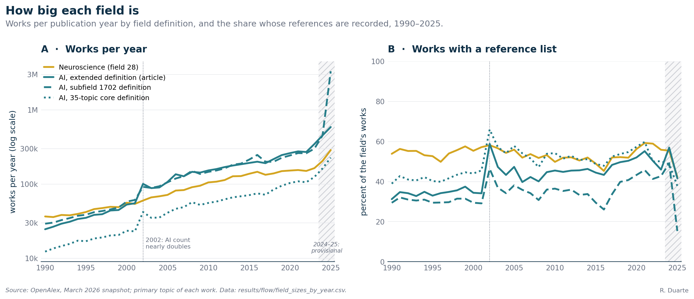

# S1. Data, corpus and field classification

This supplement says where the article's "roughly 458 million works" and "2.9 billion links" come from, how I decide whether a paper counts as neuroscience, as AI or as neither, and how large each field is year by year, which is the baseline of the odds ratio of Figure 1. Each paper gets one label, taken from the single primary topic OpenAlex assigns to it, and I ignore what it cites. For AI I use an extended definition of 87 topics and carry a narrower 35-topic core through as a check. Two features of the field sizes matter for Figures 1 and 2: a near-doubling of AI in 2002 that comes from how some records are dated, and a geology topic that would have swamped AI in 2025 had I not excluded it.

**Article statements covered**

- "I analyzed roughly 458 million works from OpenAlex [...] and the 2.9 billion links among them" (paragraph 4): section 2.1.
- "The vertical axis is an odds-ratio against what the field sizes would predict" (Figure 1 caption) and "given each field's size" (paragraph 10): sections 2.3 and 2.4.
- What counts as neuroscience, as AI and as neither, and the extended versus the 35-topic core definition: sections 1.1 to 1.3 and 2.4.
- "Data from 2024 and 2025 is somewhat unreliable" (paragraph 9), for field sizes and coverage: sections 2.2 and 2.5.

## 1. Methods

All numbers come from one frozen copy of OpenAlex, the snapshot of 30 March 2026 (458,112,708 records). Full definitions and selection procedures: [METHODS, section 2](../METHODS.md#2-data) and [section 3](../METHODS.md#3-field-definitions).

### 1.1 One paper, one topic, one label

OpenAlex places each work it can classify in a hierarchy of topic (about 4,500), subfield, field and domain, and gives it several scored topics. The highest-scoring one is its primary topic, and I use only that. Each paper gets exactly one of four labels:

| Label | Rule (on the primary topic) | OpenAlex topics | Works, 1990-2025 |
|-|-|-:|-:|
| Neuroscience | field 28, Neuroscience, all eight subfields | 62 | 3,552,562 |
| AI (extended) | subfield 1702 Artificial Intelligence minus 26 listed topics; all of subfield 1707 Computer Vision and Pattern Recognition; topic T10502 Advanced Memory and Neural Computing | 51 + 35 + 1 = 87 | 5,480,569 |
| Other (third field) | any other primary topic | the rest | |
| Unknown | no primary topic | none | |

No topic is in both lists, so I never count a paper on both sides. The label belongs to the paper, never to the citation, and references are sorted by the label of the paper they point to. A deep-learning paper that cites a study of visual cortex adds one reference to the teal line of Figure 1 (AI papers citing neuroscience); an electrophysiology paper that cites a machine-learning package adds one to the gold line (neuroscience papers citing AI). There is no mixed category: a NeuroAI paper is whatever OpenAlex's classifier made its main topic.

I treat third fields as neither: references to them enter neither line of Figure 1, only the unrestricted odds ratio of [S2, section 2.6](S2-citation-flow.md#26-the-unrestricted-odds-ratio-and-leave-one-topic-out). They include psychology (OpenAlex field 32; Experimental and Cognitive Psychology holds 1,144,610 works and Neuropsychology and Physiological Psychology 103,407), radiology, molecular biology and hardware (subfield 1708, 396,086 works). Secondary topics, venues and affiliations play no part, so a Nature Neuroscience paper whose primary topic is computer vision is an AI paper.

Topic labels err at the boundary, and NeuroAI papers are boundary papers. In my hand-picked audit set ([`results/corpus/anchor_labels.csv`](../../results/corpus/anchor_labels.csv); [METHODS, section 3](../METHODS.md#3-field-definitions)) the DQN paper lands in neuroscience, the AFNI software in AI, and FSL and AlphaFold in third fields. A mislabel can move a top-15 ranking while barely moving an aggregate over millions of references; [S4](S4-what-ai-cites.md) tests the aggregate.

### 1.2 The extended definition

The OpenAlex subfield 1702 holds 77 topics. I read the list and removed 26 that are not AI (education, cryptography and security, quantum computing, software engineering, business and law, and others; list: [METHODS, section 3.2](../METHODS.md#3-field-definitions) and [`results/corpus/classification_topics.csv`](../../results/corpus/classification_topics.csv)). Together they hold 41.8 percent of all subfield 1702 works published 1995 to 2023. The largest is T12157 Geochemistry and Geologic Mapping with 591,088 works, then T14335 Educational Robotics and Engineering with 179,489; the smallest, T13567 AI and Multimedia in Education, has 3,171 ([`results/flow/ai_topic_sizes_by_year.csv`](../../results/flow/ai_topic_sizes_by_year.csv)).

I then added all of subfield 1707 and topic T10502. In the 15 plainly AI papers of the audit set, the subfield 1702 definition (used only in the cross-source samples of [S2, section 2.5](S2-citation-flow.md#25-cross-source-replication)) labels only 4 as AI, because AlexNet, ResNet and the GAN paper sit in computer vision; the extended definition labels 10 (three are missing from the snapshot, DQN lands in neuroscience and AlphaFold in molecular biology). T10502 holds the neuromorphic-hardware papers (TrueNorth, Loihi, SpiNNaker, e-prop). I fixed this definition before computing any odds ratio. It is a choice, not a measurement, and a leave-one-topic-out sweep that re-admits each excluded topic shows that only T12157 matters much ([S2, section 2.6](S2-citation-flow.md#26-the-unrestricted-odds-ratio-and-leave-one-topic-out)).

### 1.3 The 35-topic core

The core is a hand-curated set of 35 topics of subfield 1702 whose subject is an AI method (neural networks, reinforcement learning, language and speech, Bayesian and evolutionary methods, reasoning). It has no computer vision and no T10502, and all 35 topics lie in the extended definition (`AI_CORE_TOPIC_IDS` in `src/neuroai_cn/utils/duckdb.py`; the list is in [METHODS, section 3.3](../METHODS.md#3-field-definitions)).

## 2. Results

### 2.1 The snapshot

I downloaded the snapshot as 381 daily update files and converted it to a DuckDB database.

| Quantity | Value |
|-|-:|
| Work records in the 381 daily files, all publication years | 458,112,708 |
| Works in the DuckDB index, publication years 1990 to 2026 | 398,288,606 |
| of which published 1990 to 2025 | 386,753,369 |
| Works with an OpenAlex primary topic | 311,299,063 |
| Works with a non-empty reference list | 111,676,520 |
| Citation links (one per entry of a reference list) | 2,893,128,636 |
| OpenAlex topics | 4,516 |

Values are in [`results/corpus/corpus_totals.csv`](../../results/corpus/corpus_totals.csv). The article's "roughly 458 million works" is the first row, the size of the download, of any publication year. My analyses use the second row, the works of 1990 to 2026; older and undated material is never analyzed. The "2.9 billion links" is the citation-link row, 2,893,128,636, and counts every reference of every indexed work, including references to works outside the index.

### 2.2 How much of the literature can cite

A paper can appear as a citing paper only if OpenAlex holds its reference list, true for 28.0 percent of works; the rest can be cited but not cite. Coverage differs by field and over time:

| Year | All works | Neuroscience | AI (extended definition) |
|-|-:|-:|-:|
| 1995 | 24.7 | 52.7 | 33.0 |
| 2002 | 29.3 | 58.2 | 58.9 |
| 2019 | 24.9 | 51.9 | 50.4 |
| 2023 | 24.6 | 55.9 | 46.0 |

*Percent of each year's works whose reference list is in the snapshot ([`results/flow/field_sizes_by_year.csv`](../../results/flow/field_sizes_by_year.csv), `n_with_references` over `n_works`).*

About half of neuroscience papers carry references throughout. AI starts near a third and approaches neuroscience only after 2002 (section 2.5), so before 2002 the AI line of Figure 1 rests on a third of the AI literature, and on a different third than later. The odds ratio uses shares, which protects it against coverage that is low but even, not against coverage that differs between kinds of AI paper.

Two further gaps matter. In 2019, references pointing to works not in the index were 10.2 percent of neuroscience references and 18.3 percent of AI references. And the share of all works that carry a primary topic was 92.1 percent in 2010, 80.8 percent in 2019, then fell to 65.9 percent in 2023 and 53.6 percent in 2024. Works without a topic are left out of the numerators and the field sizes, so the last years describe a shrinking, possibly unrepresentative part of the literature.

### 2.3 Field sizes per year



*Figure S1.1. A: works per publication year, 1990 to 2025, log scale. Gold: neuroscience (field 28). Teal: AI, solid for the extended definition used in the article, dashed for the subfield 1702 definition, dotted for the 35-topic core definition. B: percent of those works whose reference list is in the snapshot. Dotted line: 2002 (section 2.5). Hatched band: 2024 to 2025, provisional; the dashed spike in 2025 is topic T12157 (section 2.5). Data: `results/flow/field_sizes_by_year.csv`.*

| Year | Neuroscience | AI, extended | AI, subfield 1702 definition | AI, 35-topic core definition |
|-|-:|-:|-:|-:|
| 1995 | 42,049 | 35,135 | 38,658 | 17,004 |
| 2001 | 54,052 | 55,150 | 61,139 | 23,077 |
| 2002 | 60,118 | 100,726 | 91,808 | 42,133 |
| 2019 | 149,538 | 245,916 | 226,234 | 95,120 |
| 2023 | 164,016 | 346,525 | 300,319 | 124,748 |
| 2025 (provisional) | 287,415 | 586,892 | 3,310,775 | 227,253 |

These are the field sizes I use in the odds ratio: the neuroscience and extended-AI columns equal `n_works_source` and `n_works_target` in `results/flow/or_by_year.csv` for every year. Each counts all works of that year whose primary topic falls in the definition, of any type, with or without a reference list. From 1995 to 2023 I find that neuroscience grew 3.9-fold and extended AI 9.9-fold. AI was 0.84 times the size of neuroscience in 1995, overtook it in 2001 and was 2.11 times its size in 2023. This is why the article corrects for field size: a fixed habit of citing AI would produce more citations simply because there is more AI to cite.

### 2.4 Extended versus core

In 2023 the extended AI side holds 346,525 works: 187,603 from subfield 1702 after the exclusions, 150,559 from computer vision and 8,363 from the neuromorphic topic. Computer vision and T10502 together make up 45.9 percent of extended AI in 2023 and 42.6 percent over 1995 to 2023. The extension also keeps broad buckets such as "Data Analysis with R", which is how a statistics package comes to count as AI in [S4](S4-what-ai-cites.md) and [S5](S5-bridge-builders.md). The core is much smaller: 124,748 works in 2023. A re-check against the live database in October 2026 gives different sizes ([`results/flow/fresh_recheck_field_sizes_20261006.csv`](../../results/flow/fresh_recheck_field_sizes_20261006.csv)) because that database keeps changing; every computation used the snapshot values.

### 2.5 Two anomalies in the field sizes

**The 2002 jump in AI.** AI goes from 55,150 works in 2001 to 100,726 in 2002 and back to 88,275 in 2003; neuroscience shows nothing of the kind. A breakdown of the AI works of 2000 to 2004 by venue, DOI registrant and record type ([`results/flow/ai_works_2000_2004_breakdown.csv`](../../results/flow/ai_works_2000_2004_breakdown.csv), [`results/flow/subfield_sizes_2000_2004.csv`](../../results/flow/subfield_sizes_2000_2004.csv)) shows that most of the extra works are IEEE records. AI works with an IEEE DOI go from 1,635 in 2001 to 40,701 in 2002, against a total increase of 45,576. Most have no venue recorded (works without a venue go from 15,797 to 54,146) and are "article" records with reference lists, which is why the share of AI works with references jumps in 2002 (Figure S1.1, B).

The jump is not specific to AI: works in computer science grow by a factor of 1.755 from 2001 to 2002 and in engineering by 1.243, against 1.112 in neuroscience. It is not my classifier either, since the re-check with plain subfields and a fresher database shows the same step (52,230 AI works in 2001 against 101,606 in 2002). My reading is that a large batch of IEEE conference records, many of them older, carries 2002 as its publication year in the metadata OpenAlex received. I could not check individual records against IEEE and have not re-dated them.

In Figure 1 the step acts through the denominator. In 2002 AI's share of the two fields' papers, the expected share for neuroscience papers citing AI, jumps from 0.505 to 0.626, while the observed share of neuroscience references going to AI rises only from 1.63 to 1.83 percent. So the gold odds ratio drops from 0.0163 to 0.0111 in a single year, which coincides with the gold turning point the change-point search places at 2002 ([S2, section 2.3](S2-citation-flow.md#23-change-points)). Teal barely moves (0.0428 to 0.0441). The article does not interpret the 2002 break.

**The T12157 artifact.** T12157, Geochemistry and Geologic Mapping, is filed under artificial intelligence because its papers use machine learning for mineral-prospectivity mapping and remote sensing. It holds 50,854 works published in 2024 and 2,818,121 published in 2025, a 55-fold jump in one year. Left inside subfield 1702, it would be 85.1 percent of that subfield's 3,310,775 works in 2025. Added to the extended definition, it would make up 82.8 percent of AI in 2025 and raise AI's share of the two fields' combined 2025 literature, the expected share for neuroscience papers citing AI, from 0.671 to 0.922, so the odds ratio would move with no change in what anybody cites. I excluded the topic. It was erratic even before 2025 (46,229 works in 2015, 70,878 in 2016, 33,102 in 2017).

## 3. Caveats

One topic per paper is coarse: a paper on deep networks as models of visual cortex lands on one side, and its other half is invisible. I keep the sides disjoint by design.

The level ordering of the two lines in Figure 1 depends on how widely AI is defined, and the trends do not. Under the extended definition AI papers cite neuroscience more than chance relative to the reverse in all 31 years from 1995 to 2025; under the 35-topic core teal is above gold in 5 of the 31 years, and the teal slope from 2006 to 2019 is +0.00011 per year (p = 0.29, not significant). The rise of the gold line since 2006 and the upturn of the teal line around 2020 remain under the core ([S2, section 3](S2-citation-flow.md#3-caveats)).

The 2002 break of the gold line coincides with a batch of records dated 2002 from one publisher (IEEE), and the article does not interpret it. Records are sometimes misdated or reclassified in bulk: the 2002 batch and the 2025 geology topic are the two I found, and works dated 2006 are also anomalous in number (10,744,114 against 6,653,425 in 2005), though almost all of the excess has no topic.

Reference coverage is uneven by field, year and publisher in ways I cannot bound, and I treat 2024 and 2025 as provisional. Work published before 1990 is outside the index, so my counts undercount the classical canon by construction.

## 4. Reproduce

```bash
./reproduce.sh figures          # redraws Figure S1.1 (and the other figures) from results/flow/field_sizes_by_year.csv
.venv/bin/python -m neuroai_cn.figures.figure_s1_field_sizes
.venv/bin/python -m pytest -q tests/test_supplement_claims.py -k "s1-"      # every number in this supplement
.venv/bin/python -m neuroai_cn.analysis.export_field_sizes   # needs the snapshot (NEUROAI_DATA): field sizes, topic table, corpus totals
```

The snapshot (about 364 GB of parquet) cannot be redistributed, and a new download will not reproduce these counts exactly. Outputs: `results/corpus/` and `results/flow/`.
