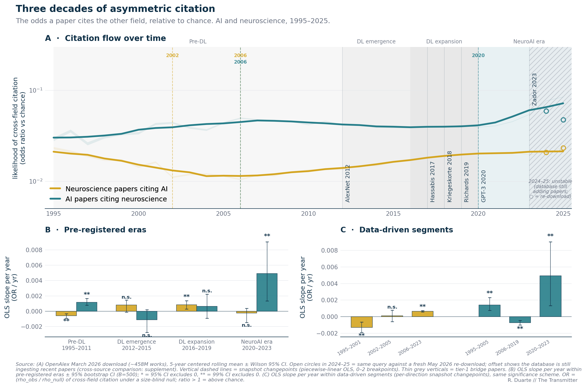
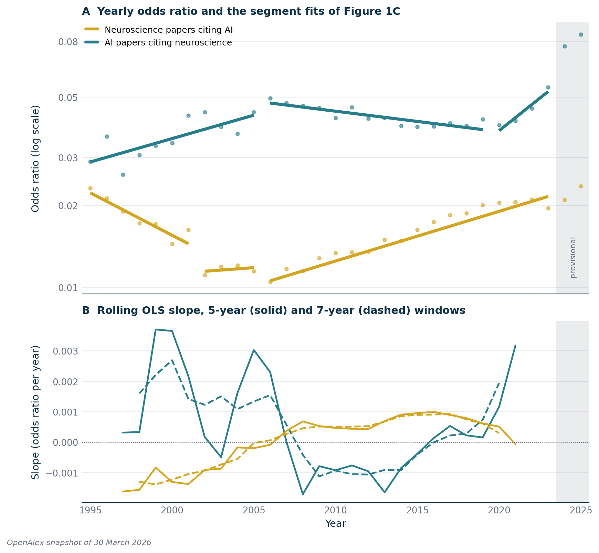
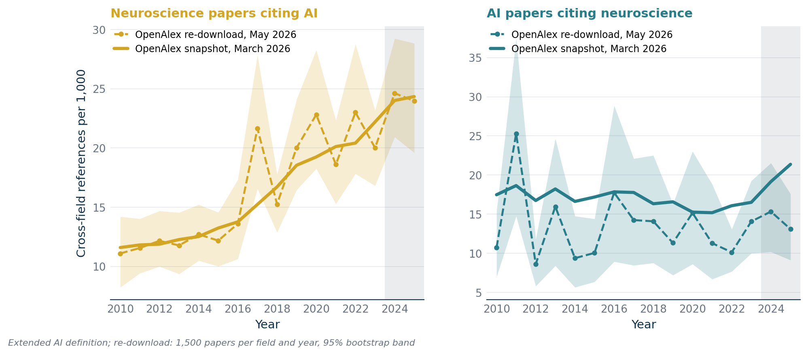
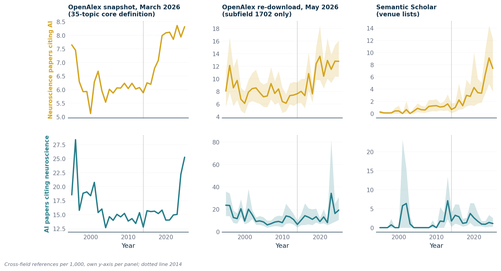
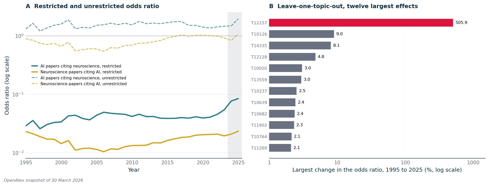

# S2. Citation flow: the odds ratio behind Figure 1

Here I explain Figure 1 of the article element by element and give the numbers behind it: what the vertical axis measures, what each element shows, and how the levels, trends and change points come out. I find that AI papers cited neuroscience more often, relative to chance, than neuroscience papers cited AI in every year from 1995 to 2025 under the AI definition the article uses, and the checks in sections 2.5 and 2.6 leave that in place. Gold is always neuroscience papers citing AI, teal always AI papers citing neuroscience.

**Article statements covered**

- "The (chance-corrected) likelihood of AI papers citing neuroscience papers is higher than the reverse, across the range of time examined, 1995 to 2025" (paragraph 7): section 2.1; limit in section 3.
- "growing to about double its 1995 level" (Figure 1 caption): section 2.1, thick teal line 0.0302 in 1995 and 0.0605 in 2023.
- "The vertical axis is an odds-ratio against what the field sizes would predict": section 1.2. Dashed lines, thin lines, shaded eras, panels B and C (caption): sections 1.3, 1.4, 2.2 and 2.3.
- The teal line "leveled off, slightly decaying until 2019" and rose from 2020 with "the steepest slope of the entire series"; the gold line "fell steadily until around 2006" and "has risen significantly and steadily since 2006" (caption, paragraph 8): section 2.2.
- "data from 2024 and 2025 is somewhat unreliable [...] the upturn predates those years" (paragraph 9) and the open circles of Figure 1: sections 2.4 and 2.5.

## 1. Methods

### 1.1 Data and the two lines

I use the OpenAlex snapshot of 30 March 2026 (458,112,708 records). A paper is neuroscience if its primary topic sits in the OpenAlex field Neuroscience, and AI under the extended definition: the subfield Artificial Intelligence minus 26 topics that are not AI, plus the subfield Computer Vision and Pattern Recognition, plus one neuromorphic-hardware topic. Every other paper goes to a third field; papers with no primary topic are unknown. [S1](S1-data-and-classification.md) and [METHODS section 3](../METHODS.md#3-field-definitions) give the definitions. For each citing year from 1990 to 2025 and each line, [`results/flow/or_by_year.csv`](../../results/flow/or_by_year.csv) holds the citing field's references to its own field, the other field, third fields, unknown works and missing works, and the papers each field published that year. I plot 1995 to 2025, because 1990 to 1992 rest on few cross-field references.

I name each line by who cites whom, and the data files use the code names in the first column:

| Data column | Who cites whom | Color in Figure 1 |
|-|-|-|
| `neuro_to_ai` | neuroscience papers citing AI (influence of AI on neuroscience) | gold |
| `ai_to_neuro` | AI papers citing neuroscience (influence of neuroscience on AI) | teal |

I assign each paper to the line of its own field; under this definition the two fields do not overlap.

### 1.2 The odds ratio

For each year and line, I take the observed share to be the fraction of a field's references to the two fields that go to the other field. Its counterpart, the expected share, is what that fraction would be if references were handed out blind to discipline, in proportion to the number of papers each field published that year. The odds ratio I plot divides the odds of the observed share by the odds of the expected share ([METHODS section 4](../METHODS.md#4-citation-flow-and-the-odds-ratio) has the derivation and the unrestricted variant):

```
observed   = refs_to_other_field / (refs_to_own_field + refs_to_other_field)
expected   = papers_other_field / (papers_own_field + papers_other_field)
odds ratio = [observed / (1 - observed)] / [expected / (1 - expected)]
```

A value of 1 means a field crosses into the other exactly as often as the two sizes predict. Both lines sit far below 1 (between about 0.01 and 0.09), because every discipline cites itself far more than a size-blind null predicts; what I look at is the comparison between the lines and their change over time. Panel A has a logarithmic axis from 0.005 to 0.3, so the chance level of 1 lies above the plotted range. The raw share cannot separate a change in citing habits from a change in field size when AI grows faster than neuroscience ([S3](S3-counts-and-field-sizes.md) shows both views).

Worked example for 2019, from the 2019 rows of `or_by_year.csv`:

| | Neuroscience papers citing AI (gold) | AI papers citing neuroscience (teal) |
|-|-:|-:|
| references to own field | 2,097,457 | 2,060,136 |
| references to the other field | 69,308 | 51,938 |
| observed share crossing over | 0.0320 | 0.0246 |
| papers in the citing field | 149,538 | 245,916 |
| expected share from field sizes | 0.622 | 0.378 |
| odds ratio | 0.0201 | 0.0415 |

In 2019 a neuroscience paper choosing blindly would land on AI 62.2 percent of the time; neuroscience papers did so 3.20 percent of the time. Their odds are 0.033, the odds of 62.2 percent are 1.64, and the ratio is 0.0201. AI was the larger field, so a neuroscience paper citing AI is less surprising, and the teal line sits about twice as high.

### 1.3 What each element of Figure 1 is

| Element | What it is |
|-|-|
| Title and legend | "Three decades of asymmetric citation"; the legend names the two lines as in section 1.1. |
| Vertical axis of A | "likelihood of cross-field citation (odds ratio vs chance)", the odds ratio of section 1.2, log scale. |
| Thick line | Centered 5-year rolling mean of the yearly odds ratio over 1995 to 2025 (at least three years per window); near the end it includes 2024 and 2025. |
| Pale band | Wilson 95 percent interval of the yearly value (z = 1.96), which I compute on the observed share and push through the odds-ratio formula. It shows counting noise only and is narrow: in 2019 the teal interval runs from 0.0411 to 0.0418. |
| Shaded eras | Four eras I fixed in the code before computing any slope (`style.CANONICAL_ERAS`): Pre-DL (to 2011), DL emergence (2012 to 2015), DL expansion (2016 to 2019) and NeuroAI era (from 2020). |
| Dashed vertical lines | Turning points I found with a piecewise regression, drawn per line in its color and labeled by the first year of the new segment: gold 2002 and 2006, teal 2006 and 2020. |
| Thin gray lines | Six milestone papers that I added as annotations (AlexNet 2012, Hassabis 2017, Kriegeskorte 2018, Richards 2019, GPT-3 2020, Zador 2023); no statistic is computed at them. |
| Hatched band | From 2023 to the edge of the axis: the provisional years 2024 and 2025, which no slope uses. |
| Open circles | One per line in 2024 and 2025: the same odds ratio from a sample of a May 2026 re-download (section 1.5). |
| Panel B | "Pre-registered eras" (written into the code before the slopes were computed; [METHODS section 5](../METHODS.md#5-trends-and-change-points)): OLS slope of the yearly odds ratio against year within each era, fitted on 1995 to 2023, with bootstrap 95 percent whiskers. |
| Panel C | "Data-driven segments": OLS slope within each segment between turning points, three gold segments then three teal ones. |

Every element's values are in `results/flow/figure1_article_panelA.csv`, `panelB.csv`, `panelC.csv`, `circles.csv` and `markers.csv`.

### 1.4 Slopes, whiskers and change points

Whiskers are 95 percent bootstrap intervals over the years of an era or segment (500 resamples, seed 20260528); I print two stars where the 99 percent interval excludes zero, one star where the 95 percent interval does, and "n.s." for neither. Segment slopes also have an ordinary t interval in [`results/flow/segment_slopes.csv`](../../results/flow/segment_slopes.csv).

I find the turning points with an exhaustive piecewise-OLS search over zero, one or two breakpoints in 1995 to 2023, each segment at least four years long, run separately on each line. The cap of two breakpoints and the four-year minimum are my choices, not findings ([METHODS section 5](../METHODS.md#5-trends-and-change-points)).

### 1.5 The open circles and the cross-source samples

Samples of papers, not the full graph, underlie the circles and section 2.5. For each field and year I draw 1,500 papers from the OpenAlex API, classified all their references and estimated the cross-field share per 1,000 classified references with a 95 percent bootstrap interval over papers. Through the OpenAlex API in May 2026 I drew the sample behind the circles ([`results/crosssource/openalex_live_extended.csv`](../../results/crosssource/openalex_live_extended.csv)). That API cannot apply the 26 exclusions or add the neuromorphic topic, so it defines AI as the subfields Artificial Intelligence and Computer Vision and Pattern Recognition, and I take the expected share from the snapshot for the same year and line. Levels differ between sources, so I use the samples to test shapes ([METHODS section 6](../METHODS.md#6-cross-source-replication)).

## 2. Results



*Article Figure 1, as published (`figure1_article`). A: yearly odds ratio of cross-field citation against the field-size expectation, log scale. Gold: neuroscience papers citing AI. Teal: AI papers citing neuroscience. Pale bands: Wilson 95 percent intervals; thick lines: centered 5-year means; hatched band: provisional years 2024 and 2025; open circles: May 2026 re-download. B: OLS slope per era. C: OLS slope per segment between turning points.*

### 2.1 Levels: teal above gold in every year shown

| Year | AI papers citing neuroscience (teal) | Neuroscience papers citing AI (gold) | Teal / gold |
|-|-:|-:|-:|
| 1995 | 0.0290 | 0.0232 | 1.25 |
| 2006 | 0.0496 | 0.0105 | 4.73 |
| 2019 | 0.0415 | 0.0201 | 2.06 |
| 2023 | 0.0544 | 0.0195 | 2.78 |

In my data the teal line is above the gold one in all 31 years from 1995 to 2025. The gap is widest in 2006 (4.73 times). The thick teal line stands at 0.0302 in 1995 and 0.0605 in 2023, 2.00 times as high, which is the caption's "about double" (the yearly value of 2023 is 1.88 times that of 1995). Its 2023 point averages 2021 to 2025, so it includes the two provisional years. Under the unrestricted odds ratio and with any single excluded topic re-admitted the ordering also holds (section 2.6); section 3 states how it depends on the AI definition.

### 2.2 Trends

Panel B, the four eras fixed in advance (odds ratio per year; bootstrap 95 percent interval; ** the 99 percent interval excludes zero):

| Era | Teal slope | 95% interval | | Gold slope | 95% interval | |
|-|-:|-|-|-:|-|-|
| Before deep learning, 1995-2011 | +0.00117 | +0.00080 to +0.00166 | ** | −0.00059 | −0.00089 to −0.00032 | ** |
| Deep-learning emergence, 2012-2015 | −0.00113 | −0.00275 to +0.00021 | n.s. | +0.00081 | −0.00012 to +0.00147 | n.s. |
| Deep-learning expansion, 2016-2019 | +0.00065 | −0.00091 to +0.00221 | n.s. | +0.00084 | +0.00030 to +0.00137 | ** |
| NeuroAI era, 2020-2023 | +0.00493 | +0.00133 to +0.00903 | ** | −0.00025 | −0.00147 to +0.00038 | n.s. |

Panel C, the segments between turning points (bootstrap 95 percent interval; R2 is the share of year-to-year variance the straight line explains):

| Line | Segment | Slope | Bootstrap 95% | R2 |
|-|-|-:|-|-:|
| Gold | 1995-2001 | −0.00130 | −0.00190 to −0.00066 | 0.86 |
| Gold | 2002-2005 | +0.00012 | −0.00060 to +0.00079 | 0.12 |
| Gold | 2006-2023 | +0.00065 | +0.00057 to +0.00073 | 0.96 |
| Teal | 1995-2005 | +0.00140 | +0.00076 to +0.00230 | 0.57 |
| Teal | 2006-2019 | −0.00074 | −0.00099 to −0.00046 | 0.75 |
| Teal | 2020-2023 | +0.00493 | +0.00133 to +0.00903 | 0.89 |

I find gold the cleanest result. It fell until about 2006 and then rose at +0.00065 per year (bootstrap 95 percent interval +0.00057 to +0.00073) for eighteen consecutive years, with a straight line explaining 0.96 of the variation: the "risen significantly and steadily since 2006" of paragraph 8. Inside it, the 2016-2019 era slope is +0.00084 (interval +0.00030 to +0.00137) and the 2012-2015 era slope (+0.00081) is not distinguishable from zero. The short segment 2002 to 2005 has a slope of +0.00012 per year, an R2 of 0.12 and an interval that spans zero.

Teal rose between 1995 and 2005, declined in 2006 to 2019 (both intervals exclude zero; over 14 years a slope of −0.00074 adds up to a fall of about 0.01 against a level near 0.045, which I read as the caption's "slightly decaying"), and rose steeply after 2020.

I regard the 2020 to 2023 teal slope as the largest in either panel and the least secure. It is the slope behind the "steepest slope of the entire series" of paragraph 8, and I fit it on four yearly values because 2024 and 2025 are provisional. I regard four-point fits (this segment and the three four-year eras) as weak evidence: the t interval of this segment, −0.00032 to +0.01018, includes zero (t-test p = 0.056), and a fit that includes 2024 and 2025 is twice as steep, +0.00984 per year. I would defend the 18-year gold segment and the 14-year teal segment.



*Figure S2.1 (`figure_s2_trends`). A: yearly odds ratio (dots, 1995 to 2025) with the OLS fit of each segment of Figure 1C (thick lines). Gold: neuroscience papers citing AI. Teal: AI papers citing neuroscience. B: OLS slope in a centered 5-year (solid) and 7-year (dashed) window, windows inside 1995 to 2023; the two window lengths have the same sign in 21 of the 23 window centers for teal and in 22 of 23 for gold. Gray: provisional years 2024 and 2025. Data: `results/flow/or_by_year.csv`, `segment_slopes.csv`.*

### 2.3 Change points

Figure 1 turns at 2002 and 2006 for the gold line and at 2006 and 2020 for the teal line. Other procedures and settings return other years; I list all of them in [`results/flow/changepoints.csv`](../../results/flow/changepoints.csv). PELT is a standard penalized change-point algorithm ([METHODS section 5](../METHODS.md#5-trends-and-change-points)).

| Procedure | Window | Min. segment | Neuroscience citing AI (gold) | AI citing neuroscience (teal) |
|-|-|-:|-|-|
| Piecewise OLS, as in Figure 1 | 1995-2023 | 4 years | 2002, 2006 | 2006, 2020 |
| Piecewise OLS, wider window | 1990-2025 | 3 years | 1993, 2005 | 2005, 2022 |
| PELT (l2 cost, BIC penalty) | 1990-2025 | 3 years | 1993 | 2001, 2023 |
| PELT (l2 cost, BIC penalty) | 1995-2023 | 3 years | 2000, 2015 | 2001 |

All years are the first year of the new segment. The figure and the wider-window row agree on the mid-2000s turn once the convention is aligned (2005 as the last year of the old segment, 2006 as the first of the new one). The late teal breakpoint moves with the settings: 2020 in the figure, 2021 with a three-year minimum on the same window and 2022 when 2024 and 2025 are included, so what is robust is an upward turn around 2020 to 2022, not the exact year. PELT with an l2 cost looks for shifts in the average level, not in slope, so it returns other years. Breakpoint years have no interval. Figure 1 uses the piecewise search.

### 2.4 Why the fits stop at 2023, and the open circles

Toward the end of the series both lines rise, teal sharply, from 0.0544 in 2023 to 0.0849 in 2025. I treat 2024 and 2025 as provisional for three reasons. First, I find that the composition of AI's references changed abruptly: the share of AI papers' references that point at other AI papers held between 0.63 and 0.66 in 2016 to 2023 and then fell to 0.550 in 2024 and 0.514 in 2025, mechanically raising the cross-field share. Second, fresher copies of the same database disagree with the snapshot, as the open circles show (below). Third, OpenAlex was rebuilding its database through 2024 and 2025 (new topic classifier, retroactive reference matching, a platform rewrite), which can shift recent cohorts. I therefore stop every fit at 2023. The 2020 to 2023 rise is in the snapshot, so I take the teal upturn to begin before the provisional years, but its size is not established and its statistical support is marginal (section 2.2).

Each circle is a sample of 1,500 papers per field and year, so I read it as the direction and rough size of the disagreement between the downloads, not a corrected value.

| Year | Line | Circle (May 2026 re-download) | Snapshot, yearly value | Circle / snapshot | Snapshot, thick line |
|-|-|-:|-:|-:|-:|
| 2024 | teal | 0.0594 | 0.0770 | 0.77 | 0.0654 |
| 2025 | teal | 0.0475 | 0.0849 | 0.56 | 0.0721 |
| 2024 | gold | 0.0208 | 0.0209 | 0.99 | 0.0213 |
| 2025 | gold | 0.0233 | 0.0235 | 0.99 | 0.0213 |

Among neuroscience papers citing AI the circles fall within 1 percent of the snapshot's yearly values. Among AI papers citing neuroscience they sit below the snapshot, 23 percent lower in 2024 and 44 percent lower in 2025. In cross-field references per 1,000 the 2025 teal sample gives 13.09 with a bootstrap 95 percent interval of 9.14 to 17.58, which excludes the snapshot's 21.37 ([`results/flow/figure1_article_circles.csv`](../../results/flow/figure1_article_circles.csv)).

### 2.5 Cross-source replication

For the teal line I find the re-download below the snapshot before the provisional years too: its odds ratio is below the snapshot's in 11 of the 14 years from 2010 to 2023, with a median ratio of 0.80, and only one earlier year, 2012 (ratio 0.54), shows a larger offset than 2025. Part of the teal offset in the circles is therefore a level difference between the downloads (Figure S2.2).



*Figure S2.2 (`figure_s2_replication`). Cross-field references per 1,000 classified references, 2010 to 2025. Left, gold: neuroscience papers citing AI. Right, teal: AI papers citing neuroscience. Solid: March 2026 snapshot (full population, extended AI definition). Dashed with band: May 2026 re-download (AI = subfields 1702 and 1707 only), 1,500 papers per field and year, 95 percent bootstrap interval. Gray: provisional years. Data: `results/flow/or_by_year.csv`, `results/crosssource/openalex_live_extended.csv`.*

I find that the re-download reproduces the rise of neuroscience papers citing AI: over 2014 to 2023 the OLS slope is +1.11 references per 1,000 per year in the snapshot and +1.06 in the re-download. Among AI papers citing neuroscience the snapshot value lies outside the re-download's 95 percent interval in 5 of the 10 years from 2010 to 2019, neither vintage shows a rise in the raw share over 2014 to 2023 (snapshot −0.18 per year, re-download +0.06), and the snapshot's end-of-series climb is absent from it.

In Figure S2.3 I add two samples. One uses the subfield 1702 definition, the OpenAlex subfield Artificial Intelligence taken whole, without the 26 exclusions, computer vision or the neuromorphic topic; I use it only in cross-source samples. The other is a Semantic Scholar sample that I built from venue lists (400 sampled per cell, of which 21 to 349 are retained). Both give the gold line the snapshot's shape: over 2014 to 2023 the per-1,000 share of neuroscience references going to AI rises by +0.59 per year in the OpenAlex sample and by +0.50 per year in Semantic Scholar. On the teal side neither shows a trend distinguishable from zero (OpenAlex +1.33 per year, p = 0.12, driven by one noisy year; Semantic Scholar −0.14, p = 0.23), and Semantic Scholar shows no 2024 to 2025 spike (1.36 per 1,000 in 2024, 1.09 in 2025).



*Figure S2.3 (`figure_s2_sources`). Cross-field references per 1,000 classified references, 1995 to 2025. Top row, gold: neuroscience papers citing AI. Bottom row, teal: AI papers citing neuroscience. Columns: OpenAlex snapshot of March 2026 under the 35-topic core definition (full population, no interval), OpenAlex re-download of May 2026 (subfield 1702 definition), Semantic Scholar (venue lists); bands are 95 percent cluster-bootstrap intervals; dotted line at 2014. Each panel has its own y-axis: compare shapes down each column, not levels across columns. Data: `results/crosssource/openalex_live.csv`, `s2.csv`, `results/flow/sensitivity_strict_or_by_year.csv`.*

A repeat in October 2026 for 2020 to 2025, with field sizes of the same fresher vintage ([`results/flow/fresh_vs_snapshot_2020_2025.csv`](../../results/flow/fresh_vs_snapshot_2020_2025.csv)), gives the same picture: teal above gold in all 6 years, both lines far below 1, and the snapshot's 2025 teal value not reproduced (0.043 against 0.085).

### 2.6 The unrestricted odds ratio and leave-one-topic-out

The unrestricted variant keeps references to third fields and papers in third fields in both the observed and the expected share, so it asks how often a field cites the other compared with the whole of science. Both lines sit near or above 1 (in 2019, 1.51 for teal and 1.02 for gold), and teal is above gold in every year from 1995 to 2025, so the ordering does not depend on the choice of null. Trends come out weaker: over 1995 to 2023 the gold slope is +0.0122 per year (p = 0.0002) and the teal slope +0.0032 per year (p = 0.37). Third-field references dominate this variant, so it cannot resolve the teal trend (`or_population` in `or_by_year.csv`).

The extended definition excludes 26 topics; I recomputed the series 27 times, each time re-admitting one candidate topic into AI ([`results/flow/sensitivity_loto.csv`](../../results/flow/sensitivity_loto.csv)), and took the largest relative change of the odds ratio in any year. Re-admitting T12157 ("Geochemistry and Geologic Mapping") changes the 2025 teal odds ratio by 506 percent, because the topic swelled in a 2025 OpenAlex re-export ([S1](S1-data-and-classification.md)); inside 1995 to 2023 its largest effect is 34.5 percent. Next, T10126 moves the series by at most 9.0 percent in 1995 to 2023, and the median of the 27 topics is 1.8 percent. No single re-admitted topic reverses the order of the two lines in any year; the smallest teal-to-gold ratio across all 27 variants in 1995 to 2023 is 1.20.



*Figure S2.4 (`figure_s2_sensitivity`). A: restricted (solid) and unrestricted (dashed) odds ratio, log scale. Gold: neuroscience papers citing AI. Teal: AI papers citing neuroscience. Gray: provisional years. B: leave-one-topic-out, the largest change in the odds ratio over 1995 to 2025 when each of the twelve most influential excluded topics is re-admitted, in percent on a log axis with the value printed at each bar; T12157 (506 percent) in red. Data: `results/flow/or_by_year.csv`, `sensitivity_loto.csv`.*

## 3. Caveats

The level ordering of the two lines in Figure 1 depends on how widely AI is defined, and the trends of the gold line since 2006 and of the teal line around 2020 do not. The statement of paragraph 7 that the chance-corrected likelihood of AI papers citing neuroscience is higher than the reverse holds under the extended definition used here: teal is above gold in all 31 years from 1995 to 2025. With the narrower 35-topic core definition, teal is above gold in only 5 of those 31 years and gold is above in the other 26. Under the core definition the teal slope from 2006 to 2019 is +0.00011 per year (p = 0.29), which is not significant ([`results/flow/sensitivity_strict_or_by_year.csv`](../../results/flow/sensitivity_strict_or_by_year.csv), whose file name says `strict` but which holds the 35-topic core; [S1](S1-data-and-classification.md) describes both definitions).

The 2002 break of the gold line coincides with a batch of records dated 2002 from one publisher (IEEE), which raises the number of AI works in that year ([S1](S1-data-and-classification.md)). The expected share of the gold line is built from that count, so a jump in the count can by itself produce a break, and the figure's search cannot tell the two apart. The article does not interpret the 2002 break.

## 4. Reproduce

```bash
./reproduce.sh figures          # redraws Figure 1, Figures S2.1 to S2.4 and the other figures from results/
.venv/bin/python -m neuroai_cn.figures.figure1_main_v2 or    # Figure 1 and results/flow/figure1_article_*.csv
.venv/bin/python -m neuroai_cn.figures.figure_s2             # Figures S2.1 to S2.4
.venv/bin/python -m neuroai_cn.analysis.changepoints         # changepoints.csv, segment_slopes.csv
.venv/bin/python -m pytest -q tests/test_supplement_claims.py -k "s2-"
```

These read only the committed `results/` files; new samples are described in [METHODS section 6](../METHODS.md#6-cross-source-replication), and a re-run against a newer database reproduces shapes, not exact counts.
