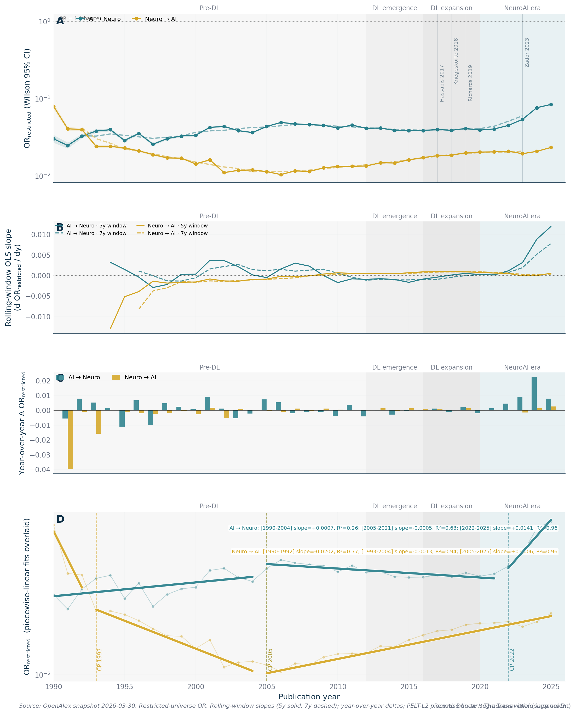
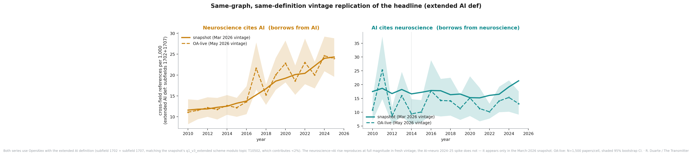
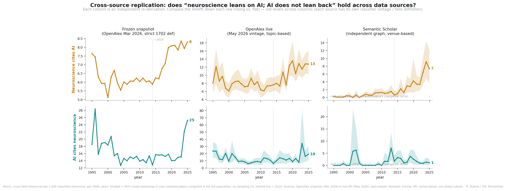
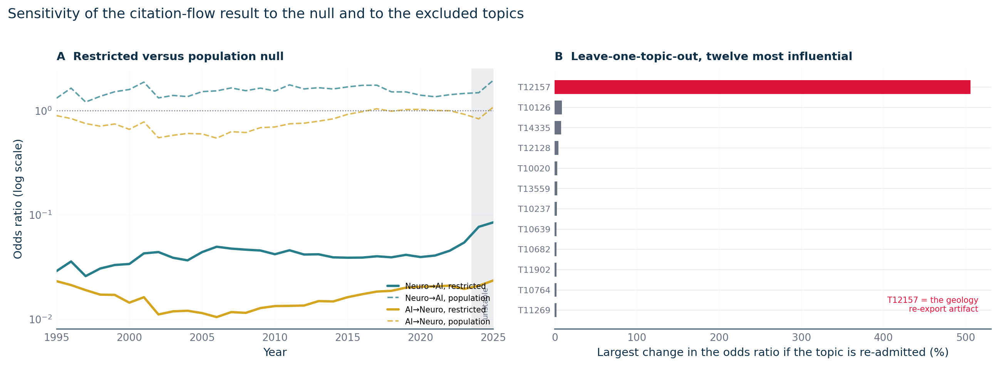

# S2. Citation flow: the odds ratio behind Figure 1

This supplement explains the first figure of the article, element by element: what its vertical axis measures, how I assign each paper to a line, what the bands, thick lines, shaded eras, dashed lines, thin labeled lines, hatched band and open circles show, which trends in panels B and C are statistically solid and which are not, and how the result holds up when I change the data source, the null or the excluded topics. In short, AI papers cited neuroscience more often, relative to chance, than neuroscience papers cited AI in every year from 1995 to 2025 under the AI definition the article uses, and the checks of sections 4.5 to 4.7 leave that result in place. The gold line declines until about 2006 and rises afterwards. Section 5 states what the level ordering, the teal slope before 2020 and the gold line's 2002 break depend on.

## 1. What the article says

I wrote this figure to support three passages of the article. Paragraph 7 reads:

> Corrected for field size, neuroscience has had a larger influence on AI over the last three decades than AI on neuroscience. The (chance-corrected) likelihood of AI papers citing neuroscience papers is higher than the reverse, across the range of time examined, 1995 to 2025.

The caption of Figure 1 (formatting removed) reads:

> Intellectual influence: The relative share of AI citations going to neuroscience (teal) rose gradually until 2006, then leveled off, slightly decaying until 2019. It began rising again in 2020, growing to about double its 1995 level. The relative share of neuroscience's citations of AI (gold) fell steadily until around 2006, when AI's influence on neuroscience began to rise. Panel A highlights how often, relative to chance, each field cites the other. The vertical axis is an odds-ratio against what the field sizes would predict. Dashed vertical lines mark change points in citation trends, thin vertical lines, milestone papers, and shaded areas correspond to pre-defined eras that I fixed beforehand. Panel B shows growth rates (change per year) for specific pre-defined eras (the shaded areas in panel A), and C highlights growth rates between changepoints detected in the data (whiskers: 95% CI; **statistically significant). More details on the analysis are available here.

Paragraph 8 and the first caveat of paragraph 9 read:

> The relative share of neuroscience's citations of AI (the gold line) has risen significantly and steadily since 2006 [...]. The relative share of AI papers' citations of neuroscience (in teal), however, held relatively stable for a long period and declined significantly from 2006 to 2019. It then began to pick up again, with the period from 2020 to 2025 marking the steepest slope of the entire series.

> First, data from 2024 and 2025 is somewhat unreliable, due to an ongoing rebuild of the OpenAlex database [...]. However, the upturn predates those years, so it is not an artifact, but its size is not yet measurable.

Where each sentence of the caption is backed: the teal and gold trends in section 4.2 and the "about double" in section 4.1; the odds ratio of panel A in section 3.2; the dashed lines, shaded eras and labeled papers in sections 3.5 and 3.6; panels B and C, their whiskers and the stars in sections 3.5 and 4.2. The gold line fell "until around 2006", as the caption says (section 4.2). The dashed line that the figure draws for gold at 2002 is the first turning point the piecewise search returned for that line (section 4.3); section 5 describes what it coincides with.

What paragraph 8 says about the kind of neuroscience AI cites (mostly cognitive) is covered in [S4](S4-what-ai-cites.md). For the raw counts and shares of paragraph 9 and Figure 2, I refer you to [S3](S3-counts-and-field-sizes.md).

## 2. Data

Except for the open circles, all numbers come from one OpenAlex snapshot, downloaded in March 2026 and held locally (about 458 million works; the figure's source note calls it the "OpenAlex March 2026 download"). [S1](S1-data-and-classification.md) describes the corpus, the coverage of reference lists and the field definitions in full; here I give the short version. I call a paper neuroscience if its primary OpenAlex topic sits in the field Neuroscience. A paper counts as AI under what I call the extended definition: the OpenAlex subfield Artificial Intelligence minus 26 topics that are not AI (cryptography, geology, photovoltaics and the like), plus the whole subfield Computer Vision and Pattern Recognition, plus one neuromorphic-hardware topic. Every other paper belongs to a third field, and papers with no primary topic are unknown. I count over the whole snapshot, not over any of the curated NeuroAI pools. The open circles come from a sample of a later download of the same database, which section 3.7 describes.

For each citing year from 1990 to 2025 and each direction, the snapshot gives a handful of counts, all in [`results/flow/or_by_year.csv`](../../results/flow/or_by_year.csv). There are the citing field's references to its own field, to the other field, to third fields, to works of unknown field and to works missing from the database, and there is the number of papers each field published that year. Plotted are the years 1995 to 2025. I leave 1990 to 1992 out of the plot because they rest on few cross-field references, and 2026 is incomplete. I draw the values for 2024 and 2025 but treat them as provisional (section 4.4). These counts include a reference only if the cited work is in my index with a publication year up to 2025: the index also holds works dated 2026, and a reference to one of them is counted as pointing to a work missing from the database. Counting those references as present would raise the cross-field counts by at most 8 and the own-field counts by at most 169 per year and direction, under 0.02 percent of any cell.

## 3. Method

### 3.1 Which direction is which

Pointing backwards in time, at the work that came first, a citation runs opposite to the way the idea traveled. When an AI paper cites a neuroscience paper, something moved out of neuroscience and into AI. The article labels flows by where the influence lands and the data files by the citation link, and the two are easy to confuse, as I found out myself:

| Data column | Who cites whom | Article label | Color in Figure 1 |
|-|-|-|-|
| `ai_to_neuro` | AI papers citing neuroscience | Neuro -> AI (neuroscience informs AI) | teal |
| `neuro_to_ai` | neuroscience papers citing AI | AI -> Neuro (AI informs neuroscience) | gold |

The legend of Figure 1 avoids arrows and names the lines in plain words: "Neuroscience papers citing AI" (gold) and "AI papers citing neuroscience" (teal). The same two colors mark the bars of panels B and C. Each paper's own field decides its line: a neuroscience paper contributes to gold, an AI paper to teal. References to third fields (physics, medicine, statistics outside AI and so on) do not enter the odds ratio at all; they matter only for the unrestricted variant in section 4.6. Since my extended AI definition and the neuroscience field do not overlap, I never count a paper on both sides.

### 3.2 The odds ratio on the vertical axis

The vertical axis of panel A is labeled "likelihood of cross-field citation (odds ratio vs chance)". For each year and line, it answers one question: when papers of the citing field cite either neuroscience or AI, how often do they pick the other field, compared with what the sizes of the two fields would predict?

I start with the observed share, the fraction of a field's two-field references that cross over (references to the other field divided by references to the own field plus references to the other field). Next comes the expected share, which is what that fraction would be if references were handed out blind to discipline, in proportion to how many papers each field published that year (the other field's papers divided by both fields' papers). An odds ratio compares the two. The odds of a share p are p / (1 - p), and the odds ratio divides the odds of the observed share by the odds of the expected share:

```
observed   = refs_to_other_field / (refs_to_own_field + refs_to_other_field)
expected   = papers_other_field / (papers_own_field + papers_other_field)
odds ratio = [observed / (1 - observed)] / [expected / (1 - expected)]
```

The figure's source note writes the measure in short as "OR = (rho_obs / rho_null) of cross-field citation under a size-blind null", where rho_obs is the observed share and rho_null the expected one; the plotted number is the ratio of their odds, as above.

At 1, a field crosses into the other exactly as often as the two sizes predict ("ratio > 1 = above chance", in the source note's words). Below 1 it stays at home more than chance; above 1 it reaches out more. Both lines in Figure 1 sit far below 1, between about 0.01 and 0.09, and this is not a finding about neuroscience or AI. Every discipline cites itself far more than a size-blind null predicts, because a discipline is a community that reads its own literature. The axis of panel A runs from 0.005 to 0.3, so the chance level of 1 lies above the top of the plotted scale. What I care about is the comparison between the two lines and how each changes over time. Odds ratios have no units, and the axis is logarithmic (the tick labels 10^-2 and 10^-1 are 0.01 and 0.1), so equal vertical distances mean equal ratios.

Why not plot the raw share? Because AI grew much faster than neuroscience over the window, and a raw share cannot tell "neuroscientists developed an appetite for AI" apart from "neuroscientists kept their habits while the AI literature multiplied". Over in [S3](S3-counts-and-field-sizes.md) I show the raw shares and argue that both views are valid answers to different questions.

### 3.3 Reading the lines: a worked example for 2019

Here is my arithmetic for one year, taken from the 2019 rows of `or_by_year.csv`.

| | Neuroscience papers citing AI (gold) | AI papers citing neuroscience (teal) |
|-|-:|-:|
| references to own field | 2,097,457 | 2,060,136 |
| references to the other field | 69,308 | 51,938 |
| observed share crossing over | 0.0320 | 0.0246 |
| papers in the citing field | 149,538 | 245,916 |
| papers in the cited field | 245,916 | 149,538 |
| expected share from field sizes | 0.622 | 0.378 |
| odds ratio | 0.0201 | 0.0415 |

In 2019 AI published 245,916 papers and neuroscience 149,538, so a neuroscience paper choosing blindly between the two fields would land on AI 62.2 percent of the time. Neuroscience papers actually did so 3.20 percent of the time. The odds of 3.20 percent are 0.033; the odds of 62.2 percent are 1.64; their ratio is 0.0201. On the AI side the expected share of neuroscience is 37.8 percent, the observed share 2.46 percent, and the odds ratio 0.0415. So in 2019 the teal line sits about twice as high as the gold one, even though neuroscience papers made more cross-field references in absolute terms (69,308 against 51,938). It comes down to the denominator: AI was the larger field, so a neuroscience paper citing AI is less surprising than an AI paper citing neuroscience.

### 3.4 Pale bands and thick lines

Each line of panel A has two parts. The pale band is the Wilson 95 percent interval of the yearly odds ratio, drawn year by year from 1995 to 2025, so its wiggles trace the yearly values; no separate line is drawn for them. A Wilson score interval is a confidence interval for a proportion that stays well behaved when the proportion is small; I compute it on the observed share (z = 1.96, no continuity correction) and push its two ends through the same odds-ratio formula. With hundreds of thousands to millions of references per year, the bands are narrow: in 2019 the teal interval runs from 0.0411 to 0.0418. They express counting noise only. Classification error and database drift, which I consider the larger uncertainties here, are not in them.

The thick line is a centered 5-year rolling mean of the yearly values, the "5-year centered rolling mean" of the source note. I compute it over the plotted years 1995 to 2025 only, with at least three years in each window, so at 1995 and 2025 it averages three years and at 1996 and 2024 four. It is drawn solid from 1995 to 2025. Near the end its windows reach into the provisional years: the point at 2022 includes 2024, the point at 2023 includes 2024 and 2025, and the points at 2024 and 2025 rest mostly on them. I list every value of the band and the thick line in [`results/flow/figure1_article_panelA.csv`](../../results/flow/figure1_article_panelA.csv).

### 3.5 Shaded eras, dashed lines, panels B and C

Time is divided in two different ways in Figure 1, and I keep them apart on purpose.

The shaded areas of panel A are four eras that I fixed in the code before computing any slope (`style.CANONICAL_ERAS`), labeled above the panel: "Pre-DL", before deep learning, to 2011 (shown from 1995); "DL emergence", deep-learning emergence, 2012 to 2015, starting with AlexNet; "DL expansion", deep-learning expansion, 2016 to 2019; and "NeuroAI era", from 2020, tinted teal. Their boundaries come from events in AI, not from the data. Panel B, titled "Pre-registered eras", shows, for each era and line, the ordinary least-squares (OLS) slope of the yearly odds ratio against the year, in odds-ratio units per year ("OR / yr" on its axis), with every fit clipped to 1995 to 2023, so the last era is fitted on 2020 to 2023, as its axis label says. By "pre-registered" I mean that the eras were written into the code before I computed the slopes; they were not lodged with an outside registry, and one amendment is on record. On 2026-05-14 I widened the expansion era to four years, up from two, so that its slope would rest on four points ([methods 03](../methods/03-citation-metric.md), section 6).

The dashed vertical lines are turning points found in the data by a piecewise regression, which fits straight lines to consecutive stretches of years (the source note's "snapshot changepoints (piecewise-linear OLS, 0–2 breakpoints)"). My search tries every placement of zero, one or two breakpoints in 1995 to 2023, with each segment at least four years long, and keeps the placement with the smallest total squared error. More breakpoints always lower the squared error, so the search is capped at two, with a minimum segment of four years, and the cap is a choice, not a finding. I run it separately on each line and draw each line's turning points in its own color, labeled by the first year of the new segment at the top of the panel: gold at 2002 and 2006, teal at 2006 and 2020. Both lines turn at 2006, so two dashed lines overlap there and the year is printed twice, gold above teal. Panel C, "Data-driven segments", shows the OLS slope inside each segment, first the three gold segments and then the three teal ones, labeled with their years. Further on, in section 4.3, I compare this search with other procedures. No search can tell a change in the literature from a change in how records were dated; section 5 describes the one case of this kind I know of in the gold line.

For the whiskers in panels B and C I use a bootstrap. Within each era or segment I resample the years with replacement 500 times (seed 20260528), refit the slope each time, and take the 2.5th and 97.5th percentiles as the 95 percent interval. Above or below each bar, two stars mean the 99 percent interval excludes zero, one star the 95 percent interval, "n.s." neither; every bar in the figure carries either two stars or "n.s.". I resample years rather than individual references because the year is the unit that varies; resampling millions of correlated references would produce intervals that look precise and mean nothing. Segment slopes also have an ordinary t interval in [`results/flow/segment_slopes.csv`](../../results/flow/segment_slopes.csv), which I quote where the two disagree. I put the bars, whiskers and markers in [`figure1_article_panelB.csv`](../../results/flow/figure1_article_panelB.csv) and [`figure1_article_panelC.csv`](../../results/flow/figure1_article_panelC.csv).

### 3.6 The milestone papers

Six thin gray verticals, labeled in the figure "AlexNet 2012", "Hassabis 2017", "Kriegeskorte 2018", "Richards 2019", "GPT-3 2020" and "Zador 2023", mark papers listed in `TIER1_BRIDGES` in `src/neuroai_cn/figures/style.py` (the source note's "tier-1 bridge papers"):

- AlexNet 2012, Krizhevsky, Sutskever and Hinton, the usual marker for the start of the deep-learning era ([doi:10.1145/3065386](https://doi.org/10.1145/3065386), the 2017 journal version).
- Hassabis et al. 2017, "Neuroscience-inspired artificial intelligence" ([doi:10.1016/j.neuron.2017.06.011](https://doi.org/10.1016/j.neuron.2017.06.011)).
- Kriegeskorte and Douglas 2018, "Cognitive computational neuroscience" ([doi:10.1038/s41593-018-0210-5](https://doi.org/10.1038/s41593-018-0210-5)).
- Richards et al. 2019, "A deep learning framework for neuroscience" ([doi:10.1038/s41593-019-0520-2](https://doi.org/10.1038/s41593-019-0520-2)).
- GPT-3 2020, Brown et al., the start of the large-language-model period ([doi:10.48550/arXiv.2005.14165](https://doi.org/10.48550/arXiv.2005.14165)).
- Zador et al. 2023, "Catalyzing next-generation artificial intelligence through NeuroAI" ([doi:10.1038/s41467-023-37180-x](https://doi.org/10.1038/s41467-023-37180-x)).

Four of these are NeuroAI position papers and the anchors of the bridge analysis ([methods 05](../methods/05-bridge-metric.md)); the two AI papers date the technical shifts that readers asked me about. I added all six as annotations. No statistic is computed at them, the change-point search does not know about them, and a turning point that happens to fall on a marked year (2020, GPT-3) is no evidence that the paper caused it.

### 3.7 The 2024-25 band and the open circles

A hatched band covers the right end of panel A, from 2023 to the edge of the axis, with the note "2024–25: unstable (database still adding papers; ○ = re-download)". It marks the two provisional years, which no slope in panels B and C uses (section 4.4).

Inside the band sit four open circles, one per line in 2024 and in 2025. They are the source note's "same query against a fresh May 2026 re-download": the same restricted odds ratio, computed from a sample that I drew in May 2026 through the OpenAlex API, eight weeks after the snapshot. For each field and year the sample holds 1,500 papers, all of whose references I classified ([`results/crosssource/openalex_live_extended.csv`](../../results/crosssource/openalex_live_extended.csv)). The API cannot apply the snapshot's 26 exclusions or add the neuromorphic topic, so the sample defines AI as the subfields Artificial Intelligence and Computer Vision and Pattern Recognition, close to but not identical with the extended definition. A sample does not give field sizes, so I take the expected share from the snapshot for the same year and line. I draw no interval for the circles, and I give their values and the comparison with the snapshot in section 4.5 and in [`results/flow/figure1_article_circles.csv`](../../results/flow/figure1_article_circles.csv).

## 4. Results


*Figure 1 (`figure1_article`), as published. A: yearly odds ratio of cross-field citation against the field-size expectation, log scale, gold for neuroscience papers citing AI and teal for AI papers citing neuroscience; pale bands Wilson 95 percent intervals of the yearly values, thick lines centered 5-year means; shading the four eras fixed in advance; dashed lines the turning points found by the piecewise search (2002 and 2006 gold, 2006 and 2020 teal); thin gray lines the six labeled papers; hatched band the provisional years 2024 and 2025; open circles the May 2026 re-download in those years. B: OLS slope per era, 1995 to 2023, odds ratio per year, bootstrap 95 percent whiskers. C: OLS slope per segment between turning points. Data: `results/flow/figure1_article_panelA.csv`, `figure1_article_circles.csv`, `figure1_article_panelB.csv`, `figure1_article_panelC.csv`, `figure1_article_markers.csv`; regenerated by `python -m neuroai_cn.figures.figure1_main_v2 or`.*

### 4.1 Levels: teal above gold in every year shown

| Year | AI papers citing neuroscience (teal) | Neuroscience papers citing AI (gold) | Teal / gold |
|-|-:|-:|-:|
| 1995 | 0.0290 | 0.0232 | 1.25 |
| 2000 | 0.0339 | 0.0144 | 2.35 |
| 2006 | 0.0496 | 0.0105 | 4.73 |
| 2015 | 0.0389 | 0.0163 | 2.39 |
| 2019 | 0.0415 | 0.0201 | 2.06 |
| 2023 | 0.0544 | 0.0195 | 2.78 |
| 2024 (provisional) | 0.0770 | 0.0209 | 3.67 |
| 2025 (provisional) | 0.0849 | 0.0235 | 3.61 |

In the table I give yearly values, the centers of the pale bands. The teal line is above the gold one in all 31 years from 1995 to 2025. The gap is widest in 2006, when teal was 4.73 times gold, and narrows to about twice gold in the late 2010s. In the three earliest years of the series, 1990 to 1992, the order is reversed; those years rest on between 298 and 2,578 cross-field references per direction and year, against tens of thousands later, which is why I start the figure in 1995.

The caption's "about double its 1995 level" can be read on either part of the teal line. The thick teal line stands at 0.0302 in 1995 and 0.0605 in 2023, 2.00 times as high; the yearly teal value of 2023 is 1.88 times its 1995 value. The thick line's 2023 point averages 2021 to 2025, so it includes the two provisional years (section 3.4).

This is the ordering that paragraph 7 states, "across the range of time examined, 1995 to 2025", under the AI definition of this supplement. It also holds under the unrestricted null (section 4.6), in the October 2026 re-check (section 4.5) and with any single excluded topic re-admitted (section 4.7).

### 4.2 Trends: where the teal line is flat and where it is not

Panel B, the four eras fixed in advance (odds ratio per year, bootstrap 95 percent interval):

| Era | Teal slope | 95% interval | | Gold slope | 95% interval | |
|-|-:|-|-|-:|-|-|
| Before deep learning, 1995-2011 | +0.00117 | +0.00080 to +0.00166 | ** | −0.00059 | −0.00089 to −0.00032 | ** |
| Deep-learning emergence, 2012-2015 | −0.00113 | −0.00275 to +0.00021 | n.s. | +0.00081 | −0.00012 to +0.00147 | n.s. |
| Deep-learning expansion, 2016-2019 | +0.00065 | −0.00091 to +0.00221 | n.s. | +0.00084 | +0.00030 to +0.00137 | ** |
| NeuroAI era, 2020-2023 | +0.00493 | +0.00133 to +0.00903 | ** | −0.00025 | −0.00147 to +0.00038 | n.s. |

Panel C, the segments between the turning points (odds ratio per year; bootstrap and t 95 percent intervals; R2 is the share of year-to-year variance the straight line explains):

| Line | Segment | Slope | Bootstrap 95% | t 95% | R2 |
|-|-|-:|-|-|-:|
| Gold | 1995-2001 | −0.00130 | −0.00190 to −0.00066 | −0.00190 to −0.00070 | 0.86 |
| Gold | 2002-2005 | +0.00012 | −0.00060 to +0.00079 | −0.00083 to +0.00106 | 0.12 |
| Gold | 2006-2023 | +0.00065 | +0.00057 to +0.00073 | +0.00057 to +0.00072 | 0.96 |
| Teal | 1995-2005 | +0.00140 | +0.00076 to +0.00230 | +0.00049 to +0.00232 | 0.57 |
| Teal | 2006-2019 | −0.00074 | −0.00099 to −0.00046 | −0.00101 to −0.00047 | 0.75 |
| Teal | 2020-2023 | +0.00493 | +0.00133 to +0.00903 | −0.00032 to +0.01018 | 0.89 |

In panel C every bar carries two stars except the gold 2002-2005 segment ("n.s."). The gold segment boundary at 2002 is the one the figure's search returned; section 5 describes what it coincides with.

Small as these slopes look, they are small because the levels are small. Over the 14 years of 2006 to 2019, a slope of −0.00074 per year adds up to a fall of about 0.01 against a teal level near 0.045, roughly a fifth of its value.

Gold gives the cleanest result in the figure. It fell from 1995 until about 2006 and then rose at +0.00065 per year (bootstrap 95 percent interval +0.00057 to +0.00073) for eighteen consecutive years, 2006 to 2023, with a straight line explaining 0.96 of the variation. "Risen significantly and steadily since 2006" describes that segment. Inside it, the 2016-2019 era slope is +0.00084 (interval +0.00030 to +0.00137), above the 18-year slope, and the interval of the era slope contains the 18-year slope. The 2012-2015 era slope (+0.00081) is not distinguishable from zero. During the NeuroAI era the gold slope is indistinguishable from zero. The segment between the first two gold turning points, 2002 to 2005, has a slope of +0.00012 per year with an R2 of 0.12 and an interval that spans zero.

Teal rose between 1995 and 2005, declined in 2006 to 2019 (both intervals exclude zero), and rose steeply after 2020. "Flat" fits it in two narrower senses: inside the two four-year deep-learning eras, neither of which shows a slope distinguishable from zero, and in the raw share of AI references going to neuroscience, which moves little (see [S3](S3-counts-and-field-sizes.md)). For 2006 to 2019, I think the caption's "leveled off, slightly decaying until 2019" is a good description.

Of all the slopes in either panel, the 2020 to 2023 teal slope is the largest and the least secure. It is the slope behind the "steepest slope of the entire series" of paragraph 8, and it is fitted on the four yearly values of 2020 to 2023, because 2024 and 2025 are provisional (section 4.4). Its bootstrap interval excludes zero, but with four points the bootstrap distribution is coarse (the 95 and 99 percent limits in the file are identical), and the ordinary t interval, −0.00032 to +0.01018, includes zero; the t-test p-value is 0.056. A fit that includes the provisional years 2024 and 2025 is twice as steep, +0.00984 per year, which shows how much those two years would add if I trusted them.

### 4.3 Change points: what each procedure finds

The turning points of Figure 1 are 2002 and 2006 for neuroscience papers citing AI and 2006 and 2020 for AI papers citing neuroscience. Other procedures and other settings of the search return other years. I recompute all of them from the committed table (`python -m neuroai_cn.analysis.changepoints`, output in [`results/flow/changepoints.csv`](../../results/flow/changepoints.csv)). PELT (pruned exact linear time; Killick, Fearnhead and Eckley 2012, [doi:10.1080/01621459.2012.737745](https://doi.org/10.1080/01621459.2012.737745)) is a standard algorithm that finds the best set of breakpoints for a cost plus a penalty per breakpoint.

| Procedure | Window | Min. segment | Neuroscience citing AI (gold) | AI citing neuroscience (teal) |
|-|-|-:|-|-|
| Piecewise OLS, as in Figure 1 | 1995-2023 | 4 years | 2002, 2006 | 2006, 2020 |
| Piecewise OLS, wider window | 1990-2025 | 3 years | 1993, 2005 | 2005, 2022 |
| PELT (l2 cost, BIC penalty) | 1990-2025 | 3 years | 1993 | 2001, 2023 |
| PELT (l2 cost, BIC penalty) | 1995-2023 | 3 years | 2000, 2015 | 2001 |

All years are the first year of the new segment. Four things follow.

The wider-window row is the same exhaustive piecewise-OLS search, which I ran on a different window (1990 to 2025, including the provisional years) with a three-year minimum segment. It is not PELT output.

Once I align the convention, the figure's breakpoints and those of the wider-window row agree on the mid-2000s turn. Writing "2005" for the last year of the old segment and "2006" for the first year of the new one puts them a year apart by construction; whatever difference remains comes from the window and the minimum segment.

My late teal breakpoint moves with the settings: 2020 in the figure, 2021 with a three-year minimum on the same window, 2022 when 2024 and 2025 are included. With a four-year minimum on a window ending in 2023, 2020 is also the latest year the search is allowed to choose. What is robust is an upward turn somewhere around 2020 to 2022, not the exact year.

Real PELT returns other breakpoints because it answers a different question. With an l2 cost it looks for shifts in the average level of the series, while the piecewise search looks for changes in slope. PELT's 2001 break in the teal line marks the step up to the higher level of the 2000s; its 2015 break in the gold line marks gold climbing to a new level. I declared the PELT settings before running them (series standardized within the window, minimum segment three years, penalties BIC, twice BIC and a constant 2); all of them are in the CSV, along with exploratory runs on other series that are labeled as such. Both Figure 1 and the article's years use the piecewise search.



*Figure S2.1 (`figure1_v4_diagnostic`), a diagnostic sheet kept for its middle panels. Its legends use the citation-link names: "AI → Neuro" here is teal, AI papers citing neuroscience; "Neuro → AI" is gold, neuroscience papers citing AI. A: yearly odds ratio 1990 to 2025 with Wilson intervals and four of the labeled papers. B: rolling-window OLS slopes (5-year solid, 7-year dashed); the two windows agree until the final years, so the sign of the trends does not depend on window length. C: year-over-year changes; no single year carries a segment. D: the piecewise fits of the audit run (1990 to 2025, three-year minimum segment), whose breakpoints are labeled "CP 1993, 2005, 2022" and described in the footer as PELT; they are piecewise-OLS breakpoints, not PELT (see the table above). Regenerated by `python -m neuroai_cn.figures.figure1_v4_diagnostic`, which reads the heavy derived files.*

### 4.4 Why the fits stop at 2023

Toward the end of the series both lines rise, teal sharply: 0.0544 in 2023, 0.0849 in 2025. Neither year is trustworthy, for three reasons, two of which can be checked from the committed files.

AI's references changed composition abruptly. The share of AI papers' references (to own, other and third fields) pointing at other AI papers held between 0.62 and 0.66 in 2016 to 2023, and then fell to 0.550 in 2024 and 0.514 in 2025. When within-AI references drop out, the cross-field share rises mechanically. Meanwhile the teal line's expected share, neuroscience's share of the two fields' papers, fell from 0.359 in 2021 to 0.311 in 2024. Both changes push the odds ratio up without any change in what AI authors read.

Fresher copies of the same database disagree with my snapshot. The open circles of panel A show it: for AI papers citing neuroscience the May 2026 re-download gives an odds ratio of 0.0475 for 2025, where the snapshot gives 0.0849 (section 4.5). In cross-field references per 1,000 the re-download gives 13.09 for 2025, where the snapshot gives 21.37. In the October 2026 re-check (section 4.5) the teal odds ratio for 2025 is 0.043, about half the snapshot's 0.085.

Behind both sits a database being rebuilt. OpenAlex's release notes for 2024 and 2025 record a new topic classifier, a large retroactive addition of references matched by title, author and year, reclassification of works, and a full platform rewrite in November 2025, a few months before my snapshot. Any of these can shift the most recent cohorts, and the 2024 to 2025 cohorts went through all of them.

My verdict, recorded in May 2026 and unchanged since, is that the 2024 to 2025 rise is mostly a database artifact. Those years stay visible in Figure 1, hatched and labeled unstable, and every fit stops at 2023. What this leaves of the article's claim: the teal upturn begins before the provisional years (the 2020 to 2023 rise is in the snapshot), but its size is not established and its statistical support is marginal, as section 4.2 says.

### 4.5 Cross-source replication

Because a single snapshot of a single database is a single point of failure, I re-estimated the series three ways, from samples rather than the full graph. For each field and year, a random sample of papers was drawn, all their references classified, and the cross-field share estimated with a 95 percent interval from a bootstrap over papers. Most of my comparisons below use cross-field references per 1,000 classified references, a raw share, not the odds ratio; the exceptions are the open circles of Figure 1 and the October re-check, for which I compute the odds ratio. They test the shape of the curves. Levels differ between sources and must not be compared or spliced.

The open circles of Figure 1 are the odds ratio of the May 2026 re-download in 2024 and 2025 (section 3.7). Next to them I put the snapshot's values at the same years:

| Year | Line | Circle (May 2026 re-download) | Snapshot, yearly value | Circle / snapshot | Snapshot, thick line |
|-|-|-:|-:|-:|-:|
| 2024 | teal | 0.0594 | 0.0770 | 0.77 | 0.0654 |
| 2025 | teal | 0.0475 | 0.0849 | 0.56 | 0.0721 |
| 2024 | gold | 0.0208 | 0.0209 | 0.99 | 0.0213 |
| 2025 | gold | 0.0233 | 0.0235 | 0.99 | 0.0213 |

For neuroscience papers citing AI the circles fall within 1 percent of the snapshot's yearly values; the 2025 gold circle sits just above the thick line only because the thick line averages 2023 to 2025. For AI papers citing neuroscience the circles sit below the snapshot, 23 percent lower in 2024 and 44 percent lower in 2025. This is the offset the source note refers to. In cross-field references per 1,000 the 2025 teal sample gives 13.09, and its bootstrap 95 percent interval, 9.14 to 17.58, excludes the snapshot's 21.37; in 2024 the interval (10.18 to 21.54) still contains the snapshot's 19.16. For this direction the re-download also sits lower in earlier years: computed the same way, its odds ratio is below the snapshot's in 11 of the 14 years from 2010 to 2023, with a median ratio of 0.80. Part of the teal offset in the circles is therefore a level difference between the two downloads that predates the provisional years. Only one earlier year, 2012 (ratio 0.54), shows a larger offset than 2025.



*Figure S2.2 (`figure1_extended_replication`). Cross-field references per 1,000 classified references, 2010 to 2025, extended AI definition. Solid: March 2026 snapshot (full population). Dashed with shaded 95 percent bootstrap interval: OpenAlex re-download of May 2026, 1,500 papers per field and year. Left: neuroscience papers citing AI (gold line of Figure 1). Right: AI papers citing neuroscience (teal line). Data: `results/flow/or_by_year.csv` and `results/crosssource/openalex_live_extended.csv`; regenerated by `scripts/api_crosscite/plot_crosscite_compare.py`.*

With the same definition, the May 2026 re-download reproduces the rise of neuroscience papers citing AI at full size: over 2014 to 2023 the OLS slope is +1.11 references per 1,000 per year in the snapshot and +1.06 in the re-download. For AI papers citing neuroscience the re-download sits below the snapshot in most years, not only at the end: in 5 of the 10 years from 2010 to 2019 the snapshot value lies outside the re-download's 95 percent interval. So the two vintages differ in level for this direction throughout. Neither shows a rise in the raw share over 2014 to 2023 (snapshot −0.18 per year, re-download +0.06), and the snapshot's end-of-series climb is missing from the re-download, which is the artifact of section 4.4.

I ran the same sampling with the narrow API definition of AI (subfield 1702 only), and a Semantic Scholar sample built from venue lists (NeurIPS, ICML, CVPR and peers for AI; Neuron, Nature Neuroscience, Journal of Neuroscience, NeuroImage and peers for neuroscience). Both give the gold direction the shape I see in the snapshot. Over 2014 to 2023 the per-1,000 share of neuroscience references going to AI rises by +0.59 per year in the OpenAlex sample and by +0.50 per year in Semantic Scholar. On the teal side neither source shows a trend distinguishable from zero over 2014 to 2023 (OpenAlex +1.33 per year, p = 0.12, driven by one noisy year; Semantic Scholar −0.14, p = 0.23), and Semantic Scholar shows no 2024 to 2025 spike (1.36 per 1,000 in 2024, 1.09 in 2025). Semantic Scholar lacks reference lists for many sampled papers; the average share of sampled papers with no references was 48.7 percent on the neuroscience side and 66.6 percent on the AI side, and since these papers are dropped, its estimates cover the rest.



*Figure S2.3 (`figure1_share_crosscheck`). Cross-field references per 1,000 classified references, 1995 to 2025, top row neuroscience citing AI (gold), bottom row AI citing neuroscience (teal); columns: March 2026 snapshot, OpenAlex re-download of May 2026 (subfield 1702), Semantic Scholar (venue lists); shaded 95 percent cluster-bootstrap intervals; dotted line at 2014. The first column is labeled "strict 1702 def" but plots the snapshot under the curated 35-topic AI core described in [S1](S1-data-and-classification.md), not subfield 1702. Compare shapes down each column, not levels across columns. Data: `results/crosssource/openalex_live.csv`, `results/crosssource/s2.csv` and the strict snapshot table; regenerated by `scripts/api_crosscite/plot_crosscite_compare.py`.*

October 2026 brought a repeat of the extended-definition sampling for 2020 to 2025 (1,500 papers per field and year), with the odds ratio recomputed from field sizes of the same, fresher vintage ([`results/flow/fresh_vs_snapshot_2020_2025.csv`](../../results/flow/fresh_vs_snapshot_2020_2025.csv)). Three of my findings hold. The teal odds ratio is above the gold one in all 6 years, so the level ordering survives a fresher vintage. Both lines remain far below 1. And the snapshot's 2025 teal value is not reproduced (0.043 against 0.085). Fresh gold values come out lower than the snapshot's (0.012 to 0.016 against about 0.020), partly because AI's share of the two fields is larger in the fresher vintage. On the teal side the fresh series is too noisy to confirm or refute the 2020 to 2023 rise: its 2022 value is 0.023 and its 2024 value 0.099.

### 4.6 The unrestricted odds ratio

Figure 1's odds ratio is restricted: it ignores references to third fields and papers in third fields. In the unrestricted (population) variant they stay in both the observed and the expected share, so the question becomes how often a field cites the other field compared with the whole of science. Under this null both lines sit near or above 1 (in 2019, 1.51 for teal and 1.02 for gold), because relative to the rest of science neuroscience and AI are close neighbors. Teal is above gold in every year from 1995 to 2025 under this variant too, so the ordering does not depend on the choice of null. Trends come out weaker: over 1995 to 2023 the gold slope is +0.0122 per year (p = 0.0002), and the teal slope +0.0032 per year (p = 0.37), indistinguishable from flat. Third-field references make up most of every reference list and dominate this variant, which therefore cannot resolve the teal trend. You can find the values in the `or_population` columns of `or_by_year.csv`.

### 4.7 Leave-one-topic-out

My extended definition drops 26 topics, all taken out of the AI subfield. To test whether that list drives the result, I recomputed the odds-ratio series 27 times, each time re-admitting one candidate topic into AI ([`results/flow/sensitivity_loto.csv`](../../results/flow/sensitivity_loto.csv)). As the measure I take the largest relative change in the odds ratio in any year and either direction.

One topic dominates. Re-admitting T12157, "Geochemistry and Geologic Mapping", changes the 2025 teal odds ratio by 506 percent; [S1](S1-data-and-classification.md) explains why (the topic swelled in a 2025 OpenAlex re-export). Inside 1995 to 2023 its largest effect is 34.5 percent (2016). Next in line, T10126 moves the series by at most 9.0 percent in 1995 to 2023, and the median of the 27 topics is 1.8 percent. No single re-admitted topic reverses the order of the two lines in any year from 1995 to 2025; the smallest teal-to-gold ratio across all 27 variants in 1995 to 2023 is 1.20. Over the whole series, 2025 included, T12157 matters more than fifty times as much as the next-largest exclusion, but that holds only because 2025 is included; within the fitted years the factor is about four.



*Figure S2.4 (`fig_sensitivity`), labeled with the article's arrows: Neuro→AI is teal (AI papers citing neuroscience), AI→Neuro is gold (neuroscience papers citing AI). A: restricted (solid) against population (dashed) odds ratio, log scale (section 4.6). B: leave-one-topic-out, largest change in the odds ratio when each of the twelve most influential excluded topics is re-admitted, in percent (this section). Gray band 2024 to 2025. Regenerated by `python -m neuroai_cn.figures.sensitivity_fig`, which reads the heavy derived files; the panels are drawn from the same values as `or_by_year.csv` and `sensitivity_loto.csv`.*

## 5. Caveats and what this does not show

Citations record use, not intellectual debt, and I treat them that way. Each reference says that one paper acknowledged another, not why. Foundational ideas and statistics packages look identical in the graph, and [S4](S4-what-ai-cites.md) and [S5](S5-bridge-builders.md) are about what actually crosses. "Influence" in the article means chance-corrected citation, nothing more. Old ideas absorbed so thoroughly that nobody cites them any more (obliteration by incorporation) are invisible here; [S4](S4-what-ai-cites.md) discusses what that means for AI's short citation memory.

Reference coverage is incomplete and uneven. Many references point at works absent from the database: in 1995, 56.2 percent of neuroscience papers' references; in 2019, 10.2 percent for neuroscience and 18.3 percent for AI. Coverage varies by publisher, decade and field, and I cannot bound the bias from inside the data. Conference proceedings, which matter more for AI, are a weak spot I know of.

Self-citation stays in. Every reference counts, including those to the authors' own work. Removing them would lower the within-field counts for both fields and change the levels; I have not measured by how much.

The level ordering of the two lines in Figure 1 and the teal slope before 2020 depend on how widely AI is defined. The statement of paragraph 7 that the chance-corrected likelihood of AI papers citing neuroscience is higher than the reverse holds under the extended definition used here, which counts computer vision and the wider machine-learning literature as AI: teal is above gold in all 31 years from 1995 to 2025. With the narrower, hand-curated core of 35 topics, teal is above gold in only 5 of those 31 years and gold is above in the other 26. Under the core the rise of the gold line since 2006 and the upturn of the teal line around 2020 remain, but the teal slope from 2006 to 2019 is +0.00011 per year (p = 0.29), which is not significant, so the decline of the teal line over those years appears under the extended definition only ([`results/flow/sensitivity_strict_or_by_year.csv`](../../results/flow/sensitivity_strict_or_by_year.csv); [S1](S1-data-and-classification.md) describes both definitions). OpenAlex topic labels also carry errors at the level of single papers, and the share of papers with any topic falls in the most recent years ([S1](S1-data-and-classification.md)).

The 2002 break in the gold line coincides with a batch of records dated 2002 from one publisher (IEEE), which raises the number of AI works in that year ([S1](S1-data-and-classification.md), section 4.3). The expected share of the gold line is built from that count, so a jump in the count can by itself produce a break, and the figure's search cannot tell the two apart. The text of the article does not interpret the 2002 break.

An odds ratio can move because its denominator moved. Its expected share is literally the other field's share of papers. When AI grows faster than neuroscience, gold's expected share rises and teal's falls, and both odds ratios move with no change in anyone's reading habits. That is the point of the measure, but it means part of the post-2020 teal rise may be dilution: neuroscience shrinking as a share of a booming AI literature. [S3](S3-counts-and-field-sizes.md) sets the raw shares beside the odds ratio.

I regard four-point fits as weak evidence. Three of the four eras, and the last teal segment, rest on four yearly values after truncation at 2023. Their bootstrap intervals are coarse and optimistic. I would defend the 18-year gold segment and the 14-year teal segment.

Change-point years have no interval. Neither the piecewise search nor PELT gives an uncertainty for where a break sits, and section 4.3 shows that the late teal break moves by up to two years with reasonable settings. I have not run a bootstrap over breakpoint locations.

The open circles are a sample, not a census. Each rests on 1,500 papers per field and year, uses an approximation of the extended AI definition and borrows its expected share from the snapshot, so I read it as showing the direction and rough size of the disagreement between the two downloads, not a corrected value for 2024 or 2025.

Both fields are flattened. Here neuroscience spans molecular, cellular, systems, clinical and cognitive work, and AI spans machine learning, computer vision and neuromorphic hardware. [S4](S4-what-ai-cites.md) breaks down the cited neuroscience by subfield; I do not break down the AI side here.

## 6. Reproduce

Everything in sections 3 and 4, except the regenerated diagnostic figures, runs from the CSV files I committed:

```bash
# Figure 1 and its data bundle (reads results/flow/or_by_year.csv and results/crosssource/)
.venv/bin/python -m neuroai_cn.figures.figure1_main_v2 or

# change points, all procedures and settings
.venv/bin/python -m neuroai_cn.analysis.changepoints

# headline numbers of the citation-flow text
.venv/bin/python -m neuroai_cn.analysis.flow_numbers

# every number in this supplement, checked against the results files
.venv/bin/python -m pytest -q tests/test_supplement_claims.py tests/test_flow_numbers.py tests/test_changepoints.py
```

These steps need the heavy data (the local OpenAlex snapshot and its derived tables under `NEUROAI_DATA`, see `src/neuroai_cn/config.py`):

```bash
# re-export the snapshot table and the cross-source samples
.venv/bin/python -m neuroai_cn.analysis.export_flow_inputs

# re-export the strict-AI table, the leave-one-topic-out table and the October 2026 re-check
.venv/bin/python -m neuroai_cn.analysis.export_flow_sensitivity

# diagnostic and sensitivity sheets (Figures S2.1 and S2.4)
.venv/bin/python -m neuroai_cn.figures.figure1_v4_diagnostic
.venv/bin/python -m neuroai_cn.figures.sensitivity_fig
```

I draw new cross-source samples through the OpenAlex and Semantic Scholar APIs with `scripts/api_crosscite/` (instructions in [reproducing the cross-source crawls](../reproducing-cross-source.md)). Against the live API, a re-run will not reproduce these counts exactly, because the database keeps changing; it should reproduce the shapes and every conclusion about years before 2024.

## 7. Related

- [S1. Data, corpus and field classification](S1-data-and-classification.md): the snapshot, the extended AI definition, the excluded topics, field sizes.
- [S3. Counts, shares and field sizes](S3-counts-and-field-sizes.md): Figure 2, the raw view of the same data, and the dilution reading of the post-2020 rise.
- [S4. What AI cites in neuroscience](S4-what-ai-cites.md): subfields and age of the cited neuroscience.
- [S5. The bridge builders](S5-bridge-builders.md) and [S6. Citation age](S6-citation-age.md): which papers, people and places carry the traffic.
- [Methods 03, the citation metric](../methods/03-citation-metric.md) and [methods 06, decisions and limitations](../methods/06-decisions-and-limitations.md): formal definitions.
