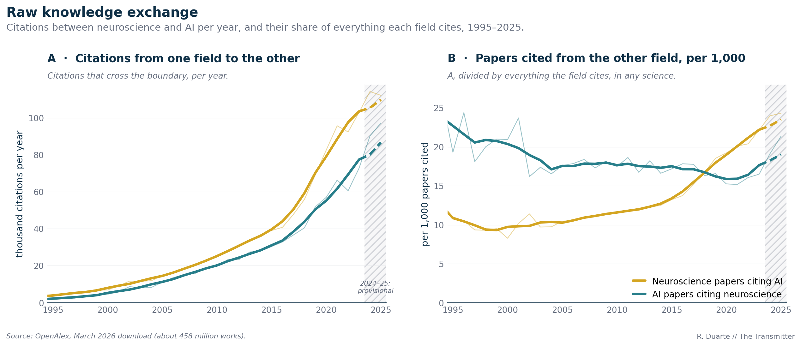
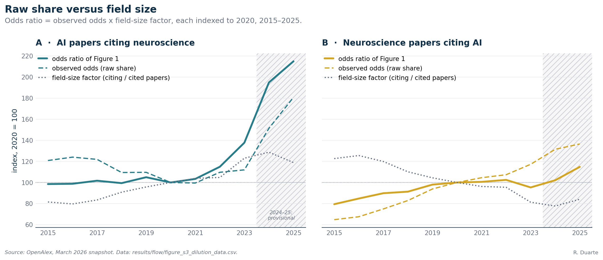

# S3. Counts, shares and field sizes: the other way of looking at Figure 1 (Figure 2)

This supplement sets the raw numbers behind Figure 2 of the article beside the odds ratio of Figure 1 and says what each one answers. Briefly, neuroscience papers cite AI more often than AI papers cite neuroscience in every year of the record, mostly because neuroscience papers carry longer reference lists. As a share of what each field cites, AI papers' citing of neuroscience led until 2017, and neuroscience papers' citing of AI has led since 2018. Corrected for field size, AI papers' citing of neuroscience is ahead in every year. I read the disagreement among the three views as a difference in the question each asks, and I find that about two thirds of the post-2020 rise in the teal line of Figure 1 comes from neuroscience shrinking as a share of the two fields, not from a larger raw share.

## 1. What the article says

Paragraph 9 gives the dilution caveat:

> Second, the steep rise in AI papers citing neuroscience since 2020 may be partly due to neuroscience shrinking as a share of a booming AI literature, rather than AI citing neuroscience more often. The raw numbers (figure below) illustrate this point: Between 2020 and 2023, the share of AI papers' citations that go to neuroscience did rise substantially, but more modestly than depicted in the odds ratio.

The caption of Figure 2 (formatting removed) reads:

> Raw citation flow: The number of citations crossing between the fields each year (neuroscience citing AI in gold, AI citing neuroscience in teal) has grown significantly over the past decades (A). Panel B shows what fraction of all citations this represents: of all the references cited by neuroscience papers, how many are AI papers (gold), and of all the references cited by AI papers, how many are neuroscience papers (teal). The odds ratio in the first figure compares this share in B with what would be expected if references were spread at random in proportion to the sizes of the two fields. The hatched band (2024–25) reflects provisional data.

And paragraph 10:

> A technical note, detailed in depth in the accompanying repository: I chose to analyze the odds ratio–how often papers in one field cite the other, compared with what you would expect if citations were handed out at random given each field's size. The raw numbers, shown in the figure above, tell a slightly different story: As a share of everything each field cites, neuroscience's citations of AI work have led since 2018, when the lines cross and AI's influence on neuroscience takes the lead. That crossover reflects the disproportionate growth and explosion of AI literature in recent years: There is simply more AI work to cite. Correcting for field size is the more honest view.

In section 3 I show how the share of panel B and the odds ratio of Figure 1 are built, in section 4.2 I give the shares and where the lines cross, in section 4.4 I take up the 2020 to 2023 rise of the raw share and of the odds ratio, and in section 4.6 I say what each view answers. [S2](S2-citation-flow.md) explains the Figure 1 caption and the odds ratio itself.

## 2. Data

Everything comes from the March 2026 OpenAlex snapshot and the extended AI definition of Figure 1 (I describe both in [S1](S1-data-and-classification.md)). For each citing year and direction, [`results/flow/or_by_year.csv`](../../results/flow/or_by_year.csv) holds the references a field's papers make to its own field, to the other field, to third fields, to works of unknown field and to works missing from the database, plus the papers each field published that year. Two derived files sit beside it: [`results/flow/figure2_raw_v2_data.csv`](../../results/flow/figure2_raw_v2_data.csv), the plotted values of Figure 2, and [`results/flow/companion_counts_shares_sizes.csv`](../../results/flow/companion_counts_shares_sizes.csv), which adds papers per field and references per paper. `src/neuroai_cn/analysis/flow_numbers.py` recomputes the quantities below from `or_by_year.csv`.

I name the directions as S2 does. Gold stands for neuroscience papers citing AI (data column `neuro_to_ai`; the article calls the flow AI to Neuro, because knowledge moves from AI into neuroscience). Teal stands for AI papers citing neuroscience (`ai_to_neuro`; Neuro to AI). A reference counts here only if it points to a work whose field could be determined; references to works absent from the database are left out of every numerator and denominator. In 2023 they were 8.5 percent of all references made by neuroscience papers and 19.6 percent of those made by AI papers, a gap that matters in section 4.5. The counts follow the same scope rule as in S2: a reference counts as present only if the cited work is in my index with a publication year up to 2025, and a reference to a work dated 2026 is counted as missing. Counting such references as present would add 1 to 44 references to the printed yearly counts, under 0.05 percent of any of them.

## 3. Method

### 3.1 The three quantities

In panel A I plot the count of cross-field references per year, in thousands: for the gold line the references that neuroscience papers make to AI papers, for the teal line those that AI papers make to neuroscience papers. Panel B divides each count by all references the citing field's papers make to papers of known field, third fields included (hence "in any science" under the panel), and multiplies by 1,000. I draw the lines as in Figure 1: thin yearly values, a thick centered 5-year mean over the whole series (at least three points per window), dashed over the hatched 2024 to 2025 band.

Three versions of the "share" exist in my files:

| Share | Denominator | Where it is used |
|-|-|-|
| per 1,000, Figure 2B | own-field + other-field + third-field references | Figure 2B, `figure2_raw_v2_data.csv` |
| per 1,000, companion table | the same plus references to works of unknown field | `companion_counts_shares_sizes.csv` (`rho_population` x 1000) |
| observed share, odds ratio | own-field + other-field references only | Figure 1 (`rho_restricted`) |

The first two differ only by the few unknown-field references: the companion value is lower by at most 0.43 percent (AI papers citing neuroscience, 1990), and by at most 0.18 percent from 1995. I use the Figure 2B definition throughout, so that the lines I quote match the figure. Larger by far is the third, because third-field references are many (34.2 percent of the recorded references of AI papers in 2023, 44.0 percent for neuroscience papers) and the odds ratio ignores them. The odds ratio of Figure 1 starts from the same idea, the share of the citing field's references that go to the other field, but forms it among references to the two fields only and leaves third-field references out; it then compares that observed share with the share expected from the field sizes. So the share inside the odds ratio is larger than the share of panel B. In 2023 the observed share is 25.10 per 1,000 for AI papers citing neuroscience against 16.51 in panel B, and 39.65 against 22.19 for neuroscience papers citing AI.

### 3.2 How the odds ratio is built from the share

I give the formulas in S2. Written in odds, the link to the raw share is explicit: the odds of a share p are p / (1 - p), and the odds ratio is the odds of the observed share divided by the odds of the expected share. That expected share is the cited field's fraction of the two fields' papers in the citing year, so for the teal line the expected odds are neuroscience papers divided by AI papers, and for the gold line AI papers divided by neuroscience papers. Hence

```
odds ratio (teal) = observed odds (teal) x (AI papers / neuroscience papers)
odds ratio (gold) = observed odds (gold) x (neuroscience papers / AI papers)
```

Each odds ratio is the raw share, in odds, times a field-size factor, and the two factors are reciprocals. Divide one equation by the other and the teal odds ratio exceeds the gold one exactly when the teal-to-gold ratio of observed odds is larger than the squared ratio of neuroscience papers to AI papers. Because the size ratio enters twice, a field-size correction can reverse the order of two raw lines (section 4.3).

### 3.3 The decomposition of a change

I take the logarithm of the identity above, which splits a change in the odds ratio between two years into two terms that add up exactly, whatever the order: the log change of the observed odds and the log change of the field-size factor. Dividing each by the total gives the part of the change that belongs to the raw share and the part that belongs to field sizes. I fixed the years before computing anything, because paragraph 9 speaks of 2020 to 2023, 2020 starts the last era of Figure 1 and 2023 is the last year the fits use. I tried no other pair. As a second view, I recompute the 2023 odds ratio with the 2020 field sizes, which shows what the odds ratio would have done had the sizes stayed put.

## 4. Results



*Figure 2 (`figure2_raw_v2`), as published. A: references crossing between the two fields, in thousands per year, 1995 to 2025; gold is neuroscience papers citing AI, teal is AI papers citing neuroscience. B: the same count per 1,000 references the field's papers make to papers of known field, in any field of science. Thin lines are yearly values, thick lines are centered 5-year means, the hatched band is 2024 to 2025 (provisional). Data: `results/flow/figure2_raw_v2_data.csv`; regenerated by `python -m neuroai_cn.figures.figure2_raw_v2`.*

### 4.1 Panel A: counts

| Year | Neuroscience citing AI (gold) | AI citing neuroscience (teal) | Gold / teal |
|-|-:|-:|-:|
| 1995 | 4,439 | 1,886 | 2.35 |
| 2000 | 6,964 | 4,661 | 1.49 |
| 2010 | 24,871 | 19,946 | 1.25 |
| 2019 | 69,308 | 51,938 | 1.33 |
| 2023 | 103,054 | 72,841 | 1.41 |
| 2024 (provisional) | 114,308 | 90,282 | 1.27 |
| 2025 (provisional) | 112,183 | 97,295 | 1.15 |

Neuroscience papers cite AI more often than AI papers cite neuroscience in every year of the series, 1990 to 2025, with no exception. Nowhere does the ratio of the two counts fall below 1.15 (in 2025) and, from 1995 on, never above 2.35 (in 1995). Between 2006 and 2019 it stays within 1.19 and 1.38, and it rises to 1.52 in 2022 before the provisional years pull it down. So the gold curve sits above the teal curve in panel A for the whole period, though the gap is narrow (about 1.2 to 1.4 times) from the mid-2000s on.

From 1995 to 2023 the gold count multiplied by 23.2 and the teal count by 38.6. A count is the product of three things, the papers in the citing field, the references recorded per paper and the share of those that cross, and I can separate them exactly with the companion table:

| Factor, 1995 to 2023 | Neuroscience citing AI (gold) | AI citing neuroscience (teal) |
|-|-:|-:|
| papers in the citing field | x 3.90 | x 9.86 |
| references recorded per paper | x 2.96 | x 4.58 |
| cross-field share, per 1,000 | x 2.01 | x 0.85 |
| cross-field count | x 23.2 | x 38.6 |

For the gold line all three factors grew. For the teal line the share fell, and all the growth in counts is growth in the number and the reference lists of AI papers. A rising count says the citing literature got bigger, not that its authors turned toward the other field.

Why does gold exceed teal in 2023? AI published 2.11 times as many papers as neuroscience that year, yet the gold count is 1.41 times the teal one: a neuroscience paper recorded 2.22 times as many references as an AI paper, and the neuroscience cross-field share was 1.34 times the AI one (0.473 x 2.224 x 1.344 gives the 1.41). I read the dominance of the gold count as largely a statement about long reference lists in neuroscience.

### 4.2 Panel B: shares, and where the lines cross

| Year | Neuroscience citing AI (gold) | AI citing neuroscience (teal) |
|-|-:|-:|
| 1995 | 11.05 | 19.33 |
| 2000 | 8.30 | 20.95 |
| 2010 | 11.59 | 17.48 |
| 2017 | 15.23 | 17.78 |
| 2018 | 16.71 | 16.34 |
| 2019 | 18.54 | 16.58 |
| 2020 | 19.24 | 15.26 |
| 2023 | 22.19 | 16.51 |
| 2025 (provisional) | 24.34 | 21.37 |

Cross-field references per 1,000 references, Figure 2B definition.

Starting at 11.05 per 1,000 in 1995, the gold share fell to its lowest value, 8.30, in 2000, and then rose, with one yearly dip in 2003, to 22.19 in 2023. Teal shows no such trend: it begins at 19.33, stays between 16.2 and 18.7 from 2002 to 2019, falls to 15.26 in 2020 and has its lowest value, 15.19, in 2021. By 2023 it is back at 16.51, still below the 20.95 of 2000.

Between 2017 and 2018 the two yearly lines cross: teal was higher in 2017 (17.78 against 15.23), gold has been higher in every year since 2018, and a straight-line interpolation of the difference puts the crossing at 2017.87. Centered 5-year means, the thick lines, cross later: teal is still higher in 2018 and gold is higher from 2019, with the interpolated crossing at 2018.04. Neither pair of years changes under the companion definition. "Have led since 2018" is exact for the yearly values, and the thick lines put the moment about a year later at most.

Paragraph 10 ties the crossing to the growth of AI, "there is simply more AI work to cite", and I checked that against the sizes. For the later part of the rise the sizes move with the share: AI went from 1.64 times the size of neuroscience in 2019 to 2.11 times in 2023 while the gold share went from 18.54 to 22.19. In the earlier part the two move in opposite directions: from 2006 to 2015 the ratio of AI to neuroscience papers fell from 1.66 to 1.40 while the gold share rose from 10.58 to 13.24 per 1,000. These data do not tell me what moved neuroscience's reference lists toward AI in those years.

### 4.3 How panel B relates to the odds ratio: a worked year

Here is my arithmetic for 2023, the last year I treat as solid, taken from the 2023 rows of `or_by_year.csv`. In S2 I work through 2019 in the same layout.

| | Neuroscience papers citing AI (gold) | AI papers citing neuroscience (teal) |
|-|-:|-:|
| references to own field | 2,495,721 | 2,828,899 |
| references to the other field | 103,054 | 72,841 |
| observed share, own + other | 0.0397 | 0.0251 |
| odds of the observed share | 0.0413 | 0.0257 |
| papers in the citing field | 164,016 | 346,525 |
| papers in the cited field | 346,525 | 164,016 |
| expected share from field sizes | 0.679 | 0.321 |
| odds of the expected share | 2.113 | 0.473 |
| odds ratio | 0.0195 | 0.0544 |

I get the gold odds ratio, 0.0195, by dividing 0.0413 by 2.113, and the teal one, 0.0544, by dividing 0.0257 by 0.473. In raw terms the gold line is higher: its observed odds are 1.6 times the teal ones. After the size correction the teal line is 2.78 times the gold line. Here, as I showed in section 3.2, the squared size ratio does the work: the observed odds of the teal line are 0.624 times those of the gold line, while the squared AI-to-neuroscience size ratio is 4.46, and 0.624 x 4.46 is 2.78. Neuroscience is the smaller field, so an AI paper's reference to it departs further from chance than a neuroscience paper's reference to the larger AI literature does.

A flat or falling share can give a rising odds ratio in the same way. Between 1995 and 2023 the teal share in panel B fell by 15 percent (from 19.33 to 16.51 per 1,000), but the neuroscience fraction of the two fields' papers, the denominator of the null, fell from 0.545 to 0.321, and the teal odds ratio rose by a factor of 1.88. With that much weight on the expected share, the odds ratio can move opposite to the raw share. The converse holds for the gold line: its raw share doubled between 1995 and 2023, but its odds ratio fell to 0.84 of its 1995 value.

### 4.4 The dilution reading of the post-2020 rise

Between 2020 and 2023 neuroscience published 152,180 and then 164,016 papers per year and AI 261,340 and then 346,525, so AI went from 1.72 to 2.11 times the size of neuroscience. The decomposition of section 3.3 applied to those two years:

| | AI citing neuroscience (teal) | Neuroscience citing AI (gold) |
|-|-:|-:|
| expected share of the cited field | 0.368 to 0.321 | 0.632 to 0.679 |
| observed share, per 1,000 (own + other) | 22.48 to 25.10 | 34.01 to 39.65 |
| odds ratio | 0.0395 to 0.0544 | 0.0205 to 0.0195 |
| change in odds ratio | x 1.38 | x 0.95 |
| of which, observed odds | x 1.12 | x 1.17 |
| of which, field-size factor | x 1.23 | x 0.81 |

Between 2020 and 2023 the teal odds ratio rose by 37.8 percent. Its observed odds rose by 12.0 percent and the field-size factor by 23.0 percent; in logarithms, about 35 percent of the rise is the raw share and about 65 percent is the shrinking share of neuroscience among the two fields. Neuroscience grew by 7.8 percent over the three years and AI by 32.6 percent. Had the field sizes stayed at their 2020 values, the teal odds ratio would have reached 0.0442 in 2023 instead of 0.0544.

On the figure's own scale, I find that the teal share in panel B went from 15.26 to 16.51 per 1,000, a rise of 8.2 percent, against the 37.8 percent of the odds ratio. This is the contrast paragraph 9 draws between the raw share and the odds ratio. The raw share starts close to the series minimum (15.19 in 2021) and ends below its 2000 value of 20.95. The dilution reading of paragraph 9, that the uptick "also reflects a relative dilution", corresponds to the size term: two thirds of the rise in the odds ratio, in logarithms, comes from it.

For the gold line the arithmetic runs the other way. Its raw share rose by 15.3 percent in panel B while its odds ratio fell by 4.7 percent, because the size change that inflates the teal line deflates the gold one by the reciprocal factor, 0.81. Figure S3.1 shows both factors for both lines.



*Figure S3.1 (`figure_s3_dilution`). For each direction, 2015 to 2025, three quantities indexed to 2020 = 100: the odds ratio of Figure 1 (thick line), the odds of the observed share (dashed, same color) and the field-size factor, the citing field's papers divided by the cited field's papers (dotted gray). The odds ratio is the product of the other two, so the log distance of the thick line from 100 is the sum of the log distances of the other two. Left, AI papers citing neuroscience; right, neuroscience papers citing AI. Hatched band 2024 to 2025, provisional. Data: `results/flow/figure_s3_dilution_data.csv`; regenerated by `python -m neuroai_cn.figures.figure_s3_dilution`.*

Figure S3.1 also shows the correction acting earlier. From 2015 to 2020 the teal observed share (own + other) fell from 27.04 to 22.48 per 1,000 while the size factor rose, and the odds ratio stayed almost flat. In my reading, the correction hid a decline in the raw share then and magnified the rise afterwards.

### 4.5 References per paper

| Year | References per neuroscience paper | References per AI paper |
|-|-:|-:|
| 1995 | 9.56 | 2.78 |
| 2000 | 14.95 | 4.20 |
| 2010 | 20.36 | 7.47 |
| 2019 | 25.00 | 12.74 |
| 2021 | 30.78 | 15.84 |
| 2023 | 28.31 | 12.73 |
| 2024 (provisional) | 23.21 | 10.39 |
| 2025 (provisional) | 16.04 | 7.76 |

Decade after decade up to 2021, the peak for both, both fields recorded more references per paper. Neuroscience papers carry about 2.2 times as many as AI papers in 2023, and 3.4 times as many in 1995. Up to 2023 the fall is gradual (neuroscience at 92 percent of its 2021 value, AI at 80 percent) and steep in the provisional years: by 2025 neuroscience is at 52 percent of its 2021 level and AI at 49 percent, while the papers per field rose by 75 and 69 percent from 2023. But I do not find a real halving of reference lists plausible. These counts include only references the database has linked to a work of known field, in 2023 all but 8.5 percent (neuroscience) and 19.6 percent (AI) of the references made, and a likely reason for the fall is that the reference lists of recent papers are still being ingested (the rebuild described in S2). With the committed files I cannot separate a true shortening from lagging data, so I read no trend after 2021. Recording can also explain the low AI values, since conference proceedings, which matter more for AI, are a weak spot I know of (S2); in 1995, 56.2 percent of neuroscience papers' references pointed at works absent from the database.

### 4.6 What each view says about "neuroscience has had a larger influence on AI"

Paragraph 7 makes a claim about influence, and the three views give three different answers from one table and one classification.

| View | What it measures | Neuroscience citing AI (gold) vs AI citing neuroscience (teal) | Consequence for the claim |
|-|-|-|-|
| Count (Figure 2A) | how many citations land on the cited field's papers each year | gold above teal in every year, 1990 to 2025 | AI work receives more citations from neuroscience than the reverse, so if counts measure influence the claim fails |
| Share (Figure 2B) | what fraction of the citing field's references go to the other field | teal above gold up to 2017, gold above teal since 2018 | the claim holds until 2017 and fails afterwards |
| Odds ratio (Figure 1) | the share against what field sizes predict | teal above gold in every year, 1995 to 2025 (smallest ratio 1.25, in 1995) | the claim holds, under the extended AI definition |

Read as shares, the data say more than "flat". By 2023 the gold share is 2.68 times its value of 2000 (2.93 times with the provisional 2025 value), but 2000 is the trough of the series; from 1995 the multiple is 2.01. For teal the 2023 share is 0.79 of its 2000 value. So neuroscience's appetite for AI doubled to tripled depending on the start year, while AI's appetite for neuroscience fell over the same years. In the article's influence terms, AI's weight in neuroscience's reference lists grew and neuroscience's weight in AI's did not.

The three views answer different questions. I take the count to ask how much the cited field receives, and it is large when the citing field is large. The share asks how much of what a field reads comes from the other, a statement about the citing field's habits. For the odds ratio the question is whether the other field is over- or under-represented in those habits compared with its size. That removes the effect of a growing denominator, and it also removes something that the share records: when AI doubles in relative size, a neuroscientist citing it at an unchanged rate has more AI to choose from. Someone asking how much AI work neuroscientists draw on should look at the share; someone asking whether neuroscience punches above its weight in AI's references should look at the odds ratio. Paragraph 7 states the normalization it uses ("Corrected for field size"), and paragraph 10 gives the reason for choosing it.

By every view, cross-field references are a small part of what each field cites (16.51 and 22.19 per 1,000 for the teal and gold lines in 2023). The statement that neuroscience has had a larger influence on AI holds under one normalization, relative to field size and with AI defined broadly ([S2](S2-citation-flow.md), section 5, describes how the level ordering depends on the AI definition). In counts the opposite holds in every year, and in share of references since 2018. After 2020 the rise of the teal odds ratio is in the data and mostly a size effect: had AI authors cited neuroscience at exactly their 2020 rate, the odds ratio would still have risen by 23 percent from field sizes alone, against the 38 percent observed.

## 5. Caveats and what this does not show

One limit of the size null is that it uses the sizes of the two fields in the citing year. References point backward, and AI was smaller relative to neuroscience in the years being cited than in the citing year (the ratio of AI to neuroscience papers was 0.84 in 1995 and 2.11 in 2023). A benchmark built on the sizes at the cited paper's year would give neuroscience a higher expected share and AI a lower one, which lowers the teal odds ratio and raises the gold one and narrows the gap. I have not computed it, because the committed files do not carry the age of each reference, so I cannot say whether the order of the lines survives.

Counts, shares and odds ratios share one classifier here, so a change in how OpenAlex labels topics (S1, S2) moves them together. I treat the 2024 and 2025 values as provisional: the teal count jumps from 72,841 in 2023 to 90,282 in 2024 and 97,295 in 2025 while recorded references per paper fall to 57 percent (neuroscience) and 61 percent (AI) of their 2023 values. I use neither year for a claim, and I stop every trend at 2023 unless a table says provisional, as I did in S2.

To me a citation is a recorded reference, not influence: a count and a share both treat a reference to a statistics library and one to a founding theory as one unit ([S4](S4-what-ai-cites.md) and [S5](S5-bridge-builders.md) look at what crosses). My decomposition is bookkeeping, not a causal model: it says which factor carries a change in the odds ratio, not why authors cited as they did. It rests on two yearly values, 2020 and 2023, whose counting noise is tiny and whose classification noise is not, and a different pair would give a different split, so I quote the 35 and 65 percent only for these years, and I treat the direction (size matters more than the raw share) as the finding. Self-citations stay in every count, and both fields are flattened (neuroscience spans molecular to cognitive work, AI spans machine learning, vision and neuromorphic hardware; S4 breaks down the neuroscience that AI cites).

## 6. Reproduce

Everything in this supplement runs from committed files:

```bash
# Figure 2 and its data bundle (reads results/flow/or_by_year.csv)
.venv/bin/python -m neuroai_cn.figures.figure2_raw_v2

# Figure S3.1 and its data (reads results/flow/or_by_year.csv)
.venv/bin/python -m neuroai_cn.figures.figure_s3_dilution

# the counts, shares, crossing years and dominance checks quoted in sections 4.1 and 4.2
.venv/bin/python -m neuroai_cn.analysis.flow_numbers

# every number in this supplement, checked against the results files
.venv/bin/python -m pytest -q tests/test_supplement_claims.py tests/test_flow_numbers.py
```

The input table, `or_by_year.csv`, is exported from the heavy derived data by `python -m neuroai_cn.analysis.export_flow_inputs`; that step needs the local OpenAlex snapshot (see S2 and `src/neuroai_cn/config.py`).

## 7. Related

- [S1. Data, corpus and field classification](S1-data-and-classification.md): the snapshot, the extended AI definition, field sizes and reference coverage.
- [S2. Citation flow: the odds ratio behind Figure 1](S2-citation-flow.md): the odds ratio, its trends and its checks.
- [S4. What AI cites in neuroscience](S4-what-ai-cites.md): what part of neuroscience the teal references go to.
- [Methods 03, the citation metric](../methods/03-citation-metric.md): formal definitions of the shares and the odds ratio.
