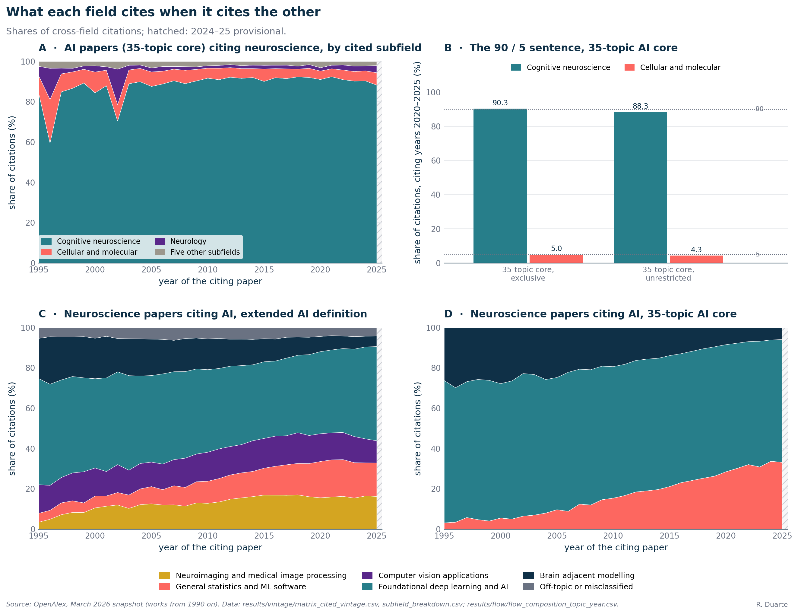
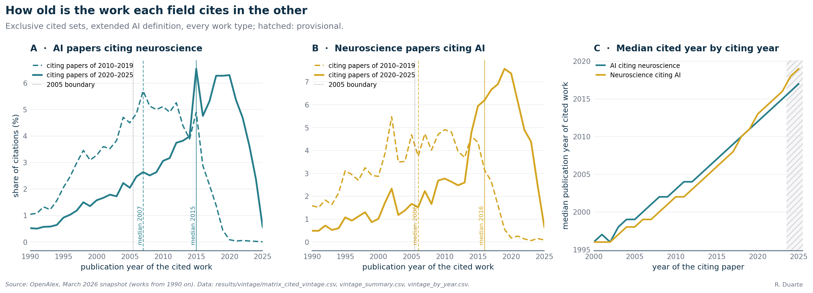
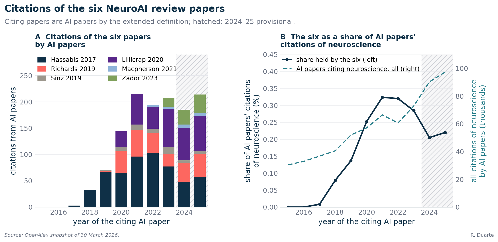
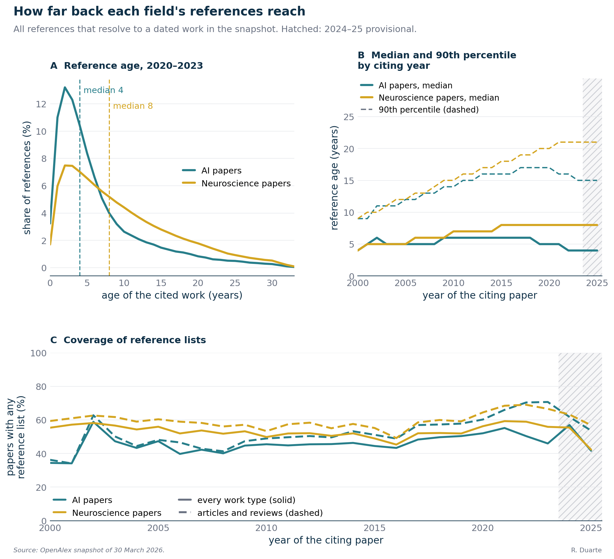

# S4. What AI cites in neuroscience: subfield, age and the NeuroAI papers

In this supplement I look inside the two citation flows of Figure 1: which parts of neuroscience AI papers cite, how old the cited work is, whether citations of the six NeuroAI papers follow the flow, and how far back each field's references reach. Wherever a line is one of the two flows, gold is neuroscience papers citing AI and teal is AI papers citing neuroscience; bars and areas that mark categories use other colors.

**What this supplement covers**

- "About 90 percent comes from cognitive neuroscience and under 5 percent from cellular and molecular work": 90.3 and 4.98 percent under the 35-topic core definition (82.7 and 9.96 under the extended one), section 2.1.
- What neuroscience papers cite in AI (the gold flow), by category of the cited topic: section 2.2.
- "AI continues to cite newer neuroscience papers": median cited year 2007 to 2015, and 7 years at fixed age in both periods, section 2.3.
- "Consistent with the timing of the NeuroAI manifestos": citations of the six sidebar papers by AI papers, section 2.4.
- AI's short citation memory (median reference age 4 years against 8 for neuroscience), section 2.5.

## 1. Methods

I use the OpenAlex snapshot of 30 March 2026 and the labels of [S1](S1-data-and-classification.md). The works table starts in 1990, so every age statistic loses its old tail, and I count citation edges over citing years 1995 to 2025, with 2024 and 2025 provisional. AI is the extended definition of Figure 1 unless I say otherwise; the article's sentence on cognitive neuroscience was computed under the narrower 35-topic core, which leaves out computer vision. The cited neuroscience is split by the OpenAlex subfield of its primary topic ("cognitive neuroscience" and "cellular and molecular" in the article are two of the eight subfields), and the AI that neuroscience cites is sorted by hand into six categories of topic. I report two cited sets: all neuroscience (what Figure 1 counts) and the exclusive set, which also drops works that carry an AI topic and is the primary specification. Age is the citing year minus the cited year; because a paper of 2025 can reach back 35 years in the snapshot and one of 2010 only 20, I also compute the age profile inside a common window of ages 0 to 20. Before running the check on AI papers filed under neuroscience, I declared that it fails if the cognitive share or the share published in 2005 or earlier moves by more than 2 points, or the median cited year by more than 1 year. The six NeuroAI papers are those of the article's sidebar, resolved by DOI. Full definitions: [METHODS section 9](../METHODS.md#9-what-ai-cites-in-neuroscience) and [section 3](../METHODS.md#3-field-definitions).

## 2. Results



*Figure S4.1. A: AI papers (35-topic core) citing neuroscience, share of citations by subfield of the cited work, exclusive cited set. B: shares of cognitive and of cellular and molecular neuroscience in 2020 to 2025; dotted lines at 90 and 5 percent. C and D: neuroscience papers citing AI, share by category of the cited AI topic, extended definition (C) and 35-topic core (D). Colors mark categories, not the two flows, and each panel has its own legend. Hatched and right of the dashed line: 2024 and 2025, provisional.*

### 2.1 Which neuroscience AI cites: the 90 percent sentence

Panel A takes every citation that an AI paper sends to neuroscience and asks which kind of neuroscience it lands on. I find that cognitive neuroscience dominates and the split barely moves over time.

| AI papers 2020-2025 citing neuroscience, 35-topic core | Cognitive | Cellular and molecular | Neurology | Citations |
|-|-:|-:|-:|-:|
| Exclusive set (the article's basis) | 90.3 | 5.0 | 2.6 | 139,730 |
| All-neuroscience set | 88.3 | 4.3 | 5.7 | 179,242 |

I report shares as percent of citation edges. AI papers of 2020-2025, under the 35-topic core definition, send 90.3 percent of their citations of (exclusive) neuroscience to cognitive neuroscience and 4.98 percent to cellular and molecular neuroscience. Under the extended definition used for Figure 1, which adds computer vision and medical imaging papers to the AI side, the same two shares for the exclusive set are 82.7 percent and 9.96 percent, so the values depend on the definition of AI. Counting the all-neuroscience cited set instead, the shares are 88.3 and 4.3 percent, and neurology takes 5.7 percent. Restricting to 2020-2023, because the last two years are provisional, gives 91.2 and 4.41 percent. The cognitive share was 91.7 percent in 2010-2019 and 90.3 percent in 2020-2025, and in every citing year from 2010 to 2024 it lies between 90.1 percent (2015) and 92.5 percent (2021), as panel A shows.

### 2.2 What neuroscience cites in AI

An odds ratio says how strongly neuroscience reaches into AI, not for what, so I decomposed the gold flow by the topic of the cited AI work (panels C and D). For citing years 1995 to 2023, neuroscience papers cited AI works 951,900 times under the extended definition, spread over 87 topics; under the 35-topic core the same flow is 436,326 citations over 35 topics.

| Category of cited AI topic | Extended (%) | 35-topic core (%) |
|-|-:|-:|
| Foundational deep learning and AI | 41.1 | 64.5 |
| Neuroimaging and medical image processing | 15.1 | 0.0 |
| General statistics and machine-learning software | 14.5 | 21.8 |
| Computer-vision applications | 13.9 | 0.0 |
| Brain-adjacent modeling | 10.6 | 13.7 |
| Off-topic or misclassified | 4.9 | 0.0 |

I find foundational deep learning and AI the largest category under both definitions. These categories describe the topic of the cited AI work, not whether a paper is a tool or a concept; that split is made for the strongest bridge works in [S5](S5-bridge-builders.md#15-tools-and-concepts). General statistics and machine-learning software is a growing category: under the extended definition it rises from 4.4 percent of the 1995 citations to a peak of 18.4 percent in 2021. Brain-adjacent modeling (cognitive-science and attention topics) has shrunk, from 20.0 percent of neuroscience's AI citations in 1995 to 6.2 percent in 2023. Neuroimaging and computer vision are zero under the core because it admits no computer-vision topic, so the definition decides there. At the top sits lme4, the R package for mixed-effects models, and 10 of the 25 most-cited works are neuroimaging tools. AI used as a model of the brain is filed as neuroscience and never enters this flow.

### 2.3 The age of the neuroscience AI cites



*Figure S4.2. A: AI papers citing neuroscience (teal); share of citations by publication year of the cited work, for citing papers of 2010 to 2019 (dashed) and 2020 to 2025 (solid), with the medians (vertical lines, values in the legend). B: the same for neuroscience papers citing AI (gold). C: median cited year by citing year, teal and gold as in A and B; hatched: provisional years. Exclusive cited sets, extended definition, every work type.*

In panels A and B I show how old the cited work is: the curve of the 2020s sits to the right of the curve of the 2010s, so the cited work is newer in calendar years. Panel C shows why this needs care: the median cited year climbs almost in step with the citing year.

| AI papers citing neuroscience | 2010-2019 | 2020-2025 | 2020-2023 |
|-|-:|-:|-:|
| Citations, exclusive set | 224,890 | 315,457 | 179,925 |
| Median cited year | 2007 | 2015 | 2014 |
| Share published 2005 or earlier (%) | 43.8 | 19.9 | 23.1 |
| Mean age (years) | 9.2 | 10.1 | 10.1 |
| Within ages 0-20: median age (years) | 7 | 7 | 7 |
| Within ages 0-20: share aged 5 or less (%) | 38.0 | 43.1 | 42.4 |

Extended definition, every work type, exclusive cited set. In calendar terms the cited neuroscience got newer by eight years: the median cited year moved from 2007 to 2015, and the share published in 2005 or earlier fell from 43.8 to 19.9 percent. Inside the common 0-to-20-year window, the median age was 7 years in both periods, and the share of citations to work at most five years old rose modestly, from 38.0 to 43.1 percent. The median cited year sits eight years behind the citing year in every year from 2012 to 2025, so most of the eight-year shift between the two decades is the decade itself. The article's statement in paragraph 16 that AI continues to cite newer neuroscience papers rests on the median cited year; the fixed-age medians are the further check, and they say that AI cites neuroscience at the same lag as before, not at a longer one. For paragraph 6, a fifth of AI's citations of neuroscience in 2020-2025 still go to work published in 2005 or earlier (19.9 percent).

My declared check for AI papers filed under neuroscience removed 13,946 cited works, mostly by a title pattern. In the primary (exclusive) set I find that the cognitive share holds within 0.7 points and the 8-year shift in the median cited year survives every stage of removal. In the all-neuroscience set the cognitive share moves by up to 2.2 points for 2020-2025, above the 2-point threshold, and old-work shares rise by 2.2 to 2.8 points because most removed works are recent AI papers, so the check fails in part for levels in 2020-2025, which I treat as about one year and two to three points softer than the baseline suggests (`robustness_shift.csv`).

For neuroscience papers citing AI the cited work got younger in age, not only in calendar years: the median cited year moved from 2006 to 2016, and the median age inside the common window fell from 8 to 6 years, with nearly half of the AI citations going to work five years old or less (49.0 percent in 2020-2025). This fits the adoption of deep-learning tools in neuroscience after 2015 that the gold line of Figure 1 records ([S2](S2-citation-flow.md)).

### 2.4 The six NeuroAI papers



*Figure S4.3. A: citations by AI papers (extended definition) of the six NeuroAI papers of the article's sidebar, per citing year, stacked by paper (colors mark papers). B: the same as a percentage of all citations of neuroscience by AI papers (navy, left axis), and the number of those citations in thousands (teal dashed, right axis: AI papers citing neuroscience). Hatched: provisional years.*

In panel A I count how often AI papers cite the six papers of the sidebar, year by year; panel B sets that against the whole flow of AI papers citing neuroscience, which is the teal quantity of Figure 1. If the post-2020 rise were made of citations to the six, the share in B would climb with the flow. I find that it does not.

| Citations received 2020-2023 | from AI | from neuroscience | from neither | total |
|-|-:|-:|-:|-:|
| Hassabis et al. 2017 | 341 | 206 | 288 | 835 |
| Richards et al. 2019 | 153 | 365 | 140 | 658 |
| Lillicrap et al. 2020 | 201 | 208 | 122 | 531 |
| Sinz et al. 2019 | 41 | 54 | 32 | 127 |
| Macpherson et al. 2021 | 8 | 17 | 35 | 60 |
| Zador et al. 2023 | 16 | 19 | 21 | 56 |
| All six | 760 | 869 | 638 | 2,267 |

I find all six in the snapshot (DOIs in the article's sidebar); my classifier labels four of them neuroscience and two (Sinz, Zador) AI. I count that, per year, AI papers' citations of the six rose from 3 in 2017 to 144 in 2020 and 215 in 2021, then held near 200: 194 in 2022, 207 in 2023, 185 in 2024 and 214 in 2025. Over the same years the flow of AI papers citing neuroscience kept growing, from 57,081 edges in 2020 to 72,841 in 2023 and 97,295 in 2025, so the six account for 0.25 to 0.32 percent of the flow in 2020-2023, with the peak in 2021, and for about 0.2 percent in 2024-2025. Removing the six as cited works changes the teal odds ratio of Figure 1 by at most 0.31 percent in any year from 2015 to 2023 (2023: 0.0544 before, 0.0543 after), and the gold one by at most 0.02 percent.

Year-over-year changes in the citations that AI papers send to the six correlate with changes in the number of citations of neuroscience by AI papers at a Spearman coefficient of 0.59 (exact p = 0.098), and with changes in the odds ratio at -0.34 (p = 0.36). The teal rise and the six NeuroAI papers are contemporaneous, as the article says, and the rise is not made of citations to them. With nine changes and six papers this is a description of two curves, not a test of influence.

### 2.5 Reference age: AI's short citation memory



*Figure S4.4. A: distribution of reference age for AI papers (teal) and neuroscience papers (gold) of 2020 to 2023, articles and reviews, all references that resolve to a dated work; dashed lines at the medians. B: median (solid) and 90th percentile (dashed) of reference age by citing year. C: share of papers with any reference list, every work type (solid) and articles and reviews (dashed). Hatched: provisional years.*

Here I use every reference of every AI and neuroscience paper, not only the cross-field ones, and ask how old the cited work is. Panel A shows the distribution: AI's is piled up at small ages, neuroscience's has a longer tail. Panel B shows that the gap persists year by year, and panel C shows how many papers have a reference list at all.

| Articles and reviews, 2020-2023 | AI papers | Neuroscience papers |
|-|-:|-:|
| References with a dated cited work | 12,173,300 | 14,320,543 |
| Median age (years) | 4 | 8 |
| Mean age (years) | 6.6 | 9.7 |
| 90th percentile (years) | 16 | 21 |
| Share aged 5 or less (%) | 58.5 | 36.2 |
| Share aged 10 or less (%) | 80.1 | 62.2 |

For AI articles and reviews of 2020-2023 the median reference is 4 years old and 58.5 percent of references are five years old or less; for neuroscience the median is 8 years and the share 36.2 percent. AI's memory has also shortened: the AI median was 6 years for papers of 2010-2019 and 4 for 2020-2023, while the neuroscience median went from 7 to 8. Cross-field references sit in between: when AI papers of 2020-2023 cite neuroscience, the median cited work is 7 years old, and so it is when neuroscience papers cite AI.

Ideas absorbed so thoroughly that they are no longer cited leave no edge in the graph. AI's short memory is real, so I expect a citation-based measure to understate neuroscience's older contributions to AI more than the reverse, and I take the 19.9 percent of section 2.3 as a lower bound on how much of what AI owes neuroscience is old. [S5](S5-bridge-builders.md) lists the papers, authors and institutions that both fields cite. Only 41.7 to 57.0 percent of AI works of 2020-2025 have any reference list in the snapshot, against 55.5 to 59.3 percent of neuroscience works in 2020-2024, so these results describe papers with lists.

## 3. Caveats

I count citations, which record use and not intellectual debt: citing lme4 and citing a theory of plasticity count the same. My snapshot starts in 1990, so every share of "old" work is a lower bound and every all-ages statistic drifts upward with the citing year; the common window removes the drift but ignores older work by design, and I added it after seeing the calendar results.

The 90.3 and 4.98 percent are for the 35-topic core definition; under the extended definition they are 82.7 and 9.96 percent. OpenAlex classifies on the primary topic, its "cognitive neuroscience" is broad, and its labels carry errors on single papers. The category assignment of section 2.2 is my judgment, and I print it so that anyone can redraw a line. Six papers are six papers: I describe their curves and do not test influence, and the 2024 and 2025 values are provisional.

## 4. Reproduce

```bash
.venv/bin/python -m neuroai_cn.figures.figure_s4            # Figures S4.1 to S4.4 from results/
.venv/bin/python -m neuroai_cn.analysis.manifesto_citations
./reproduce.sh numbers                                       # claims of S4 recomputed from results/
```

Outputs are in `results/vintage/`, `results/flow/` and `results/manifestos/` (the directory of the six NeuroAI papers). The steps that read the snapshot are listed by `./reproduce.sh heavy` ([METHODS section 11](../METHODS.md#11-statistical-conventions-and-reproducibility)); the claims call `src/neuroai_cn/analysis/s4_numbers.py`.
