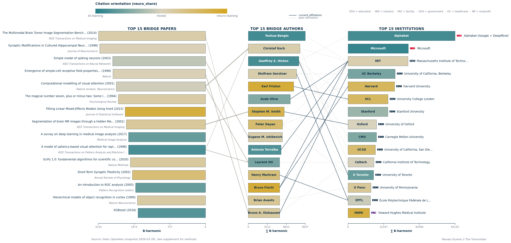
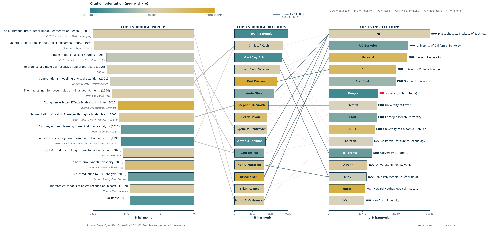

# S5. The bridge builders: papers, authors and institutions (Figure 3)

This supplement backs the third figure of the article and paragraphs 11 to 14: how I score a paper as a bridge between neuroscience and AI, which papers enter the ranking, how paper scores become author and institution scores, how I verified the affiliations, and how concentrated the bridge weight is. The strongest bridges are an old canon plus general-purpose software, and the institutions column is led by Alphabet and Microsoft.

**Article statements covered**

- Ranking by the harmonic mean of citations from each field, with the 1,000 and 2 against 100 and 100 example: section 1.2.
- "Roughly 59,000 papers with at least 5 citations from each side": 133,763 pass the gate, 58,971 remain after the eligibility filters (section 1.3).
- "The full scoring, the locked corpus, a hand-verification of every affiliation drawn here, and a more thorough analysis beyond the top 15": sections 1.2, 1.5, 2.2 and 2.7 (corpus: [S1](S1-data-and-classification.md)).
- Figure 3 caption (color, ranking basis, axes, links): sections 1.1, 1.4 and 2.1.
- "About half of the strongest bridges are [...] tools", "the most recent of these bridgeworks is from 2003": 7 tools and 8 concepts (sections 1.7 and 2.2).
- The authors column, including Oliva, and the hand-verified current and past affiliations: sections 1.5, 2.3 and 2.5.
- Alphabet and Microsoft top the institutions and are the most AI-leaning entities: section 2.4.
- The top 100 institutions hold nearly 40 percent of bridge weight, the top 100 authors below 7 percent: 39.64 and 6.63 percent, section 2.6.

## 1. Methods

### 1.1 Data and the color variable

Everything comes from the OpenAlex snapshot of 30 March 2026 (458,112,708 records) with the field labels of [S1](S1-data-and-classification.md): a paper is neuroscience or AI by its primary OpenAlex topic, under the extended AI definition ([METHODS section 3](../METHODS.md#3-field-definitions)). I call a citation "classified" when the citing paper carries one of those two labels, and I ignore other citations. For each cited paper I count the classified citations it receives from neuroscience papers (`c_neuro`) and from AI papers (`c_ai`).

Bar color is `neuro_share = c_neuro / (c_neuro + c_ai)`, which is 0 (teal) when the citations almost all come from AI papers and 1 (gold) when they almost all come from neuroscience papers. For an author or an institution I sum the counts over its bridge papers, so its share is the summed neuroscience citations over the summed citations from both fields. Color describes who cites the work, not its field. My candidates are all papers with at least five classified citations from each side, 133,763 papers, which I call the 5-and-5 gate. Author and institution identities are the OpenAlex `author_id` and `institution_id`, with no consolidation of my own except section 1.6. All tables are in [`results/bridge/`](../../results/bridge/).

### 1.2 The bridge score

For a paper p, the bridge score is the harmonic mean of the two counts (full definition in [METHODS section 8](../METHODS.md#8-bridge-works)):

```
B(p) = 2 * c_neuro(p) * c_ai(p) / (c_neuro(p) + c_ai(p))
```

B is never larger than twice the smaller count, so a paper cannot score well on one side's attention alone. BRATS is cited 2,547 times by neuroscience and 1,952 times by AI, so B is 2,210.16, close to the arithmetic mean of 2,249.5. The article's illustration, a paper cited 1,000 times by AI and twice by neuroscience, scores 3.99, against 100 for one cited 100 times by each side (the arithmetic mean would give 501 and 100). Both extremes exist: a path-planning paper cited 4,790 times by AI and 6 by neuroscience scores 11.98, and a diagnostic interview for autism cited 7,379 times by neuroscience and 7 by AI scores 13.99. I compute B on raw counts, in citations, and I do not correct it for the sizes of the two fields ([S3](S3-counts-and-field-sizes.md)).

### 1.3 Which papers are eligible

I apply three rules, in this order, to decide which candidates can be ranked; the 58,971 papers that remain are the article's "roughly 59,000".

| Step | Papers remaining | Removed |
|-|-:|-:|
| gate: at least 5 classified citations from each side | 133,763 | 0 |
| own field label neuro or ai (drops other and unknown) | 59,038 | 74,725 |
| classified citations under the 10,000 ceiling (E2) | 58,971 | 67 |

I did not vary the threshold of five, which does not affect the top of the ranking ([METHODS section 8](../METHODS.md#8-bridge-works), 8.2).

The label rule removes 74,485 papers labeled as another field and 240 with no label, among them a block of plasma-physics papers from the Large Helical Device fusion experiment that collect thousands of citations from papers labeled neuroscience and AI ([`unfiltered_top_papers.csv`](../../results/bridge/unfiltered_top_papers.csv)).

My ceiling (E2 in the code, the 10,000-citation ceiling) drops papers with 10,000 or more classified citations in total: 67 papers, 66 labeled AI and one neuroscience. All 19 highest-scoring papers of the label-filtered pool fall to it (ResNet is first), BRATS would rank 20th, and 26 of the 67 would score above the fifteenth paper of Table S5.1. They are general-purpose machine-learning references such as scikit-learn, LSTM and Adam, with a share of citations from neuroscience between 0.03 and 0.25 for the first 19 ([`ceiling_effect_top40.csv`](../../results/bridge/ceiling_effect_top40.csv)). I chose 10,000 as a round number and tested no other.

For Table S5.1 I then keep only OpenAlex types article and review, drop ebook-platform and book-series sources, empty and duplicate titles and three book titles I listed by hand, and take the first fifteen. Of the 40 best eligible candidates, 7 are removed by these rules ([`s1_eligibility_check.csv`](../../results/bridge/s1_eligibility_check.csv)).

### 1.4 Summing paper scores over authors and institutions

An author's bridge weight is the sum of B over the bridge papers on which the author is credited, and an institution's the sum over the bridge papers that carry an affiliation to it. A paper counts in full for every author and every institution on it, once per institution however many of its authors share it; I do not divide credit. Three paper sets feed the columns of Figure 3:

- Authors: the top 5,000 eligible papers by B, with at least two papers for an author.
- Institutions other than the corporate groups: the same top 5,000 eligible papers, with at least five papers for an institution.
- The three corporate groups (Alphabet, Microsoft and Meta, section 1.6): every paper that passes the 5-and-5 gate, 133,763 papers, counted once for a group when any author lists one of its sub-entities.

Institution credit follows the affiliations printed on each paper, so a researcher who moved is credited to the place where the paper was written.

### 1.5 How the affiliations were verified

Because the figure asserts employment relationships between fifteen living researchers and institutions, I checked each by hand against ORCID employment records, official institutional pages, Google Scholar, homepages or CVs and LinkedIn, in that order of priority, and no line comes from the OpenAlex field `last_known_institutions`, which gave name collisions. That gives 26 edges, 10 current and 16 past, with roles and dates in [`author_institution_edges.csv`](../../results/bridge/author_institution_edges.csv) (column `note`); three dates remain uncertain (Hinton's start at San Diego, Fischl's MIT status, the end of Avants's Penn appointment). Only research affiliations at the 15 institutions shown can appear, so some current employers are absent, and I checked the eight lines between papers and authors against Crossref and OpenAlex publisher metadata; the four rules are in [METHODS section 8](../METHODS.md#8-bridge-works), 8.6.

### 1.6 Corporate consolidation

OpenAlex lists Google (United States), Google (United Kingdom), DeepMind (United Kingdom), Microsoft (United States), Microsoft Research (United Kingdom) and Meta (Israel) as separate institutions, and for Figure 3 I merged them into three parent groups, Alphabet (Google + DeepMind), Microsoft and Meta, counting a paper once for a group however many of its sub-entities it lists. I show the unconsolidated variant as Figure S5.1; the name patterns are in [METHODS section 8](../METHODS.md#8-bridge-works), 8.5.

### 1.7 Tools and concepts

I coded each of the top fifteen by hand. I call a paper a tool if it is software, a benchmark, an analysis method or a methods survey that both fields cite because they run it, and a concept if it makes a claim about brains or minds: how neurons learn, how vision or attention work, how memory is limited. It sits in the `paper_class` column of [`table_s1_papers.csv`](../../results/bridge/table_s1_papers.csv), and it agrees with the separate hand coding of [S6](S6-citation-age.md) for every paper that file matches. By this rule 7 of the 15 are tools and 8 are concepts, the article's "about half". I find three calls arguable (Izhikevich's spiking-neuron model, Itti, Koch and Niebur's saliency model, hierarchical object-recognition models), and recoding them as tools would give 10 tools.

### 1.8 Concentration

To ask whether individuals or environments carry bridge work, I summed B over every author and institution credited on the 133,763 papers that pass the gate and computed the share of the total held by the top N. Because this pool still holds the fusion block of section 1.3, I dropped every author and institution that averages more than 400 units of B per paper (298 authors and 17 institutions) and call the result the sensitivity bound, whose values the article reports; institutions are not consolidated here, and the procedure is in [METHODS section 8](../METHODS.md#8-bridge-works), 8.7.

## 2. Results

### 2.1 Article Figure 3



*Article Figure 3 (`figure2_v3`), as published. The article caption says that color shows the proportion of citations received from either field (teal for more citations from AI papers, gold for more from neuroscience papers), and that papers are ranked directly on the harmonic mean, authors and institutions on the sum of those scores over all bridge papers they are credited on. Data: the files `table_s1_papers.csv`, `table_s2_authors.csv`, `table_s3_institutions_consolidated.csv`, `author_institution_edges.csv` and `paper_author_links.csv` in `results/bridge/`; script `.venv/bin/python -m neuroai_cn.figures.figure2_bridges_v3`.*

"Most likely to be cited by both" is the bridge score B (section 1.2), "all bridge papers" the paper sets of section 1.4, and the color is `neuro_share` (section 1.1). I explain four elements of the figure here.

- Minimum bar length. Author bars are drawn at least 55 percent of the longest author bar, 5,465 on the ∑B scale, so that names fit inside. Ranks 11 to 15 (Itti 5,386, Markram 5,378, Fischl 5,338, Avants 5,226, Olshausen 5,076) fall below it and are drawn at that length, so their bars do not show their values (Table S5.2). Ranks 1 to 10 are to scale.
- Color bar. Titled "Citation orientation (neuro_share)": "AI-leaning" (teal) at 0, "mixed" (beige) at 0.5, "neuro-leaning" (gold) at 1.
- Badges. A badge beside each institution bar gives the OpenAlex type: EDU education, IND industry (OpenAlex type company), FAC facility, GOV government, HC healthcare, NP nonprofit. The fifteen bars use three: 12 EDU, 2 IND (Alphabet and Microsoft) and 1 FAC (HHMI).
- Lines. Between papers and authors, thickness encodes the author's position on the paper (last 2.0, first 1.5, middle 1.0). Between authors and institutions, a solid dark line (1.5 pt) is a current affiliation and a faded thin line (0.9 pt) a past one: 10 current and 16 past edges. Six papers have a line to an author, 8 lines in all (section 2.5).

### 2.2 The papers

| # | Paper | Year | Cited by neuroscience | Cited by AI | B | Share from neuroscience | Class |
|-:|-|-:|-:|-:|-:|-:|-|
| 1 | Multimodal Brain Tumor Image Segmentation Benchmark (BRATS), Menze et al. | 2014 | 2,547 | 1,952 | 2,210 | 0.57 | tool |
| 2 | Synaptic modifications in cultured hippocampal neurons (spike-timing plasticity), Bi and Poo | 1998 | 2,271 | 2,106 | 2,185 | 0.52 | concept |
| 3 | Simple model of spiking neurons, Izhikevich | 2003 | 1,680 | 2,235 | 1,918 | 0.43 | concept |
| 4 | Emergence of simple-cell receptive field properties by learning a sparse code, Olshausen and Field | 1996 | 2,004 | 1,832 | 1,914 | 0.52 | concept |
| 5 | Computational modeling of visual attention, Itti and Koch | 2001 | 1,750 | 1,948 | 1,844 | 0.47 | concept |
| 6 | The magical number seven, plus or minus two, Miller | 1994 | 2,126 | 1,563 | 1,802 | 0.58 | concept |
| 7 | Fitting linear mixed-effects models using lme4, Bates et al. | 2015 | 8,437 | 920 | 1,659 | 0.90 | tool |
| 8 | Segmentation of brain MR images through a hidden Markov random field model and the expectation-maximization algorithm, Zhang et al. | 2001 | 2,111 | 1,335 | 1,636 | 0.61 | tool |
| 9 | A survey on deep learning in medical image analysis, Litjens et al. | 2017 | 969 | 4,431 | 1,590 | 0.18 | tool |
| 10 | A model of saliency-based visual attention, Itti, Koch and Niebur | 1998 | 879 | 8,286 | 1,589 | 0.10 | concept |
| 11 | SciPy 1.0, Virtanen et al. | 2020 | 1,944 | 1,293 | 1,553 | 0.60 | tool |
| 12 | Short-term synaptic plasticity, Zucker and Regehr | 2002 | 2,787 | 1,035 | 1,509 | 0.73 | concept |
| 13 | An introduction to ROC analysis, Fawcett | 2005 | 885 | 3,938 | 1,445 | 0.18 | tool |
| 14 | Hierarchical models of object recognition in cortex, Riesenhuber and Poggio | 1999 | 1,690 | 1,205 | 1,407 | 0.58 | concept |
| 15 | XGBoost, Chen and Guestrin | 2016 | 798 | 5,559 | 1,396 | 0.13 | tool |

*Table S5.1. The 15 papers of Figure 3, ranked by B.*

Of the 15 papers, 7 are tools and 8 are concepts by my coding. The 8 concepts date from 1994 to 2003 (OpenAlex dates Miller's paper by a 1994 reprint of the 1956 original), so Izhikevich's spiking-neuron model of 2003 is the most recent concept, and SciPy 1.0 of 2020 the most recent tool. The median publication year of the top 15 is 2002. Scores fall in a narrow band, from 2,210 to 1,396, and I find that the share of citations from neuroscience runs from 0.10 (the Itti, Koch and Niebur saliency model) to 0.90 (lme4). Among the 58,971 eligible papers, 48 have a B of at least 1,000.

### 2.3 The authors

| # | Author | Bridge papers | Sum of B | Cited by neuroscience | Cited by AI | Share from neuroscience |
|-:|-|-:|-:|-:|-:|-:|
| 1 | Yoshua Bengio | 41 | 9,937 | 6,739 | 76,514 | 0.08 |
| 2 | Christof Koch | 33 | 9,000 | 22,872 | 18,597 | 0.55 |
| 3 | Geoffrey E. Hinton | 34 | 8,807 | 5,505 | 58,177 | 0.09 |
| 4 | Wulfram Gerstner | 37 | 8,426 | 10,263 | 8,128 | 0.56 |
| 5 | Karl Friston | 46 | 7,909 | 55,276 | 4,444 | 0.93 |
| 6 | Aude Oliva | 32 | 7,312 | 8,303 | 23,659 | 0.26 |
| 7 | Stephen M. Smith | 16 | 6,263 | 33,904 | 5,767 | 0.85 |
| 8 | Peter Dayan | 28 | 5,963 | 23,209 | 7,815 | 0.75 |
| 9 | Eugene M. Izhikevich | 14 | 5,955 | 7,630 | 5,816 | 0.57 |
| 10 | Antonio Torralba | 25 | 5,715 | 4,111 | 31,713 | 0.11 |
| 11 | Laurent Itti | 16 | 5,386 | 4,344 | 14,998 | 0.22 |
| 12 | Henry Markram | 20 | 5,378 | 14,813 | 5,867 | 0.72 |
| 13 | Bruce Fischl | 20 | 5,338 | 42,203 | 3,246 | 0.93 |
| 14 | Brian Avants | 10 | 5,226 | 7,257 | 4,315 | 0.63 |
| 15 | Bruno A. Olshausen | 12 | 5,076 | 7,067 | 4,806 | 0.60 |

*Table S5.2. Authors ranked by the sum of B over their bridge papers in the top 5,000 eligible papers, with at least two papers each.*

I read the share-from-neuroscience column as showing the spread. Bengio, Hinton and Torralba sit at 0.08 to 0.11, with roughly eight to eleven AI citations for every neuroscience citation; Friston and Fischl sit at 0.93; Koch, Gerstner, Izhikevich and Olshausen, at 0.55 to 0.60, are the closest to balance. I conclude that a high bridge weight does not require a balanced personal profile, only individual papers that both fields read.

Aude Oliva, whom paragraph 13 lists among the prominent computational neuroscientists, ranks 6th of 15, with 32 bridge papers and a sum of 7,312, ahead of Stephen Smith (6,263) and behind Karl Friston (7,909). Her papers have been cited 8,303 times by neuroscience papers and 23,659 times by AI papers, a neuroscience share of 0.26, 5th from the AI-leaning end of the fifteen. Full credit helps authors on large collaborations: the 68-author BRATS paper alone contributes 2,210 of Avants's 5,226.

### 2.4 The institutions

| # | Institution | Type | Bridge papers | Sum of B | Share from neuroscience |
|-:|-|-|-:|-:|-:|
| 1 | Alphabet (Google + DeepMind) | company | 924 | 63,142 | 0.09 |
| 2 | Microsoft | company | 712 | 35,557 | 0.05 |
| 3 | Massachusetts Institute of Technology | education | 220 | 35,338 | 0.55 |
| 4 | University of California, Berkeley | education | 138 | 27,774 | 0.23 |
| 5 | Harvard University | education | 173 | 27,390 | 0.80 |
| 6 | University College London | education | 165 | 23,553 | 0.79 |
| 7 | Stanford University | education | 153 | 23,449 | 0.33 |
| 8 | University of Oxford | education | 92 | 16,769 | 0.50 |
| 9 | Carnegie Mellon University | education | 99 | 16,748 | 0.25 |
| 10 | University of California, San Diego | education | 100 | 16,125 | 0.75 |
| 11 | California Institute of Technology | education | 83 | 15,264 | 0.49 |
| 12 | University of Toronto | education | 77 | 15,059 | 0.18 |
| 13 | University of Pennsylvania | education | 70 | 13,500 | 0.62 |
| 14 | École Polytechnique Fédérale de Lausanne | education | 70 | 13,195 | 0.46 |
| 15 | Howard Hughes Medical Institute | facility | 98 | 12,664 | 0.89 |

*Table S5.3. Institutions with the corporate groups consolidated (section 1.6). Company rows sum over all 133,763 papers that pass the gate, the other rows over the top 5,000 eligible papers (section 1.4), so paper counts compare within a row type only.*

Alphabet (Google + DeepMind) and Microsoft hold the first two places, with a summed B of 63,142 over 924 bridge papers and 35,557 over 712. I note that MIT, Berkeley, Harvard, UCL and Stanford follow in places 3 to 7. The two companies are also the most AI-leaning institutions: Microsoft has 0.05 of its citations from neuroscience and Alphabet 0.09, against 0.18 for the University of Toronto, the next lowest. Across all 45 bars of Figure 3, Microsoft (0.046) has the lowest neuroscience share, followed by Bengio (0.081), Alphabet (0.085) and Hinton (0.086), which lie within 0.0055 of one another.

[](../../figures/figure_s5_institutions_separated.png)

*Figure S5.1 (`figure_s5_institutions_separated`). Article Figure 3 with the OpenAlex institutions left as shipped, so Google appears as Google (United States). Bar color is the share of citations from neuroscience papers (gold) against AI papers (teal), as in Figure 3. Every institution bar sums over the top 5,000 eligible papers, and 25 of the 26 author-to-institution lines are drawn, because Hinton's Alphabet line has no node here. Data: `results/bridge/table_s3b_institutions_separated.csv`; the full-size image is at the link.*

Without consolidation, MIT is first and Google (United States) is sixth; DeepMind (United Kingdom) is at rank 26, Microsoft Research (United Kingdom) at 49, Microsoft (United States) at 64 and Meta (Israel) at 76, while consolidated Meta (Facebook) is 19th ([`institution_ranks_top100.csv`](../../results/bridge/institution_ranks_top100.csv)).

### 2.5 The author-to-institution and paper-to-author lines

| # | Author | Current, drawn solid | Past, drawn faded |
|-:|-|-|-|
| 1 | Yoshua Bengio | none | MIT |
| 2 | Christof Koch | none | MIT, Caltech |
| 3 | Geoffrey E. Hinton | U Toronto | UC San Diego, CMU, UCL, Alphabet |
| 4 | Wulfram Gerstner | EPFL | UC Berkeley |
| 5 | Karl Friston | UCL | none |
| 6 | Aude Oliva | MIT | Harvard |
| 7 | Stephen M. Smith | Oxford | none |
| 8 | Peter Dayan | none | UCL, MIT, U Toronto |
| 9 | Eugene M. Izhikevich | none | none |
| 10 | Antonio Torralba | MIT | none |
| 11 | Laurent Itti | none | Caltech |
| 12 | Henry Markram | EPFL | none |
| 13 | Bruce Fischl | Harvard, MIT | none |
| 14 | Brian Avants | none | U Penn |
| 15 | Bruno A. Olshausen | UC Berkeley | Caltech, MIT |

I draw ten current and sixteen past edges. Bengio, Koch, Dayan, Itti and Avants have no solid line because their current employers are not among the fifteen institutions, and Izhikevich has no line at all. Institution rank comes from paper affiliations, not from where the fifteen authors work, so an institution can rank on volume and have no author line: HHMI has none, and the University of Pennsylvania only a faded one.

Eight paper-to-author lines come from 6 papers: only papers 1, 3, 4, 5, 8 and 10 of Table S5.1 have an author among the fifteen shown (papers 5 and 10 have two each), so the other 9 papers have no line. The lines are in [`paper_author_links.csv`](../../results/bridge/paper_author_links.csv).

### 2.6 The concentration of bridge weight

Each entry is the percentage of all bridge weight held by the top N authors or institutions in the sensitivity bound of section 1.8.

| Top N | Authors | Institutions |
|-:|-:|-:|
| 1 | 0.27 | 1.41 |
| 10 | 1.52 | 10.43 |
| 50 | 4.28 | 28.08 |
| 100 | 6.63 | 39.64 |
| 500 | 15.88 | 69.48 |
| Entities in pool | 80,898 | 5,641 |

The top 100 institutions hold 39.64 percent of all bridge weight and the top 100 authors 6.63 percent, the article's "nearly 40 percent" and "below 7 percent". Within the top 1,000 of each, the Gini coefficient (0 if everyone holds the same, 1 if one holds everything) is 0.311 for authors and 0.568 for institutions. Top-100 shares depend on the pool of papers, and the other pools of [`concentration_tiers.csv`](../../results/bridge/concentration_tiers.csv) give higher values because the bound subtracts the weight of the highest-average entities:

| Pool of papers | Papers | Top 100 authors (%) | Top 100 institutions (%) | Institutions : authors |
|-|-:|-:|-:|-:|
| Sensitivity bound (headline) | 133,763 minus entities above 400 B per paper | 6.63 | 39.64 | 6.0 |
| Eligible papers | 58,971 | 9.53 | 44.82 | 4.7 |
| Papers with a neuroscience or AI label | 59,038 | 12.53 | 46.11 | 3.7 |
| Every paper passing the gate | 133,763 | 15.01 | 41.42 | 2.8 |

In every pool the top 100 institutions hold 2.8 to 6.0 times the share of the top 100 authors, so the difference between the two levels does not depend on the pool. I need the bound because of the fusion block of section 1.3: before the high-average entities are dropped, one institute alone holds 3.03 percent of all weight.

### 2.7 Beyond the top 15

Among the 1,000 strongest eligible papers, 701 (70.1 percent) were published before 2012 and 51 (5.1 percent) in 2020 or later; the median year is 2005, against 2011 for the eligible pool as a whole. To me the canon is old.

| Tier of the 58,971 eligible papers, ranked by B (no display filters) | Papers | Median year | Before 2012 | 2012 to 2015 | 2016 to 2019 | 2020 onward |
|-|-:|-:|-:|-:|-:|-:|
| Top 100 | 100 | 2002 | 75 (75.0%) | 9 (9.0%) | 10 (10.0%) | 6 (6.0%) |
| Top 1,000 | 1,000 | 2005 | 701 (70.1%) | 115 (11.5%) | 133 (13.3%) | 51 (5.1%) |
| All eligible papers | 58,971 | 2011 | 31,459 (53.3%) | 8,412 (14.3%) | 10,449 (17.7%) | 8,651 (14.7%) |

I count these over the eligible pool before the display filters of section 1.3. A hand-labeled clustering of the top 1,000 papers of the unfiltered pool is in [`clustered_set_composition.csv`](../../results/bridge/clustered_set_composition.csv).

## 3. Caveats

Citation is not influence. My score rewards a paper for being cited by both fields. But it cannot separate the paper that gave a field an idea from the one that gave it a function call. And I measure works that both fields cite heavily, not what AI takes from neuroscience ([S4](S4-what-ai-cites.md)), and the ranking favors old papers, which had time to accumulate citations ([S6](S6-citation-age.md)).

Two bases are mixed in the institutions column of Figure 3: company rows are summed over all 133,763 papers passing the gate and university rows over the top 5,000 eligible papers, so the order across the two kinds of row depends on that choice. The concentration figures of 39.64 and 6.63 percent are values of the sensitivity bound described in section 1.8; the other pools give authors 9.53, 12.53 and 15.01 percent and institutions 44.82, 46.11 and 41.42 percent (section 2.6).

I inherit author disambiguation from OpenAlex and spot-checked it only on the canonical names. I checked the lines between authors and institutions by hand, not the institution bars, and I do not count a sub-entity of a corporate group ranked below the top 100. Full credit goes to every author and institution on a paper, so large collaborations inflate their totals. I would not draw conclusions about recent bridge papers, since 2024 and 2025 are provisional. The thresholds (five citations per side, 10,000 for the ceiling), the paper-type filter, the affiliation rules and my tool and concept coding are choices; other rules would give a different figure from the same data.

## 4. Reproduce

```bash
./reproduce.sh figures                          # Figure 3 and Figure S5.1, from results/bridge only
./reproduce.sh numbers                          # every number here against the committed results
.venv/bin/python -m pytest -q tests/test_bridge_tables.py
.venv/bin/python -m neuroai_cn.analysis.export_bridge_tables   # snapshot: Tables S5.1 to S5.3, edges, links, tiers
.venv/bin/python -m neuroai_cn.analysis.export_bridge_pool     # snapshot: eligibility funnel, ceiling, eras
```

The figures and tests read only the files committed under `results/bridge/`; the two exports need the snapshot and its derived tables under `NEUROAI_DATA` (`src/neuroai_cn/config.py`), built by `neuroai_cn.audits.q4_v3_extended`, `author_inst_bridge`, `author_inst_top1000` and `institution_consolidation`. Definitions are in [METHODS section 8](../METHODS.md#8-bridge-works) and [section 11](../METHODS.md#11-statistical-conventions-and-reproducibility).
