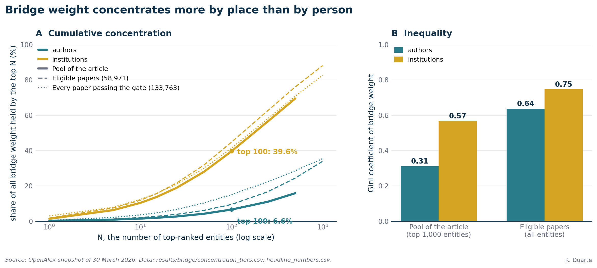
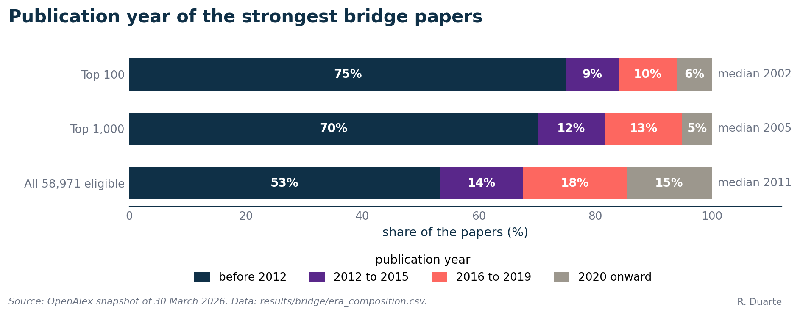

# S5. The bridge builders: papers, authors and institutions (Figure 3)

This supplement backs Figure 3 and paragraphs 11 to 14 of the article. I show how a paper is scored as a bridge between neuroscience and AI, how paper scores become author and institution scores, how I verified the affiliations, and how concentrated the bridge weight is. I find that the strongest bridges are an old canon plus general-purpose software, and the institutions column is led by Alphabet and Microsoft.

**What this supplement covers**

- Ranking by the harmonic mean of citations from each field, and the 1,000 and 2 against 100 and 100 example: section 1.1.
- "Roughly 59,000 papers with at least 5 citations from each side": 133,763 pass the gate, 58,971 remain after the eligibility filters (section 1.2).
- The Figure 3 caption, the hand-verified affiliations and the tools-and-concepts split: sections 1.4 to 1.6 and 2.1 to 2.5.
- Alphabet and Microsoft at the top of the institutions, the most AI-leaning entities of the figure: section 2.4.
- The top 100 institutions hold nearly 40 percent of bridge weight, the top 100 authors below 7 percent: 39.64 and 6.63 percent, section 2.6.

## 1. Methods

All numbers come from the OpenAlex snapshot of 30 March 2026 with the field labels of [S1](S1-data-and-classification.md). The tables are in [`results/bridge/`](../../results/bridge/), and the definitions in [METHODS section 8](../METHODS.md#8-bridge-works).

### 1.1 The bridge score

For each cited paper I count the citations it receives from neuroscience papers (`c_neuro`) and from AI papers (`c_ai`), ignoring citations from other fields. The bridge score is the harmonic mean of the two:

```
B(p) = 2 * c_neuro(p) * c_ai(p) / (c_neuro(p) + c_ai(p))
```

B is never larger than twice the smaller count, so a paper cannot score well on one side's attention alone. BRATS is cited 2,547 times by neuroscience and 1,952 times by AI, so B is 2,210.16, close to the arithmetic mean of 2,249.5. The article's illustration, a paper cited 1,000 times by AI and twice by neuroscience, scores 3.99, against 100 for one cited 100 times by each side (the arithmetic mean would give 501 and 100). I compute B on raw counts and do not correct it for the sizes of the two fields ([S3](S3-counts-and-field-sizes.md)). I color the bars of Figure 3 by the neuroscience share `c_neuro / (c_neuro + c_ai)`: teal when citations come almost all from AI papers, gold when they come almost all from neuroscience papers. It describes who cites the work, not its field.

### 1.2 Which papers are eligible

My candidates are the 133,763 papers with at least five citations from each side (the 5-and-5 gate). Two rules, in this order, give the 58,971 papers I rank, the article's "roughly 59,000".

| Step | Papers remaining | Removed |
|-|-:|-:|
| gate: at least 5 classified citations from each side | 133,763 | 0 |
| own field label neuro or ai (drops other and unknown) | 59,038 | 74,725 |
| classified citations under the 10,000 ceiling | 58,971 | 67 |

The label rule removes papers that OpenAlex files under other fields, among them a block of plasma-physics papers from a fusion experiment that collect thousands of citations from papers labeled neuroscience and AI. My ceiling drops 67 papers with 10,000 or more classified citations, 66 labeled AI and one neuroscience. They are general-purpose machine-learning references such as ResNet, scikit-learn, LSTM and Adam, whose citations come mostly from AI papers (a neuroscience share between 0.03 and 0.25 for the first 19; [`ceiling_effect_top40.csv`](../../results/bridge/ceiling_effect_top40.csv)). I chose 10,000 as a round number and tested no other value; [S6](S6-citation-age.md) shows rankings without the ceiling. I did not vary the threshold of five, and it does not affect the top of the ranking, since a paper with B above 1,396 has more than 698 citations from each field.

For the papers column of Figure 3 I then keep only OpenAlex types article and review, drop book records, empty and duplicate titles, and take the first fifteen ([`s1_eligibility_check.csv`](../../results/bridge/s1_eligibility_check.csv)).

### 1.3 Authors and institutions

An author's bridge weight is the sum of B over the bridge papers on which the author is credited, and an institution's the sum over the papers that carry an affiliation to it. I count a paper in full for every author and institution on it, and once per institution however many of its authors share it. Authors and institutions other than the corporate groups are summed over the top 5,000 eligible papers by B (at least two papers for an author, five for an institution). OpenAlex lists Google, DeepMind, Microsoft and Meta as several institutions each, so for Figure 3 I merged them into three parent groups, Alphabet (Google + DeepMind), Microsoft and Meta, and summed these over every paper that passes the gate. Company rows and university rows therefore rest on different paper sets, which I flag because it matters only for the order across the two kinds of row (section 3). Institution credit follows the affiliations printed on each paper, so a researcher who moved is credited to the place where the paper was written.

### 1.4 How the affiliations were verified

Figure 3 asserts employment relationships between fifteen researchers and institutions, so I checked each by hand against ORCID employment records, institutional pages, Google Scholar, homepages or CVs and LinkedIn, in that order of priority. No line comes from the OpenAlex field `last_known_institutions`, which gave name collisions. That gives 26 edges, 10 current and 16 past, with roles and dates in [`author_institution_edges.csv`](../../results/bridge/author_institution_edges.csv); three dates remain uncertain (Hinton's start at San Diego, Fischl's MIT status, the end of Avants's Penn appointment). Only research affiliations at the 15 institutions shown can appear, so some current employers are absent. The four rules are in [METHODS section 8](../METHODS.md#8-bridge-works), 8.6.

### 1.5 Tools and concepts

I coded each of the top fifteen by hand. A tool is software, a benchmark, an analysis method or a methods survey that both fields cite because they run it; a concept makes a claim about brains or minds: how neurons learn, how vision or attention work, how memory is limited. The coding is the `paper_class` column of [`table_s1_papers.csv`](../../results/bridge/table_s1_papers.csv) and agrees with the separate coding of [S6](S6-citation-age.md). By this rule 7 of the 15 are tools and 8 are concepts, the article's "about half". Three calls are arguable (Izhikevich's spiking-neuron model, the Itti, Koch and Niebur saliency model, hierarchical object-recognition models), and recoding them as tools would give 10 tools.

### 1.6 Concentration

To ask whether individuals or environments carry bridge work, I summed B over every author and institution credited on the 133,763 gate papers and computed the share of the total held by the top N. Because this pool still holds the fusion block, I dropped every author and institution that averages more than 400 units of B per paper (298 authors and 17 institutions); the result is the pool whose values the article reports. Institutions are not consolidated here ([METHODS section 8](../METHODS.md#8-bridge-works), 8.7).

## 2. Results

### 2.1 Article Figure 3


*Article Figure 3 (`figure2_v3`), as published. Color shows the share of citations from either field (teal for more from AI papers, gold for more from neuroscience papers). Papers are ranked on B, authors and institutions on the sum of B over their bridge papers. Data: `table_s1_papers.csv`, `table_s2_authors.csv`, `table_s3_institutions_consolidated.csv`, `author_institution_edges.csv` and `paper_author_links.csv` in `results/bridge/`.*

I draw four things in a way worth knowing. Author bars are drawn at least 55 percent of the longest bar so that names fit, so the bars of ranks 11 to 15 do not show their values (Table S5.2); ranks 1 to 10 are to scale. Badges beside the institution bars give the OpenAlex type (12 education, 2 industry, 1 facility). Between papers and authors, I let line thickness encode the author's position on the paper (last, first, middle). Between authors and institutions, a solid line is a current affiliation and a faded one a past affiliation.

### 2.2 The papers

| # | Paper | Year | Cited by neuroscience | Cited by AI | B | Share from neuroscience | Class |
|-:|-|-:|-:|-:|-:|-:|-|
| 1 | Multimodal Brain Tumor Image Segmentation Benchmark (BRATS), Menze et al. | 2014 | 2,547 | 1,952 | 2,210 | 0.57 | tool |
| 2 | Synaptic modifications in cultured hippocampal neurons (spike-timing plasticity), Bi and Poo | 1998 | 2,271 | 2,106 | 2,185 | 0.52 | concept |
| 3 | Simple model of spiking neurons, Izhikevich | 2003 | 1,680 | 2,235 | 1,918 | 0.43 | concept |
| 4 | Emergence of simple-cell receptive field properties by learning a sparse code, Olshausen and Field | 1996 | 2,004 | 1,832 | 1,914 | 0.52 | concept |
| 5 | Computational modeling of visual attention, Itti and Koch | 2001 | 1,750 | 1,948 | 1,844 | 0.47 | concept |
| 6 | The magical number seven, plus or minus two, Miller | 1994 | 2,126 | 1,563 | 1,802 | 0.58 | concept |
| 7 | Fitting linear mixed-effects models using lme4, Bates et al. | 2015 | 8,437 | 920 | 1,659 | 0.90 | tool |
| 8 | Segmentation of brain MR images through a hidden Markov random field model and the expectation-maximization algorithm, Zhang et al. | 2001 | 2,111 | 1,335 | 1,636 | 0.61 | tool |
| 9 | A survey on deep learning in medical image analysis, Litjens et al. | 2017 | 969 | 4,431 | 1,590 | 0.18 | tool |
| 10 | A model of saliency-based visual attention, Itti, Koch and Niebur | 1998 | 879 | 8,286 | 1,589 | 0.10 | concept |
| 11 | SciPy 1.0, Virtanen et al. | 2020 | 1,944 | 1,293 | 1,553 | 0.60 | tool |
| 12 | Short-term synaptic plasticity, Zucker and Regehr | 2002 | 2,787 | 1,035 | 1,509 | 0.73 | concept |
| 13 | An introduction to ROC analysis, Fawcett | 2005 | 885 | 3,938 | 1,445 | 0.18 | tool |
| 14 | Hierarchical models of object recognition in cortex, Riesenhuber and Poggio | 1999 | 1,690 | 1,205 | 1,407 | 0.58 | concept |
| 15 | XGBoost, Chen and Guestrin | 2016 | 798 | 5,559 | 1,396 | 0.13 | tool |

*Table S5.1. The 15 papers of Figure 3, ranked by B.*

By my coding, 7 of the 15 papers are tools and 8 are concepts. The 8 concepts date from 1994 to 2003 (OpenAlex dates Miller's paper by a 1994 reprint of the 1956 original), so Izhikevich's spiking-neuron model of 2003 is the most recent concept and SciPy 1.0 of 2020 the most recent tool. The median publication year of the top 15 is 2002. I find that scores fall in a narrow band, from 2,210 to 1,396, and the share of citations from neuroscience runs from 0.10 to 0.90. Among the 58,971 eligible papers, 48 have a B of at least 1,000.

### 2.3 The authors

| # | Author | Bridge papers | Sum of B | Cited by neuroscience | Cited by AI | Share from neuroscience |
|-:|-|-:|-:|-:|-:|-:|
| 1 | Yoshua Bengio | 41 | 9,937 | 6,739 | 76,514 | 0.08 |
| 2 | Christof Koch | 33 | 9,000 | 22,872 | 18,597 | 0.55 |
| 3 | Geoffrey E. Hinton | 34 | 8,807 | 5,505 | 58,177 | 0.09 |
| 4 | Wulfram Gerstner | 37 | 8,426 | 10,263 | 8,128 | 0.56 |
| 5 | Karl Friston | 46 | 7,909 | 55,276 | 4,444 | 0.93 |
| 6 | Aude Oliva | 32 | 7,312 | 8,303 | 23,659 | 0.26 |
| 7 | Stephen M. Smith | 16 | 6,263 | 33,904 | 5,767 | 0.85 |
| 8 | Peter Dayan | 28 | 5,963 | 23,209 | 7,815 | 0.75 |
| 9 | Eugene M. Izhikevich | 14 | 5,955 | 7,630 | 5,816 | 0.57 |
| 10 | Antonio Torralba | 25 | 5,715 | 4,111 | 31,713 | 0.11 |
| 11 | Laurent Itti | 16 | 5,386 | 4,344 | 14,998 | 0.22 |
| 12 | Henry Markram | 20 | 5,378 | 14,813 | 5,867 | 0.72 |
| 13 | Bruce Fischl | 20 | 5,338 | 42,203 | 3,246 | 0.93 |
| 14 | Brian Avants | 10 | 5,226 | 7,257 | 4,315 | 0.63 |
| 15 | Bruno A. Olshausen | 12 | 5,076 | 7,067 | 4,806 | 0.60 |

*Table S5.2. Authors ranked by the sum of B over their bridge papers in the top 5,000 eligible papers, with at least two papers each.*

I read the share-from-neuroscience column as showing the spread. Bengio, Hinton and Torralba sit at 0.08 to 0.11, with roughly eight to eleven AI citations for every neuroscience citation; Friston and Fischl sit at 0.93; Koch, Gerstner, Izhikevich and Olshausen, at 0.55 to 0.60, are the closest to balance. I conclude that a high bridge weight does not require a balanced personal profile, only individual papers that both fields read. I note that Aude Oliva, whom paragraph 13 lists among the computational neuroscientists, ranks 6th with 32 bridge papers and a sum of 7,312, ahead of Stephen Smith (6,263) and behind Karl Friston (7,909); 26 percent of the citations to her papers come from neuroscience. Full credit favors authors on large collaborations: the 68-author BRATS paper alone contributes 2,210 of Avants's 5,226.

### 2.4 The institutions

| # | Institution | Type | Bridge papers | Sum of B | Share from neuroscience |
|-:|-|-|-:|-:|-:|
| 1 | Alphabet (Google + DeepMind) | company | 924 | 63,142 | 0.09 |
| 2 | Microsoft | company | 712 | 35,557 | 0.05 |
| 3 | Massachusetts Institute of Technology | education | 220 | 35,338 | 0.55 |
| 4 | University of California, Berkeley | education | 138 | 27,774 | 0.23 |
| 5 | Harvard University | education | 173 | 27,390 | 0.80 |
| 6 | University College London | education | 165 | 23,553 | 0.79 |
| 7 | Stanford University | education | 153 | 23,449 | 0.33 |
| 8 | University of Oxford | education | 92 | 16,769 | 0.50 |
| 9 | Carnegie Mellon University | education | 99 | 16,748 | 0.25 |
| 10 | University of California, San Diego | education | 100 | 16,125 | 0.75 |
| 11 | California Institute of Technology | education | 83 | 15,264 | 0.49 |
| 12 | University of Toronto | education | 77 | 15,059 | 0.18 |
| 13 | University of Pennsylvania | education | 70 | 13,500 | 0.62 |
| 14 | École Polytechnique Fédérale de Lausanne | education | 70 | 13,195 | 0.46 |
| 15 | Howard Hughes Medical Institute | facility | 98 | 12,664 | 0.89 |

*Table S5.3. Institutions with the corporate groups consolidated (section 1.3). Company rows sum over all 133,763 papers that pass the gate, the other rows over the top 5,000 eligible papers, so paper counts compare within a row type only.*

In my ranking Alphabet (Google + DeepMind) and Microsoft hold the first two places, with a summed B of 63,142 over 924 bridge papers and 35,557 over 712, and I note that MIT, Berkeley, Harvard, UCL and Stanford follow in places 3 to 7. I also find the two companies the most AI-leaning institutions: Microsoft has 0.05 of its citations from neuroscience and Alphabet 0.09, against 0.18 for the University of Toronto, the next lowest. Across all 45 bars of Figure 3, Microsoft (0.046) has the lowest neuroscience share, followed by Bengio (0.081), Alphabet (0.085) and Hinton (0.086).

### 2.5 The lines between authors and institutions

| # | Author | Current, drawn solid | Past, drawn faded |
|-:|-|-|-|
| 1 | Yoshua Bengio | none | MIT |
| 2 | Christof Koch | none | MIT, Caltech |
| 3 | Geoffrey E. Hinton | U Toronto | UC San Diego, CMU, UCL, Alphabet |
| 4 | Wulfram Gerstner | EPFL | UC Berkeley |
| 5 | Karl Friston | UCL | none |
| 6 | Aude Oliva | MIT | Harvard |
| 7 | Stephen M. Smith | Oxford | none |
| 8 | Peter Dayan | none | UCL, MIT, U Toronto |
| 9 | Eugene M. Izhikevich | none | none |
| 10 | Antonio Torralba | MIT | none |
| 11 | Laurent Itti | none | Caltech |
| 12 | Henry Markram | EPFL | none |
| 13 | Bruce Fischl | Harvard, MIT | none |
| 14 | Brian Avants | none | U Penn |
| 15 | Bruno A. Olshausen | UC Berkeley | Caltech, MIT |

I draw ten current and sixteen past edges. Bengio, Koch, Dayan, Itti and Avants have no solid line because their current employers are not among the fifteen institutions, and Izhikevich has no line at all. I take institution rank from paper affiliations, not from where the fifteen authors work, so an institution can rank on volume and have no author line: HHMI has none, and the University of Pennsylvania only a faded one. Eight paper-to-author lines come from 6 papers (papers 1, 3, 4, 5, 8 and 10 of Table S5.1 have an author among the fifteen shown); they are in [`paper_author_links.csv`](../../results/bridge/paper_author_links.csv).

### 2.6 The concentration of bridge weight



*Figure S5.1 (`figure_s5_concentration`). A: share of all bridge weight held by the top N authors (teal) and institutions (gold), log axis. The thick lines are the pool of the article (section 1.6); the dashed and dotted lines are the other pools of the table below. B: Gini coefficient of bridge weight, for the top 1,000 entities of the article's pool and for every entity of the 58,971 eligible papers. Data: `results/bridge/concentration_tiers.csv`, `headline_numbers.csv`.*

The top 100 institutions hold 39.64 percent of all bridge weight and the top 100 authors 6.63 percent, the article's "nearly 40 percent" and "below 7 percent".

| Top N | Authors (%) | Institutions (%) |
|-:|-:|-:|
| 1 | 0.27 | 1.41 |
| 10 | 1.52 | 10.43 |
| 50 | 4.28 | 28.08 |
| 100 | 6.63 | 39.64 |
| 500 | 15.88 | 69.48 |
| Entities in pool | 80,898 | 5,641 |

I measure inequality with the Gini coefficient (0 if everyone holds the same, 1 if one holds everything); it is 0.311 for the top 1,000 authors and 0.568 for the top 1,000 institutions of this pool; over every entity of the eligible papers it is 0.64 and 0.75. Top-100 shares depend on the pool of papers, and the other pools of [`concentration_tiers.csv`](../../results/bridge/concentration_tiers.csv) give higher values for both:

| Pool of papers | Papers | Top 100 authors (%) | Top 100 institutions (%) | Institutions : authors |
|-|-:|-:|-:|-:|
| Pool of the article | 133,763 minus entities above 400 B per paper | 6.63 | 39.64 | 6.0 |
| Eligible papers | 58,971 | 9.53 | 44.82 | 4.7 |
| Papers with a neuroscience or AI label | 59,038 | 12.53 | 46.11 | 3.7 |
| Every paper passing the gate | 133,763 | 15.01 | 41.42 | 2.8 |

In every pool I find that the top 100 institutions hold 2.8 to 6.0 times the share of the top 100 authors, so the difference between the two levels does not depend on the pool.

### 2.7 Beyond the top 15



*Figure S5.2 (`figure_s5_eras`). Share of the top 100, the top 1,000 and all 58,971 eligible papers ranked by B, by publication year, before the display filters of section 1.2. Data: `results/bridge/era_composition.csv`.*

Among the 1,000 strongest eligible papers, 701 (70.1 percent) were published before 2012 and 51 (5.1 percent) in 2020 or later; the median year is 2005, against 2011 for the eligible pool as a whole. To me the canon is old, and the pattern holds beyond the fifteen papers of Figure 3.

| Tier of the 58,971 eligible papers, ranked by B | Papers | Median year | Before 2012 | 2012 to 2015 | 2016 to 2019 | 2020 onward |
|-|-:|-:|-:|-:|-:|-:|
| Top 100 | 100 | 2002 | 75 (75.0%) | 9 (9.0%) | 10 (10.0%) | 6 (6.0%) |
| Top 1,000 | 1,000 | 2005 | 701 (70.1%) | 115 (11.5%) | 133 (13.3%) | 51 (5.1%) |
| All eligible papers | 58,971 | 2011 | 31,459 (53.3%) | 8,412 (14.3%) | 10,449 (17.7%) | 8,651 (14.7%) |

## 3. Caveats

Citation is not influence. My score rewards a paper for being cited by both fields, and cannot separate the paper that gave a field an idea from the one that gave it a function call. It measures works that both fields cite heavily, not what AI takes from neuroscience ([S4](S4-what-ai-cites.md)), and it favors old papers, which had time to accumulate citations ([S6](S6-citation-age.md)).

Two bases are mixed in the institutions column of Figure 3: company rows are summed over all 133,763 papers passing the gate and university rows over the top 5,000 eligible papers, so the order across the two kinds of row depends on that choice. The concentration figures of 39.64 and 6.63 percent are values of the pool described in section 1.6; the other pools give authors 9.53, 12.53 and 15.01 percent and institutions 44.82, 46.11 and 41.42 percent.

I inherit author disambiguation from OpenAlex and spot-checked it only on the canonical names. I checked the lines between authors and institutions by hand, not the institution bars. Because I give full credit to every author and institution on a paper, large collaborations inflate their totals. The thresholds (five citations per side, 10,000 for the ceiling), the paper-type filter, the affiliation rules and the tool and concept coding are choices; other rules would give a different figure from the same data. I would not draw conclusions about recent bridge papers, since 2024 and 2025 are provisional.

## 4. Reproduce

```bash
./reproduce.sh figures                          # Figure 3, Figures S5.1 and S5.2, from results/bridge only
./reproduce.sh numbers                          # every number here against the committed results
.venv/bin/python -m pytest -q tests/test_bridge_tables.py
.venv/bin/python -m neuroai_cn.analysis.export_bridge_tables   # snapshot: Tables S5.1 to S5.3, edges, links, tiers
.venv/bin/python -m neuroai_cn.analysis.export_bridge_pool     # snapshot: eligibility funnel, ceiling, eras
```

The figures and tests read only the files committed under `results/bridge/`; the two exports need the snapshot and its derived tables under `NEUROAI_DATA` (`src/neuroai_cn/config.py`). Definitions are in [METHODS section 8](../METHODS.md#8-bridge-works).
