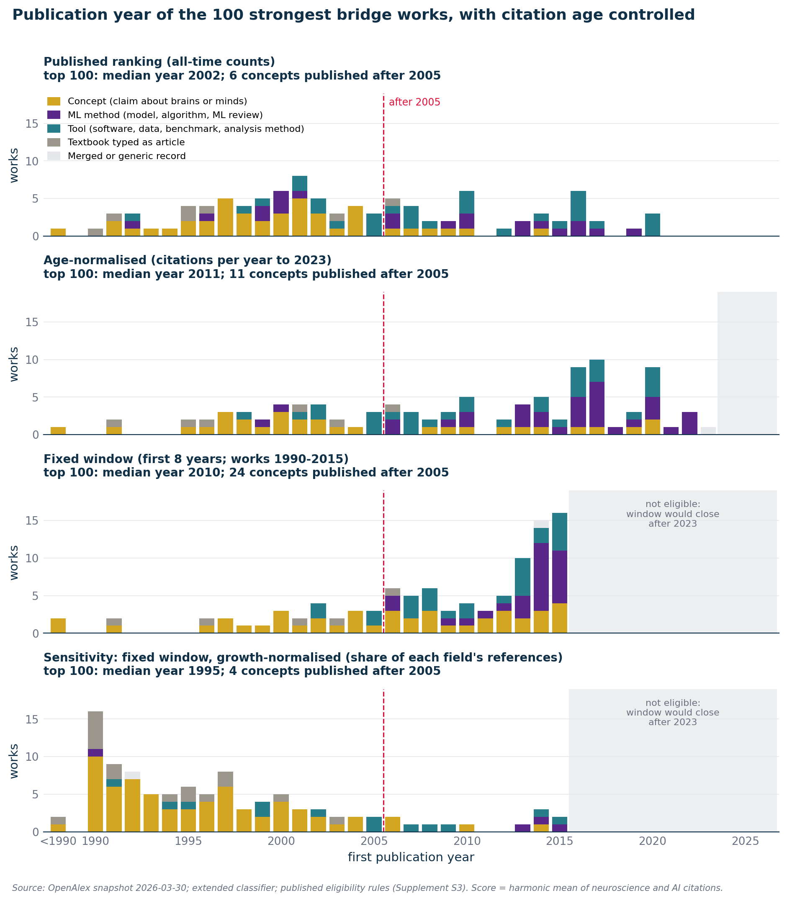

# S6. Does citation age explain the bridge canon?

This supplement asks how the bridge ranking of the article depends on the age of the papers: newer papers cannot yet have collected as many citations as papers that have had a quarter century to do so, so a ranking by accumulated citations puts older work first. I re-ranked the same papers with the same eligibility rules and changed only the score, in several ways that control for age. In short, in the all-time ranking of Figure 3 the most recent conceptual bridge work in the top 15 is Izhikevich 2003. At equal age, newer conceptual works such as Yamins et al. 2014 reach the top ranks; Yamins ranks 9th over its first eight years. Once I scale each citation by the growth of the citing literature, nothing published after 2004 reaches the top 50 of either ranking so scaled (one variant of the scaling is an exception, section 4.6).

## 1. What the article says

Paragraph 12 ends with these sentences:

> The most recent of these bridgeworks is from 2003. This does not, however, indicate the influence of neuroscience on AI is waning. AI is now citing more neuroscience than ever before. However, the last two decades have not seen a new landmark paper that both fields treat as essential.

Paragraph 16 says:

> Citation patterns suggest that AI continues to cite newer neuroscience papers. But these papers do not yet qualify as "bridge works"—foundational discoveries highly cited by both fields.

"These bridge works" in paragraph 12 are the conceptual half of the top 15 of Figure 3: the papers that make a claim about brains or minds, as opposed to the software and benchmarks that make up the other half ([S5](S5-bridge-builders.md), sections 3.6 and 4.1). The question I examine here is whether newer papers would struggle to get enough citations to qualify as highly cited compared with papers that have had 25 years to accrue them. The bridge score adds up every citation a paper ever received, so a paper from 1998 has had 28 years to collect them in this snapshot and a paper from 2020 has had about six. Both statements of the article, in paragraphs 12 and 16, concern that all-time ranking.

## 2. Data

I use the data of [S5](S5-bridge-builders.md): the March 2026 OpenAlex snapshot (the local copy is dated 2026-03-30), the extended field classifier of [S1](S1-data-and-classification.md), and the 133,763 candidate papers that have at least five classified citations from each side. A citation is classified when the citing paper carries the neuroscience or the AI label. What is new is that I extracted, for every candidate, the number of classified citations it received from each field in each citing year from 1990 to 2026, instead of only the all-time totals. Those per-year counts are heavy (about 70 MB together with the metadata and the full rankings table), so I keep them outside the repository.

All committed files are in [`results/citation_age/`](../../results/citation_age). [`citing_volume.csv`](../../results/citation_age/citing_volume.csv) gives, for each citing field and year, the number of classified papers and the number of references they made to any cited work; I use it for the growth-normalized variants. Every variant's top 100 I committed as `ranking_<name>_top100.csv` (11 files). The hand coding of section 3.4 is in [`classification.csv`](../../results/citation_age/classification.csv), and the printed Table S1 that my reproduction check aims at is in [`table_s1_reference.csv`](../../results/citation_age/table_s1_reference.csv).

In the controlled rankings I stop everything at citing year 2023, because the 2024 and 2025 values of this snapshot are provisional ([S2](S2-citation-flow.md), section 4.4). By contrast, the published ranking counts citations through 2026.

## 3. Method

### 3.1 What I changed and what I left alone

I changed the score and nothing else. The candidate pool, the field labels, the eligibility rules of [S5](S5-bridge-builders.md) section 3.2 and the harmonic mean all stay as published, and I apply them identically in every ranking: the paper's own field label must be neuroscience or AI; its all-time classified citations must be under 10,000 (the E2 ceiling); its OpenAlex type must be article or review; it must not come from an ebook platform or book series; it needs a title and must not be one of the book titles I listed by hand; and when several records share a normalized title I keep the highest-scoring one. For a paper p the score is still

```
score(p) = 2 * a(p) * b(p) / (a(p) + b(p))
```

where in the published ranking a is the all-time count of citations from neuroscience papers and b the all-time count from AI papers. Each control replaces a and b by an age-controlled quantity, and I leave the formula alone. I keep the ceiling defined on all-time counts in every ranking except two variants that drop it.

### 3.2 The five controls

I use the controls in five groups. In every window I start at the year before publication, so that online-first versions are not penalized. Citations dated earlier than that cannot have been received after publication; they come from reprints and merged records that absorbed an older work's citations, and counting them would let such a record bank decades of credit. In my data these pre-publication citations are rare: they make up 2.16 percent of all classified citations in the pool.

1. Published, all-time counts. Baseline: Table S1 of the article. I also keep a version restricted to works with an OpenAlex publication year of 1990 through 2015, to separate the effect of the counting window from the effect of the set of works that the window ranking can contain.
2. Citations per year to 2023. For a work published in year y, the citations from each field dated in citing years y - 1 through 2023, divided by 2023 - y + 1, the number of calendar years since publication. Into this ranking I admit works published up to 2023.
3. An equal 8-year window. Citations from each field dated in citing years y - 1 through y + 8. Into it I admit works published 1990 through 2015, so that every window closes by 2023. Counted in calendar years, the window runs from one year before publication through eight years after it.
4. Shorter windows. Seven years after publication (the other possible reading of "first 8 years", counting the publication year itself as the first) for works of 1990 through 2015, and five years after publication for works of 1990 through 2018, which reaches newer works at the cost of a shorter look.
5. Growth-normalized variants of the per-year rate and the 8-year window. Here I divide each citation by the number of references that the citing field made in the citing year, in millions. A citation from an AI paper in 2014 then counts as the share of all AI references that year that it makes up, not as one unit.

Three guard variants complete my set: the per-year rate and the 8-year window without the E2 ceiling, and the per-year rate with works whose own field label is "unknown" admitted.

Two controls, the per-year rate and the 8-year window, are my direct answer to the question of age. I added the growth-normalized variants afterward, because the equal-window result depends on how the literatures grew (next subsection). For the other variants I have no dated record of whether I fixed them before or after seeing the first rankings, so I treat all of them as sensitivity analyses and not as pre-specified tests.

### 3.3 Why the growth-normalized variants over-correct

An equal window equalizes exposure time but not the size of the audience. Both citing literatures grew a great deal. Here are the references made by classified papers in selected years, with the weight that growth normalization gives one citation (a million divided by the reference count).

| Citing year | AI references | Weight per AI citation | Neuroscience references | Weight per neuroscience citation |
|-:|-:|-:|-:|-:|
| 1990 | 119,184 | 8.39 | 657,528 | 1.52 |
| 1998 | 273,816 | 3.65 | 1,034,097 | 0.97 |
| 2001 | 348,524 | 2.87 | 1,270,296 | 0.79 |
| 2002 | 803,567 | 1.24 | 1,423,119 | 0.70 |
| 2014 | 1,993,334 | 0.50 | 3,361,623 | 0.30 |
| 2023 | 5,491,223 | 0.18 | 5,077,910 | 0.20 |

In 2014 the AI literature made 7.28 times as many references as in 1998, and the neuroscience literature 3.25 times as many. A raw equal window therefore favors recent works, since the same share of attention yields more citations. Dividing by the citing volume removes that advantage, but I find that it over-corrects in the other direction, for three reasons.

First, it treats all growth in the citing field as lost attention. A bridge work's neuroscience citations do not shrink because unrelated parts of AI grow, yet the denominator counts those parts. Second, the early denominators are small partly because many references of the early years point at works absent from the database ([S2](S2-citation-flow.md), section 5). A citation from an AI paper of 1990 weighs 16.72 times as much as one from 2014, and for neuroscience the factor is 5.11. Third, the AI series has a step. Between 2001 and 2002 the number of classified AI papers rises from 55,150 to 100,726, and 38,349 of the 45,576 added papers are records with no venue recorded ([`ai_works_2000_2004_breakdown.csv`](../../results/flow/ai_works_2000_2004_breakdown.csv); see [S1](S1-data-and-classification.md)). References counted rise from 348,524 to 803,567, so a citation from an AI paper of 2001 weighs 2.31 times one of 2002 for no reason connected with attention.

So, as I see it, the two families of control err in opposite directions. Raw counts in an equal window favor newer work, and growth-normalized counts favor older work. I read the pair as the two ends of a range, not as two answers of which one is right.

### 3.4 Tools, concepts and the other classes

To ask what is the most recent "bridge work" I need to say which of the ranked works are conceptual, so I coded by hand every work in the heads of the 11 rankings, 271 works in all, in [`classification.csv`](../../results/citation_age/classification.csv). My rule has five classes.

- Concept: a claim about brains or minds. This is the article's "genuine bridge work". It includes cognitive-science papers (a model of working memory, a theory of sentence comprehension), not only neuroscience in the strict sense.
- Method: a new machine-learning model, algorithm or architecture, or a review of machine-learning methods.
- Tool: software, data, a benchmark, an analysis method, or a methods tutorial or survey that both fields cite because they run it.
- Book: a textbook or handbook that OpenAlex types as an article.
- Artifact (class `artefact` in the file): not a single work, such as a merged record, a generic record or a whole proceedings volume.

The coding gives 112 concepts, 69 methods, 64 tools, 21 books and 5 artifacts. What counts for me is what the paper offers a reader, as in [S5](S5-bridge-builders.md) section 3.6, and applied to the top 15 of Table S1 this rule gives the same 8 concepts and 7 tools as the table of the article. Machine-learning methods such as the residual-network or dropout papers have no place in the article's two-way split. I keep "method" apart, and section 4.3 shows what changes if methods are counted as bridge works.

Real limits attach to my coding. Only I coded, with no second rater. For 11 works the file records a borderline call in its notes, for example Brooks's "Intelligence without representation" and the saliency review of Borji and Itti (concept or tool). I recoded all 11 as non-concepts and recomputed the answer for the published, per-year and 8-year rankings; the most recent concept in the top 15 and in the top 50 does not change in any of the three.

For recency questions I use the first publication year, which differs from OpenAlex's year for 24 of the 271 works, mostly reprints and records created later. OpenAlex dates Miller's "magical number seven" to a 1994 reprint of the 1956 paper, and Ebbinghaus's *Memory* to a 2013 reprint of the 1885 book. "After 2005" means a first publication year of 2006 or later.

## 4. Results

### 4.1 The published ranking: exact, and not blind to recent work

In the published ranking the top 15 holds 8 concepts and 7 tools. Its concepts span Miller's 1956 paper (dated 1994 in Figure 3 and Table S1, a reprint) through Izhikevich's spiking-neuron model of 2003, which is the most recent concept at rank 3. It stays the most recent concept through the top 25, and in the top 50 the most recent is a second Izhikevich paper from 2004, at rank 46. No concept published after 2005 is in the top 50, and 6 are in the top 100 (the first is Friston's free-energy principle at rank 51). Hence "the most recent of these bridgeworks is from 2003" is exact for the ranking shown.

Recent work is not shut out of the same ranking. Five of its top 15 are tools published between 2014 and 2020: the BRATS benchmark (2014), lme4 (2015), XGBoost (2016), the deep-learning survey of Litjens and colleagues (2017) and SciPy 1.0 (2020). Within about six years of appearing, a paper from 2020 reached the top 15, so in my reading age is not an absolute barrier. The question of age concerns concepts, so in the rest of this section I ask about them.

### 4.2 Where the published top 15 land under each control

Each of the 15 papers of Table S1 appears below with its rank under the controls. Ranks are within the eligible works of that ranking. Papers published after 2015 cannot enter an 8-year window ranking.

| Published # | Work | First year | Class | Per-year rate | 8-year window | 8-year window, growth-normalized | Per-year rate, growth-normalized |
|-:|-|-:|-|-:|-:|-:|-:|
| 1 | Menze et al., BRATS benchmark | 2014 | tool | 2 | 1 | 7 | 3 |
| 2 | Bi & Poo, spike-timing plasticity | 1998 | concept | 15 | 48 | 11 | 5 |
| 3 | Izhikevich, simple model of spiking neurons | 2003 | concept | 13 | 22 | 38 | 12 |
| 4 | Olshausen & Field, sparse coding | 1996 | concept | 23 | 60 | 8 | 6 |
| 5 | Itti & Koch, computational modelling of visual attention | 2001 | concept | 16 | 10 | 9 | 7 |
| 6 | Miller, magical number seven | 1956 | concept | 26 | 18 | 1 | 2 |
| 7 | Bates et al., lme4 | 2015 | tool | 4 | 2 | 6 | 4 |
| 8 | Zhang, Brady & Smith, HMRF brain MR segmentation | 2001 | tool | 24 | 143 | 283 | 16 |
| 9 | Litjens et al., DL in medical image analysis survey | 2017 | tool | 3 | not eligible | not eligible | 8 |
| 10 | Itti, Koch & Niebur, saliency model | 1998 | concept | 29 | 138 | 167 | 31 |
| 11 | Virtanen et al., SciPy 1.0 | 2020 | tool | 1 | not eligible | not eligible | 1 |
| 12 | Zucker & Regehr, short-term synaptic plasticity | 2002 | concept | 42 | 823 | 484 | 55 |
| 13 | Fawcett, ROC analysis | 2005 | tool | 19 | 24 | 99 | 29 |
| 14 | Riesenhuber & Poggio, hierarchical object recognition | 1999 | concept | 31 | 69 | 23 | 15 |
| 15 | Chen & Guestrin, XGBoost | 2016 | tool | 11 | not eligible | not eligible | 27 |

Years are first publication years (Miller's paper appears under 1956, and OpenAlex's 1994 is a reprint). Two patterns stand out to me. First, the older canon survives the per-year control: all eight concepts remain in the top 50, though they fall to ranks 13 to 42, where they were 2 to 14. Second, several canon works are slow burners, whose position rests on decades of citation. In their first 8 years Bi and Poo rank 48th and Olshausen and Field 60th, against 2nd and 4th overall, and Zucker and Regehr rank 823rd against 12th. For these works the lead rests on citations that kept accumulating for decades.

What takes the places of the older concepts shows in the top 15 of the per-year ranking and of the 8-year window.

Citations per year to 2023 (score is the harmonic mean of the two per-year counts; "Published #" is the rank of the same record in Table S1's ranking):

| # | Work | Year | Class | neuro (citations per year) | AI (citations per year) | Score | Published rank |
|-:|-|-:|-|-:|-:|-:|-:|
| 1 | Virtanen et al., SciPy 1.0 | 2020 | tool | 258 | 164 | 200 | 11 |
| 2 | Menze et al., BRATS benchmark | 2014 | tool | 170 | 134 | 150 | 1 |
| 3 | Litjens et al., DL in medical image analysis survey | 2017 | tool | 82 | 434 | 138 | 9 |
| 4 | Bates et al., lme4 | 2015 | tool | 650 | 73 | 131 | 7 |
| 5 | Harris et al., NumPy | 2020 | tool | 109 | 122 | 115 | 43 |
| 6 | Havaei et al., DNN brain tumour segmentation | 2016 | tool | 141 | 83 | 104 | 41 |
| 7 | He et al., PReLU / delving deep into rectifiers | 2015 | method | 52 | 864 | 98 | 36 |
| 8 | Chollet, Xception | 2017 | method | 51 | 797 | 95 | 28 |
| 9 | Kamnitsas et al., DeepMedic lesion segmentation | 2016 | tool | 89 | 102 | 95 | 47 |
| 10 | Schmidhuber, deep learning in neural networks: overview | 2014 | method | 53 | 441 | 94 | 33 |
| 11 | Chen & Guestrin, XGBoost | 2016 | tool | 52 | 396 | 92 | 15 |
| 12 | Silver et al., AlphaGo | 2016 | method | 46 | 803 | 86 | 60 |
| 13 | Izhikevich, simple model of spiking neurons | 2003 | **concept** | 69 | 86 | 77 | 3 |
| 14 | Shorten & Khoshgoftaar, data augmentation survey | 2019 | method | 41 | 431 | 75 | 73 |
| 15 | Bi & Poo, spike-timing plasticity | 1998 | **concept** | 78 | 70 | 74 | 2 |

Equal 8-year window (works 1990 to 2015; counts are citations within the window):

| # | Work | Year | Class | neuro (citations in window) | AI (citations in window) | Score | Published rank |
|-:|-|-:|-|-:|-:|-:|-:|
| 1 | Menze et al., BRATS benchmark | 2014 | tool | 1,364 | 1,077 | 1,204 | 1 |
| 2 | Bates et al., lme4 | 2015 | tool | 5,850 | 657 | 1,181 | 7 |
| 3 | He et al., PReLU / delving deep into rectifiers | 2015 | method | 466 | 7,772 | 879 | 36 |
| 4 | Schmidhuber, deep learning in neural networks: overview | 2014 | method | 469 | 4,013 | 840 | 33 |
| 5 | Chang & Lin, LIBSVM (duplicate record) | 2008 | tool | 304 | 2,515 | 542 | 34 |
| 6 | Bengio et al., representation learning review | 2013 | method | 247 | 3,973 | 465 | 58 |
| 7 | Hertz, Krogh & Palmer, theory of neural computation | 1991 (OA 1994) | book | 240 | 1,551 | 416 | 32 |
| 8 | Kingma & Welling, variational autoencoder | 2013 | method | 213 | 6,459 | 412 | 82 |
| 9 | Yamins et al., performance-optimized models predict higher visual cortex | 2014 | **concept** | 958 | 259 | 408 | 91 |
| 10 | Itti & Koch, computational modelling of visual attention | 2001 | **concept** | 342 | 384 | 362 | 5 |
| 11 | Graves et al., speech recognition with deep RNNs | 2013 | method | 190 | 3,382 | 360 | 137 |
| 12 | Jia et al., Caffe | 2014 | tool | 183 | 6,917 | 357 | 189 |
| 13 | Arbib (ed.), Handbook of brain theory and neural networks | 1996 | book | 347 | 294 | 318 | 38 |
| 14 | MacKay, information theory, inference and learning | 2003 (OA 2004) | book | 179 | 801 | 293 | 71 |
| 15 | Ashburner & Friston, unified segmentation | 2005 | tool | 656 | 186 | 290 | 55 |

Under the per-year rate the top 15 holds 8 tools, 5 methods and 2 concepts, with a median first publication year of 2016. Under the 8-year window it holds 5 tools, 5 methods, 3 books and 2 concepts, with a median of 2013. Machine-learning methods and software published from 2013 to 2020 push the older concepts down, and the median year moves from 2002 by more than a decade. That is the age effect, and I find it large.

### 4.3 The most recent concept under every ranking

For each ranking the table gives the number of concepts in its top 15, the most recent concept in the top 15 and in the top 50, the number of concepts published after 2005 in the top 50, and the rank of Yamins et al. 2014 ("Performance-optimized hierarchical models predict neural responses in higher visual cortex", PNAS), the best-placed recent concept under the equal windows. Because only the top 15 is fully coded for the two rankings without the E2 ceiling, I report no top 50.

| Ranking | Concepts in top 15 | Most recent concept, top 15 | Most recent concept, top 50 | Concepts after 2005, top 50 | Yamins 2014 rank |
|-|-:|-|-|-:|-:|
| Published (all-time counts) | 8 | Izhikevich, simple model of spiking neurons, 2003 (#3) | Izhikevich, which model for cortical spiking neurons, 2004 (#46) | 0 | 91 |
| Citations per year to 2023 | 2 | Izhikevich, simple model of spiking neurons, 2003 (#13) | Lillicrap et al., backpropagation and the brain, 2020 (#36) | 5 | 48 |
| Equal 8-year window (works 1990-2015) | 2 | Yamins et al., performance-optimized models predict higher visual cortex, 2014 (#9) | Kriegeskorte, DNNs as a framework for biological vision, 2015 (#21) | 12 | 9 |
| Published score, works 1990-2015 only | 9 | Izhikevich, simple model of spiking neurons, 2003 (#3) | Friston, free-energy principle, 2010 (#44) | 2 | 80 |
| 7-year window (works 1990-2015) | 2 | Yamins et al., performance-optimized models predict higher visual cortex, 2014 (#9) | Kriegeskorte, DNNs as a framework for biological vision, 2015 (#21) | 14 | 9 |
| 5-year window (works 1990-2018) | 1 | Hassabis et al., neuroscience-inspired AI, 2017 (#15) | Banino et al., grid-like representations in agents, 2018 (#41) | 11 | 27 |
| 8-year window, growth-normalized | 8 | Itti & Koch, computational modelling of visual attention, 2001 (#9) | Izhikevich, which model for cortical spiking neurons, 2004 (#50) | 0 | 87 |
| Per-year rate, growth-normalized | 7 | Izhikevich, simple model of spiking neurons, 2003 (#12) | Izhikevich, simple model of spiking neurons, 2003 (#12) | 0 | 69 |
| Per-year rate, no E2 ceiling | 0 | none | not coded | not coded | 69 |
| 8-year window, no E2 ceiling | 0 | none | not coded | not coded | 16 |
| Per-year rate, unknown-field works admitted | 2 | Izhikevich, simple model of spiking neurons, 2003 (#13) | Lillicrap et al., backpropagation and the brain, 2020 (#36) | 5 | 48 |
| 8-year window, growth-normalized, works from 1996 on | 7 | Itti & Koch, computational modelling of visual attention, 2001 (#6) | Yamins et al., performance-optimized models predict higher visual cortex, 2014 (#44) | not computed | 44 |

Reading down the table, I take away the following:

- Per-year rate: the most recent concept in the top 15 is still Izhikevich 2003, now at rank 13. Five concepts published after 2005 enter the top 50, the most recent being Lillicrap and colleagues' "backpropagation and the brain" (2020, rank 36).
- Equal windows: Yamins et al. 2014 is in the top 15 at rank 9 under both the 8-year and the 7-year window, with 12 and 14 post-2005 concepts in the top 50. With the 5-year window the only concept in the top 15 is Hassabis et al. 2017, "Neuroscience-inspired artificial intelligence", at rank 15, with 11 in the top 50, but that ranking sees only five years of each work.
- The published score restricted to the same works as the window ranking changes little (9 concepts in its top 15, Friston 2010 at rank 44 as the most recent concept in its top 50), so the shift in the equal-window ranking comes from the window and not from the choice of works.
- Admitting works whose own field label is unknown leaves the top 50 of the per-year ranking unchanged.
- Without the E2 ceiling no concept stays in the top 15 of either ranking. Of the top 15, 11 (per year) and 7 (8-year window) are works that the ceiling removes, such as ResNet, AlexNet and dropout, and the top 50 holds 20 and 9 of them. What the ceiling hides is the machine-learning workhorses, not recent concepts.

Concepts published after 2005 that reach the top 50 are these (first publication year, rank):

| Ranking | Concepts published after 2005 in the top 50 |
|-|-|
| Citations per year to 2023 | Lillicrap et al., backpropagation and the brain (2020, #36); Hassabis et al., neuroscience-inspired AI (2017, #38); Yamins & DiCarlo, goal-driven models of sensory cortex (2016, #43); Yamins et al., performance-optimized models predict higher visual cortex (2014, #48); Friston, free-energy principle (2010, #50) |
| Equal 8-year window (works 1990-2015) | Yamins et al., performance-optimized models predict higher visual cortex (2014, #9); Clark, whatever next? predictive brains (2013, #19); Kriegeskorte, DNNs as a framework for biological vision (2015, #21); DiCarlo, Zoccolan & Rust, how the brain solves object recognition (2012, #23); Lake, Salakhutdinov & Tenenbaum, human-level concept learning (2015, #29); Khaligh-Razavi & Kriegeskorte, deep supervised models explain IT (2014, #30); Torralba et al., contextual guidance of eye movements (2006, #31); Friston, free-energy principle (2010, #33); Eliasmith et al., large-scale model of the functioning brain (Spaun) (2012, #37); Güçlü & van Gerven, DNNs reveal ventral-stream gradient (2015, #42); Tenenbaum et al., how to grow a mind (2011, #47); Caporale & Dan, STDP review (2008, #50) |
| 5-year window (works 1990-2018) | Hassabis et al., neuroscience-inspired AI (2017, #15); Yamins & DiCarlo, goal-driven models of sensory cortex (2016, #16); Yamins et al., performance-optimized models predict higher visual cortex (2014, #27); Lillicrap et al., random feedback weights (feedback alignment) (2016, #33); Banino et al., grid-like representations in agents (2018, #41); Eliasmith et al., large-scale model of the functioning brain (Spaun) (2012, #44); Lake, Salakhutdinov & Tenenbaum, human-level concept learning (2015, #46); Huth et al., semantic maps in cortex (2016, #47); Marblestone, Wayne & Kording, integrating deep learning and neuroscience (2016, #48); Torralba et al., contextual guidance of eye movements (2006, #49); Wolfe & Horowitz, five factors guiding visual search (2017, #50) |

Of these, I count many as NeuroAI work on deep networks and the brain (Yamins, Kriegeskorte, Khaligh-Razavi and Kriegeskorte, Güçlü and van Gerven, Hassabis, Lillicrap). Others I count as theory (Friston, Clark, Tenenbaum and colleagues) or a neuroscience review (Caporale and Dan on spike-timing plasticity).

If machine-learning methods counted as bridge works, the answer would shift further. Under the per-year rate the top 15 would hold five methods published after 2005 (PReLU, Xception, Schmidhuber's overview, AlphaGo and a data-augmentation survey), and the most recent bridge work in it would be from 2019. The article files such works with the tools and I follow it. The published top 15 holds no method, so counting methods would change the per-year rate and the windows and not the published ranking.

### 4.4 What Yamins et al. 2014 shows

For me, Yamins and colleagues' paper is the clearest test case. All-time it has 1,432 citations from neuroscience papers and 376 from AI papers, and ranks 91st in the published ranking. In its first 8 years the counts are 958 and 259, about two thirds of what it has gathered, and its window score of 408 ranks 9th, just above Itti and Koch's attention model at rank 10. Per year to 2023 it is 48th. Its AI side is smaller than its neuroscience side by a factor of 3.7 in the window, and the harmonic mean punishes that imbalance: this is a neuroscience paper that AI reads, not a shared workhorse. And its rank depends on the control, 9th with raw counts in an equal window and 87th once each citation is scaled by the growth of the citing literature (section 4.6).

### 4.5 The publication years of the top 100



*Figure S6.1 (`fig_top100_years`). Number of works in the top 100 of each ranking by first publication year (the leftmost bar collects works from before 1990), stacked by hand-coded class: concept (gold), machine-learning method (purple), tool (teal), textbook typed as article (gray), merged or generic record (light gray). Top to bottom: the published ranking; citations per year to 2023; the equal 8-year window; the growth-normalized 8-year window. The dashed red line separates 2005 from 2006; gray shading marks years the ranking cannot contain because the window would close after 2023. The footer inside the image refers the eligibility rules to "Supplement S3"; they are described in S5. Data: `results/citation_age/ranking_{orig,rate,win8,win8_share}_top100.csv` and `classification.csv`; regenerated by `python -m neuroai_cn.analysis.citation_age.tables_and_figure`, which reads the heavy rankings table.*

The ranking here is the display-filtered ranking of [S5](S5-bridge-builders.md) (the eligibility rules and the display filters of its section 3.2), not the eligible pool counted in S5 section 4.8. The same information in numbers, with the median first publication year and the interquartile range (IQR, the middle half of the works):

| Ranking | Median (IQR) | After 2005 | Concepts | Concepts after 2005 | <1990 | 1990-95 | 1996-00 | 2001-05 | 2006-10 | 2011-15 | 2016-20 | 2021-26 |
|-|-|-:|-:|-:|-:|-:|-:|-:|-:|-:|-:|-:|
| Published (all-time counts) | 2002 (1998-2010) | 39 | 42 | 6 | 1 | 13 | 24 | 23 | 19 | 8 | 12 | 0 |
| Citations per year to 2023 | 2011 (2002-2017) | 67 | 30 | 11 | 1 | 4 | 14 | 14 | 17 | 13 | 32 | 5 |
| Equal 8-year window | 2010 (2005-2014) | 73 | 43 | 24 | 2 | 2 | 9 | 14 | 24 | 49 | 0 | 0 |
| 8-year window, growth-normalized | 1995 (1991-2000) | 12 | 66 | 4 | 2 | 49 | 25 | 12 | 6 | 6 | 0 | 0 |

Controlling age moves the median year of the top 100 from 2002 to 2011 for the per-year rate and to 2010 for the 8-year window, and the number of concepts published after 2005 from 6 to 11 and 24. Because the 8-year windows cannot contain works after 2015, the lower two panels of the figure are empty to the right, and the 49 works from 2011 to 2015 in the 8-year window pile up against that wall. Growth normalization goes the other way, to a median of 1995, with 49 of the 100 works first published from 1990 to 1995 and 16 of them in 1990 alone. That spike I read as the early-denominator problem of section 3.3: a weighting that gives 1990 citations 16.7 times the weight of 2014 ones produces it, and it does not mean that the canon peaked in 1990.

I coded only the heads of the sensitivity variants, so the table below uses OpenAlex's publication year, which differs from the first publication year for a handful of reprints. It shows the same direction for all 11 rankings.

| Ranking | Median publication year, top 100 | Works from 2006 on | Works from 2011 on |
|-|-:|-:|-:|
| Published (all-time counts) | 2002 | 39 | 20 |
| Citations per year to 2023 | 2011 | 68 | 50 |
| Equal 8-year window (works 1990-2015) | 2010 | 75 | 50 |
| Published score, works 1990-2015 only | 2001 | 32 | 9 |
| 7-year window (works 1990-2015) | 2012 | 77 | 55 |
| 5-year window (works 1990-2018) | 2016 | 92 | 85 |
| 8-year window, growth-normalized | 1995 | 12 | 6 |
| Per-year rate, growth-normalized | 2004 | 43 | 27 |
| Per-year rate, no E2 ceiling | 2014 | 72 | 58 |
| 8-year window, no E2 ceiling | 2012 | 79 | 56 |
| Per-year rate, unknown-field works admitted | 2011 | 68 | 50 |

### 4.6 What growth normalization does to the answer

In the growth-normalized 8-year window the top 15 holds 8 concepts, 4 tools and 3 books, and the most recent concept in it is Itti and Koch 2001, at rank 9. Among the top 50 the most recent is Izhikevich's 2004 paper, at rank 50. In the growth-normalized per-year rate, 7 of the top 15 are concepts, the most recent being Izhikevich 2003 at rank 12, and no concept after 2004 in its top 50. In both, the concepts that appear after 2005 are further down: Yamins et al. 2014 at rank 87 and 69, Hassabis et al. 2017 at rank 85 in the per-year version, and Lillicrap et al. 2020 at rank 97. Recent tools do well here as well: SciPy 1.0 is the first work of the growth-normalized per-year ranking.

Since the 1990 to 1995 works carry the artifact described above, I also re-ranked the growth-normalized window among works first published in 1996 or later. Again Itti and Koch 2001 is the most recent concept in its top 15, now at rank 6. Yamins et al. 2014 rises to rank 44 among these works, which is inside the top 50. This is the one place where "nothing after 2004 reaches the top 50" fails, so that statement is true for the two growth-normalized rankings as I defined them and not for every way of defining them. Another cut-off than 1996 would have been as defensible in my view.

### 4.7 The checks

Each check below except the last can fail. When one does, the script stops or records a failure, and the verifier then exits with an error.

| Check | What it asks | Result | What would make it fail |
|-|-|-|-|
| Per-year counts re-sum | Do the new per-year counts add up to the published all-time counts for every work? | 0 mismatches across 133,763 works | A different classifier or edge set; the script stops |
| Table S1 reproduced | Does the reproduced top 15 match the printed table in title, year, both counts and score, and the pipeline's own figure input by work identifier? | all 15 rows match, and the figure-input check passes | Any difference; the script stops |
| Admission gate non-binding | Could a work outside the pool, with at most 4 citations from some side, belong in a controlled top 100? | score at rank 100 is between 32.15 and 160.28 in the six controlled rankings, against a ceiling of 8 for excluded works | A rank-100 score of 8 or less |
| Unknown-field works | Does admitting works with no own field label change the per-year top 50? | no change | Any change of the top 50 |
| Independent counts check | Do my classified per-year counts ever exceed OpenAlex's own stored counts per year? | 561 work-years of 52 works, 2012 to 2023, 0 violations; the classified citations are a median of 52 percent of all citations | One violation |
| Citing-volume coverage | Does the volume table cover every row of the count table? | 0 rows missing | A missing citing field or year |
| Pre-publication scanner | Which records in a ranked head have more than 10 percent of their citations dated before their own publication? | 6 records flagged (below) | Nothing: it is a scan that lists records and cannot fail |

My independent check uses OpenAlex's stored `counts_by_year`, a different part of the database from the citation edges on which all my counts rest, and covers the top 25 of the published, per-year and 8-year rankings. It tests an inequality (a subset cannot exceed the whole), so it catches double counting or a wrong year, not undercounting. Six records are flagged: LIBSVM (a duplicate record carrying a wrong venue, 10 percent), a record titled "Science" with a generic identifier (85 percent), a survey of one-dimensional convolutional networks (13 percent), *The Elements of Statistical Learning* (13 percent), a fall-sensor paper (17 percent) and Ebbinghaus's *Memory* (43 percent). The scan reports and does not gate: the fall-sensor record and the record titled "Science" are coded as artifacts, so they cannot stand in for a recent paper, and Ebbinghaus's book carries its first publication year of 1885.

I also wrote a separate script (`verify`) that recomputes the number of concepts, the most recent concept per ranking, the publication-year table and the landing ranks from the committed CSV files alone, with no database, and exits with an error if any differ from `checks.json` and `summary.json`. It passes in the committed state.

### 4.8 What the data show

The results come down to four statements:

1. In the published ranking, the most recent conceptual bridge work in the top 15 of Figure 3 is Izhikevich 2003 at rank 3, and the most recent in the top 50 is from 2004. The top 15 holds 8 concepts and 7 tools, and five of the tools are from 2014 to 2020.
2. At equal age, newer conceptual work reaches the top. Yamins et al. 2014 ranks 9th in the first-8-years ranking and 9th in the 7-year one; Hassabis et al. 2017 ranks 15th in the 5-year one; per year, five concepts published after 2005 sit in the top 50.
3. Once citations are scaled by the growth of both literatures, nothing published after 2004 reaches the top 50 of either growth-normalized ranking, so the older canon keeps its lead in share of attention. That control over-corrects (section 3.3), and one of its variants puts Yamins et al. 2014 at rank 44.
4. In accumulated, size-uncorrected citations, no conceptual work published after 2003 is in the top 15. At equal age, Yamins et al. 2014 ranks 9th over its first eight years, and scaled for the growth of both literatures no work published after 2004 is in the top 50.

### 4.9 How this relates to S4

[S4](S4-what-ai-cites.md) looks at what AI cites in neuroscience, by the age and subfield of the cited paper, and supports the first sentence of paragraph 16, that AI continues to cite newer neuroscience. Mine is a statement of another kind. S4 describes the whole distribution of AI's citations, in which many recent papers each receive a few. The bridge ranking looks at the top of the distribution and needs both fields at once: the harmonic mean of two counts cannot exceed twice the smaller one, so a paper that AI cites often and neuroscience seldom scores low. I think both can be true. AI can cite recent neuroscience more than before while no recent paper has yet built up the counts from both sides that the top of the all-time ranking demands; the equal-age results above show where newer papers rank over a common window. S4 describes AI's side only; here I ask where the two sides meet.

## 5. Caveats and what this does not show

Ordered by weight, these are the assumptions that could change my answer:

- Growth normalization decides the fixed-window result. Raw counts in an equal window and growth-normalized counts give opposite answers, and neither is neutral (section 3.3). My statement that nothing after 2004 reaches the top 50 depends on the weights of the early 1990s and the 2002 step, as the 1996 re-ranking shows.
- The per-year rate cannot judge works published after about 2018. Citations take years to build up, so the average rate of a 2020 to 2023 paper understates it, and the 8-year window sees nothing after 2015 (the 5-year window reaches 2018). For the last several years of the last two decades, my data cannot say whether a recent work has built up the counts of the older canon. I did not measure the ramp-up from these data; I assume the usual shape of citation curves.
- The coding is one judgement. Another coder would classify some of the 11 borderline works differently, though recoding all of them leaves the primary answers unchanged (section 3.4). Whether a machine-learning method counts as a bridge work does change the answer (section 4.3), and my rule "a claim about brains or minds" admits cognitive-science papers that another reader may want outside the canon.
- As in the published ranking, I kept the E2 ceiling. Without it the top 15 of the per-year and 8-year rankings has no concept at all, and it does not produce a post-2005 concept either. The ceiling is a round number I chose and did not vary ([S5](S5-bridge-builders.md), section 4.2).
- The window definition is not decisive. A 7-year window gives the same top-15 answer as 8 years, and the 5-year window a similar one. In my count, starting one year before publication matters little; it only keeps out reprints and merged records.
- The scope is inherited. Works published before 1990 are absent (Miller enters through its 1994 reprint). The controls ignore citations after 2023, while the published ranking counts them through 2026. A citation records use, not intellectual debt ([S2](S2-citation-flow.md), section 5).

Two further limits. No uncertainty interval accompanies the ranks, and adjacent scores are close: in the 8-year window, ranks 9 and 10 score 408 and 362, so I would not read anything into differences of a few places. And the top 15 as the line for "bridge work" is the article's choice; the answer changes with it, since the equal-window ranking has one post-2005 concept in its top 15 and twelve in its top 50. I show the whole range and do not decide where the line belongs.

The four NeuroAI review papers named as validation anchors in [methods 05](../methods/05-bridge-metric.md) (Zador 2023, Richards 2019, Hassabis 2017, Kriegeskorte 2018) are not in the top 100 of the published ranking, which is consistent with their age; Hassabis 2017 and Richards 2019 enter the top 100 under some of the age controls, and the other two appear in none of the top-100 files.

## 6. Reproduce

Everything in sections 4.1 to 4.7 except the figure itself and the extraction steps runs from the committed CSV files:

```bash
# recompute every headline number from the committed CSVs, no database
.venv/bin/python -m neuroai_cn.analysis.citation_age.verify

# every number printed in this supplement, checked against the results files
.venv/bin/python -m pytest -q tests/test_supplement_claims.py
```

Beyond these, the remaining steps read the local OpenAlex DuckDB mirror (read-only, 16 GB limit) and the candidate pool written by the published pipeline. Run them one at a time and not together with other jobs on the mirror; the package README ([`src/neuroai_cn/analysis/citation_age/README.md`](../../src/neuroai_cn/analysis/citation_age/README.md)) describes each.

```bash
.venv/bin/python -m neuroai_cn.analysis.citation_age.extract_counts       # per-year counts, 33 min in the run of 2026-10-20
.venv/bin/python -m neuroai_cn.analysis.citation_age.citing_volume        # references per field and year, 13 min
.venv/bin/python -m neuroai_cn.analysis.citation_age.rankings             # checks, every ranking, 104 s
.venv/bin/python -m neuroai_cn.analysis.citation_age.check_counts_by_year # independent check, 18 s
.venv/bin/python -m neuroai_cn.analysis.citation_age.tables_and_figure    # tables, summary, Figure S6.1, 93 s
```

The hand coding and the printed Table S1 are inputs that I committed in `results/citation_age`, and the tables step stops if a ranked work is uncoded. Section 3.4's rules are stated in the coding file's header.

## 7. Related

- [S1. Data, corpus and field classification](S1-data-and-classification.md): the snapshot, the field labels, the 2000 to 2004 AI records behind the step of section 3.3.
- [S2. Citation flow](S2-citation-flow.md): why the 2024 and 2025 values are provisional.
- [S4. What AI cites in neuroscience](S4-what-ai-cites.md): the age and subfield of the cited work, the other half of paragraph 16.
- [S5. The bridge builders](S5-bridge-builders.md): the score, the eligibility rules, the ceiling and the top 15 that this supplement re-ranks.
- [Methods 05, the bridge metric](../methods/05-bridge-metric.md) and [methods 06, decisions and limitations](../methods/06-decisions-and-limitations.md): formal definitions.
