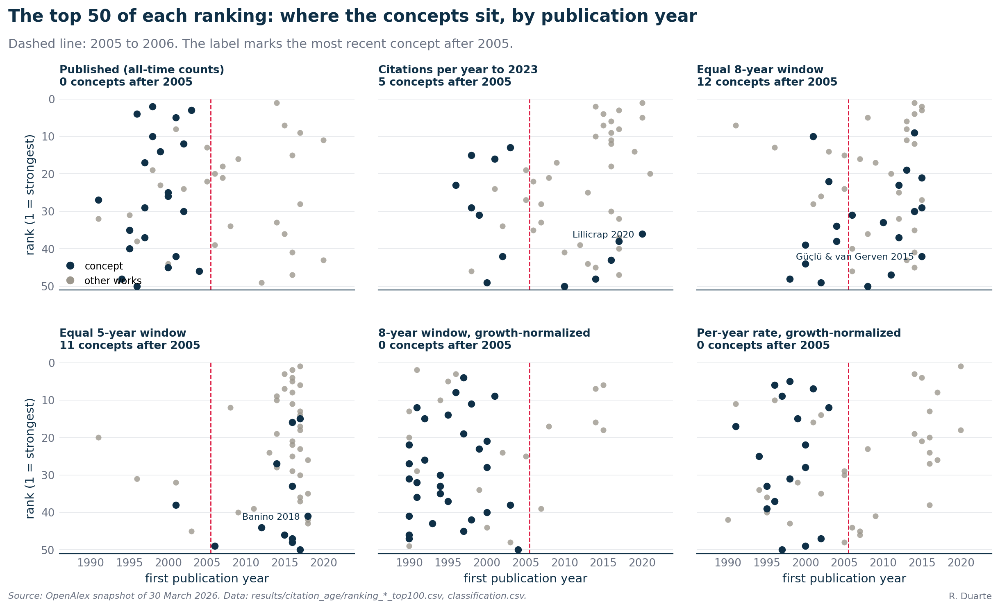
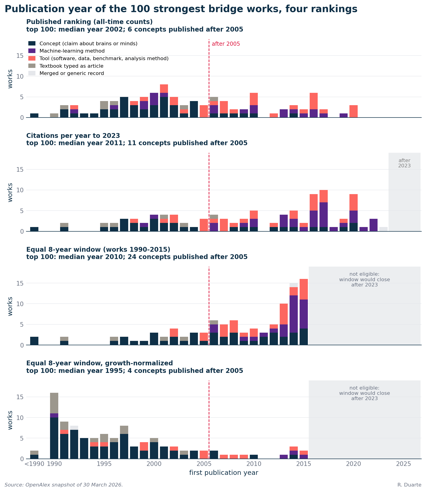

# S6. Does citation age explain the bridge canon?

In this supplement I ask how the bridge ranking of Article Figure 3 depends on the age of the papers, since newer papers cannot have collected as many citations as older ones. I re-ranked the same papers under the same eligibility rules, changing only the score, in several ways that control for age. In the all-time ranking of Figure 3 the most recent conceptual bridge work in the top 15 is Izhikevich 2003. At equal age, newer conceptual works such as Yamins et al. 2014 reach the top ranks; Yamins ranks 9th over its first eight years. When I scale each citation by the growth of the citing literature, no concept published after 2004 reaches the top 50 of either ranking so scaled (tools and methods do, and one variant that starts in 1996 is an exception, section 2.6).

**What this supplement covers**

- "The most recent of these bridgeworks is from 2003" (paragraph 12): exact for the ranking shown, section 2.1; the age controls are in sections 2.2 to 2.6.
- "The last two decades have not seen a new landmark paper that both fields treat as essential" (paragraph 12) and "these papers do not yet qualify as bridge works" (paragraph 16): what the data show, section 2.7.

"These bridge works" are the conceptual half of the top 15, the papers that make a claim about brains or minds, as opposed to the software and benchmarks of the other half ([S5](S5-bridge-builders.md#15-tools-and-concepts)).

## 1. Methods

I use the data of [S5](S5-bridge-builders.md): the OpenAlex snapshot of 30 March 2026, the extended classifier of [S1](S1-data-and-classification.md) and the 133,763 bridge papers with at least five classified citations from each field. The per-year counts of classified citations each paper receives from each field (1990 to 2026) are heavy and stay outside the repository; the committed files in [`results/citation_age/`](../../results/citation_age) are `ranking_<name>_top100.csv` for each of 11 rankings, `citing_volume.csv`, the hand coding `classification.csv` and `table_s1_reference.csv` (Table S5.1). Full definitions: [METHODS section 10](../METHODS.md#10-citation-age-controls) and [section 8](../METHODS.md#8-bridge-works). Controlled rankings stop at citing year 2023 (2024 and 2025 are provisional); the published ranking counts citations through 2026.

I changed the score and nothing else. The candidate pool, the field labels, the eligibility rules of [S5](S5-bridge-builders.md#12-which-papers-are-eligible) and the harmonic mean stay as published and apply identically in every ranking. For a paper p the score is still

```
score(p) = 2 * a(p) * b(p) / (a(p) + b(p))
```

where a and b are the citations from neuroscience papers and from AI papers; each control replaces them by an age-controlled count. The 11 rankings are the seven of section 2.3, the published ranking restricted to works of 1990 to 2015, and three guard variants: the per-year rate and the 8-year window without the 10,000 ceiling, and the per-year rate with works of unknown field admitted. The per-year counts re-sum to the published all-time counts (0 mismatches across 133,763 works), and I reproduce the top 15 of Table S5.1. For a work published in year y, every window starts at citing year y - 1, so that online-first versions are not penalized.

| Ranking | Counts used for each field | Works admitted |
|-|-|-|
| Published | all-time | all eligible |
| Citations per year | citing years y - 1 to 2023, divided by 2023 - y + 1 | up to 2023 |
| Equal 8-year window | citing years y - 1 to y + 8 | 1990 to 2015 |
| 7-year and 5-year windows | y - 1 to y + 7, and y - 1 to y + 5 | 1990 to 2015, and 1990 to 2018 |
| Growth-normalized | per-year rate or 8-year window, each citation divided by the references (in millions) made by the citing field that year | as the rate and the window |

An equal window equalizes exposure time but not the size of the audience, and both citing literatures grew a great deal (`citing_volume.csv`): in 2014 the AI literature made 7.28 times as many references as in 1998, and the neuroscience literature 3.25 times as many, so a raw equal window favors recent works. Dividing by the citing volume removes that advantage but over-corrects, because the early denominators are small partly for reasons unrelated to attention: early references point at works absent from the database, and the AI series has the 2002 step of [S1](S1-data-and-classification.md#25-two-anomalies-in-the-field-sizes), so a citation from an AI paper of 2001 weighs 2.31 times one of 2002. I read the two families as the two ends of a range: raw counts favor newer work, growth-normalized counts older work.

I coded by hand every work in the heads of the 11 rankings, 271 works in all, as concept (a claim about brains or minds), method (a machine-learning model or algorithm), tool (software, data or a benchmark), book, or artifact (a merged or generic record), in `classification.csv`. Applied to the top 15 of Table S5.1 it gives the same 8 concepts and 7 tools as the article. For 11 works the file records a borderline call; recoding all 11 as non-concepts leaves the most recent concept in the top 15 and the top 50 unchanged for the published, per-year and 8-year rankings. For recency I use the first publication year; "after 2005" means 2006 or later.

## 2. Results

### 2.1 The published ranking: exact, and not blind to recent work

In the published ranking the top 15 holds 8 concepts and 7 tools. Its concepts span Miller's 1956 paper (dated 1994 in Figure 3 and Table S5.1, a reprint) through Izhikevich's spiking-neuron model of 2003, which is the most recent concept at rank 3. It stays the most recent concept through the top 25, and in the top 50 the most recent is a second Izhikevich paper from 2004, at rank 46. No concept published after 2005 is in the top 50, and 6 are in the top 100. I therefore find "the most recent of these bridgeworks is from 2003" exact for the ranking shown.

I find that recent work is not shut out. Five of its top 15 are tools published between 2014 and 2020: the BRATS benchmark (2014), lme4 (2015), XGBoost (2016), the deep-learning survey of Litjens and colleagues (2017) and SciPy 1.0 (2020). A paper from 2020 reached the top 15 within about six years, so age is not an absolute barrier. The question here is about concepts.

### 2.2 Where the published top 15 land under each control

I give ranks within the eligible works of each ranking; papers after 2015 cannot enter the 8-year window ranking.

| Published # | Work | First year | Class | Per-year rate | 8-year window |
|-:|-|-:|-|-:|-:|
| 1 | Menze et al., BRATS benchmark | 2014 | tool | 2 | 1 |
| 2 | Bi & Poo, spike-timing plasticity | 1998 | concept | 15 | 48 |
| 3 | Izhikevich, simple model of spiking neurons | 2003 | concept | 13 | 22 |
| 4 | Olshausen & Field, sparse coding | 1996 | concept | 23 | 60 |
| 5 | Itti & Koch, visual attention | 2001 | concept | 16 | 10 |
| 6 | Miller, magical number seven | 1956 | concept | 26 | 18 |
| 7 | Bates et al., lme4 | 2015 | tool | 4 | 2 |
| 8 | Zhang, Brady & Smith, HMRF segmentation | 2001 | tool | 24 | 143 |
| 9 | Litjens et al., deep learning in medical imaging | 2017 | tool | 3 | not eligible |
| 10 | Itti, Koch & Niebur, saliency model | 1998 | concept | 29 | 138 |
| 11 | Virtanen et al., SciPy 1.0 | 2020 | tool | 1 | not eligible |
| 12 | Zucker & Regehr, short-term synaptic plasticity | 2002 | concept | 42 | 823 |
| 13 | Fawcett, ROC analysis | 2005 | tool | 19 | 24 |
| 14 | Riesenhuber & Poggio, object recognition | 1999 | concept | 31 | 69 |
| 15 | Chen & Guestrin, XGBoost | 2016 | tool | 11 | not eligible |

I find that the older canon survives the per-year control: all eight concepts remain in the top 50, though they fall to ranks 13 to 42, where they were 2 to 14. Several canon works are slow burners: in their first 8 years Bi and Poo rank 48th and Olshausen and Field 60th, against 2nd and 4th overall. What takes the places of the older concepts is machine-learning methods and software of 2013 to 2020. Under the per-year rate the top 15 holds 8 tools, 5 methods and 2 concepts, with a median first publication year of 2016; under the 8-year window it holds 5 tools, 5 methods, 3 books and 2 concepts, with a median of 2013.

### 2.3 The most recent concept under every ranking

| Ranking | Concepts in top 15 | Most recent concept, top 15 | Most recent concept, top 50 | Concepts after 2005, top 50 | Yamins 2014 rank |
|-|-:|-|-|-:|-:|
| Published (all-time counts) | 8 | Izhikevich 2003 (#3) | Izhikevich 2004 (#46) | 0 | 91 |
| Citations per year to 2023 | 2 | Izhikevich 2003 (#13) | Lillicrap 2020 (#36) | 5 | 48 |
| Equal 8-year window | 2 | Yamins 2014 (#9) | Kriegeskorte 2015 (#21) | 12 | 9 |
| 7-year window | 2 | Yamins 2014 (#9) | Kriegeskorte 2015 (#21) | 14 | 9 |
| 5-year window (works 1990-2018) | 1 | Hassabis 2017 (#15) | Banino 2018 (#41) | 11 | 27 |
| 8-year window, growth-normalized | 8 | Itti & Koch 2001 (#9) | Izhikevich 2004 (#50) | 0 | 87 |
| Per-year rate, growth-normalized | 7 | Izhikevich 2003 (#12) | Izhikevich 2003 (#12) | 0 | 69 |



*Figure S6.1 (`figure_s6_concepts_top50`). The top 50 of six rankings, each work placed by first publication year (horizontal) and rank (vertical, 1 at the top). Concepts are navy, all other works gray; the dashed line separates 2005 from 2006, and the label names the most recent concept after 2005. Data: `results/citation_age/ranking_*_top100.csv`, `classification.csv`.*

Figure S6.1 shows the same table as a picture, and I read it this way: in the published ranking every concept lies left of the dashed line; the controls that equalize exposure (per year, equal windows) move concepts of 2006 and later into the top 50; and the growth-normalized rankings move them out again. I take three points from it:

- Per-year rate: the most recent of the five concepts after 2005 in the top 50 is Lillicrap and colleagues' "backpropagation and the brain" (2020, rank 36).
- Equal windows: Yamins et al. 2014 is in the top 15 at rank 9 under both the 8-year and the 7-year window. With the 5-year window the only concept in the top 15 is Hassabis et al. 2017, "Neuroscience-inspired artificial intelligence", at rank 15, but that ranking sees only five years of each work.
- Without the 10,000-citation ceiling no concept stays in the top 15 of either ranking. What the ceiling hides is the machine-learning workhorses (ResNet, AlexNet, dropout), not recent concepts.

### 2.4 What Yamins et al. 2014 shows

Yamins and colleagues' paper is the clearest test case. All-time it has 1,432 citations from neuroscience papers and 376 from AI papers, and ranks 91st in the published ranking. In its first 8 years the counts are 958 and 259, about two thirds of what it has gathered, and its window score of 408 ranks 9th, just above Itti and Koch's attention model at rank 10. Per year to 2023 it is 48th. Its AI side is smaller than its neuroscience side by a factor of 3.7 in the window, and the harmonic mean punishes that imbalance: I read it as a neuroscience paper that AI reads, not a shared workhorse.

### 2.5 The publication years of the top 100



*Figure S6.2 (`figure_s6_top100_years`). Works in the top 100 of each ranking by first publication year (the leftmost bar collects works before 1990), stacked by class: concept (navy), machine-learning method (purple), tool (coral), textbook (gray), merged or generic record (light gray). Top to bottom: the published ranking, citations per year to 2023, the equal 8-year window, the growth-normalized 8-year window. The dashed red line separates 2005 from 2006; gray shading marks years a ranking cannot contain.*

| Ranking | Median (IQR) | After 2005 | Concepts | Concepts after 2005 |
|-|-|-:|-:|-:|
| Published (all-time counts) | 2002 (1998-2010) | 39 | 42 | 6 |
| Citations per year to 2023 | 2011 (2002-2017) | 67 | 30 | 11 |
| Equal 8-year window | 2010 (2005-2014) | 73 | 43 | 24 |
| 8-year window, growth-normalized | 1995 (1991-2000) | 12 | 66 | 4 |

Controlling for age moves the median year of the top 100 from 2002 to 2011 for the per-year rate and to 2010 for the 8-year window, and the number of concepts published after 2005 from 6 to 11 and 24. Because the 8-year windows cannot contain works after 2015, the works of 2011 to 2015 pile up against that wall. Growth normalization goes the other way, to a median of 1995, with 49 of the 100 works first published from 1990 to 1995 and 16 of them in 1990 alone; I read that spike as the early-denominator problem above, not as a canon that peaked in 1990.

### 2.6 What growth normalization does to the answer

In the growth-normalized 8-year window the top 15 holds 8 concepts, 4 tools and 3 books, and the most recent concept in it is Itti and Koch 2001, at rank 9; among the top 50 the most recent is Izhikevich's 2004 paper. In the growth-normalized per-year rate, 7 of the top 15 are concepts and no concept after 2004 is in its top 50. I find that concepts that appear after 2005 sit further down: Yamins et al. 2014 at rank 87 and 69, Hassabis et al. 2017 at rank 85 in the per-year version. I find that the statement holds for concepts only: 7 works published after 2004 are in the top 50 of the growth-normalized 8-year window (lme4 at rank 6 and the BRATS benchmark at rank 7 among them) and 21 in that of the growth-normalized per-year rate, all tools or methods.

Since the 1990 to 1995 works carry the artifact described above, I also re-ranked the growth-normalized 8-year window among the works first published in 1996 or later ([METHODS section 10](../METHODS.md#10-citation-age-controls)). Again Itti and Koch 2001 is the most recent concept in its top 15, now at rank 6. The committed top-100 file holds 49 such works, so only ranks 1 to 49 can be read, and 4 of them are concepts published after 2004: Torralba and colleagues' contextual guidance of eye movements (2006, rank 43), Yamins et al. 2014 (rank 44), Friston's free-energy principle (2010, rank 45) and the Blue Brain Project (2006, rank 46). This is the one place where "no concept after 2004 reaches the top 50" fails.

### 2.7 What the data show

1. In the published ranking, the most recent conceptual bridge work in the top 15 of Figure 3 is Izhikevich 2003 at rank 3, and the most recent in the top 50 is from 2004.
2. At equal age, newer conceptual work reaches the top. Yamins et al. 2014 ranks 9th in the first-8-years ranking and 9th in the 7-year one; Hassabis et al. 2017 ranks 15th in the 5-year one; per year, five concepts published after 2005 sit in the top 50.
3. Once citations are scaled by the growth of both literatures, no concept published after 2004 reaches the top 50 of either growth-normalized ranking (tools and methods do), so the older canon keeps its lead in share of attention. That control over-corrects, in my judgment, and the variant restricted to works from 1996 on puts four concepts published after 2004 at ranks 43 to 46.

On paragraph 16: [S4](S4-what-ai-cites.md#23-the-age-of-the-neuroscience-ai-cites) shows that AI keeps citing newer neuroscience across the whole distribution of its citations, in which many recent papers each receive a few. The bridge ranking looks at the top and needs both fields at once, since the harmonic mean cannot exceed twice the smaller count. In my reading both can be true: AI cites recent neuroscience more than before, while no recent paper has yet built up the counts from both sides that the top of the all-time ranking demands.

## 3. Caveats

Growth normalization decides the fixed-window result: raw counts in an equal window and growth-normalized counts give opposite answers, and I consider neither neutral. The per-year rate cannot judge works published after about 2018, because citations take years to build up, and the 8-year window sees nothing after 2015 (the 5-year window reaches 2018). For the last years my data cannot say whether a recent work has built up the counts of the older canon.

The coding is one judgment, mine: whether a machine-learning method counts as a bridge work changes the answer, and my rule "a claim about brains or minds" admits cognitive-science papers. The ceiling of 10,000 citations is a round number I did not vary ([S5](S5-bridge-builders.md#12-which-papers-are-eligible)). I inherit the scope: works published before 1990 are absent (Miller enters through its 1994 reprint), my controls ignore citations after 2023, and a citation records use, not intellectual debt. No interval accompanies my ranks, adjacent scores are close, and the top 15 as the line for "bridge work" is the article's choice; the equal-window ranking has one post-2005 concept in its top 15 and twelve in its top 50.

## 4. Reproduce

```bash
./reproduce.sh numbers                                        # recompute every headline and run the claims
.venv/bin/python -m neuroai_cn.figures.figure_s6              # Figures S6.1 and S6.2 from results/citation_age
```

The remaining steps (`analysis.citation_age.extract_counts`, `citing_volume`, `rankings`, `check_counts_by_year`, `tables_and_figure`) read the snapshot and the candidate pool of the published pipeline; `./reproduce.sh heavy` lists them ([METHODS section 11](../METHODS.md#11-statistical-conventions-and-reproducibility)). Outputs are in `results/citation_age/`; `tables_and_figure` stops if a ranked work is uncoded.
